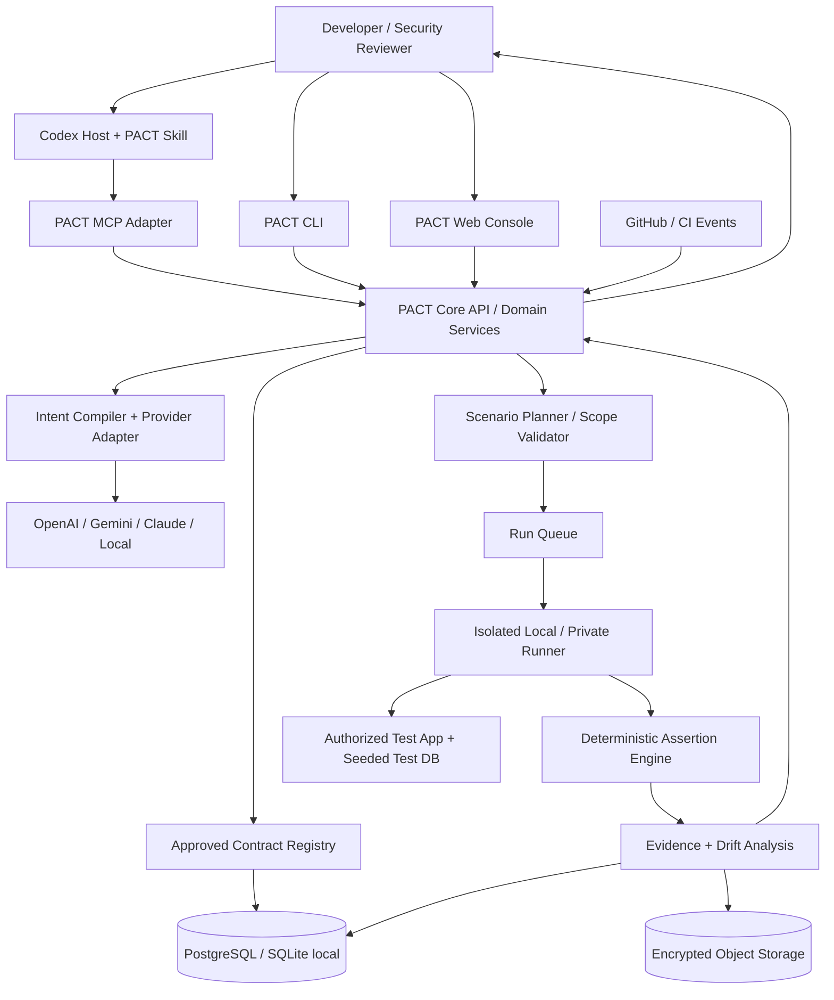

# PACT Security — Product Requirements Document (PRD)

> **Document status:** DRAFT — product source of truth for implementation planning  
> **Version:** 1.0.0  
> **Date:** 2026-10-10  
> **Product:** PACT Security (working name; brand/legal clearance pending)  
> **Positioning:** *The Security Intent Layer for AI-Built Software*  
> **Tagline:** *Define what your application must protect. Verify it continuously.*  
> **Audience:** Product, engineering, security, UX, DevOps, AI agents (including Codex), QA  
> **Companion documents planned:** `AGENTS.md`, `ARCHITECTURE.md`, `SECURITY.md`, `DATA_MODEL.md`, `API_SPEC.md`, `TEST_PLAN.md`, `ROADMAP.md`, `DECISIONS.md`  
> **Authority:** This document defines WHAT the product must achieve and how success is measured. Implementation guidance belongs in architecture/agent documents. Where details are explicitly marked **Proposed**, they require an architecture decision record (ADR) before being treated as binding.

---

## 0. Quick Start for Coding Agents

1. Read this entire PRD, focusing on Sections 1–7 and the acceptance criteria in Section 11.
2. Do **not** treat ideas, stretch goals, tentative metrics, or examples as features already implemented.
3. Build the **P0 vertical slice first**: user-defined authorization intent -> reviewed/approved versioned contract -> valid fixtures -> deterministic authorized test -> evidence -> repeatable regression check.
4. The **authorization contract approved by a human** is the normative source of expected access behavior. The AI output and current source code are *not* authoritative definitions of the policy.
5. An LLM may interpret, suggest, and explain. It must **never unilaterally approve its own contract, authorize a test target, label a finding as verified without test evidence, or modify production security settings**.
6. Ship complete, tested increments. Every PRD requirement marked P0 must have an automated acceptance test or documented manual verification.
7. If this PRD conflicts with system safety requirements, applicable law, or explicit owner decisions, escalate and record an ADR; do not silently resolve it by guessing.

### Normative wording

- **MUST / SHALL**: mandatory in the indicated release.
- **SHOULD**: recommended; exceptions require justification.
- **MAY**: optional enhancement.
- **P0**: foundation and end-to-end release-critical requirements.
- **P1**: full-product core capabilities following P0.
- **P2**: later expansion/research items, not automatically included in P0/P1.
- **Proposed**: design choice, target, or assumption awaiting validation.

---

## 1. Product Vision, Problem and Differentiation

### 1.1 The problem

Modern applications—especially those rapidly built or changed using AI coding assistants—often expose complicated authorization rules involving users, roles, organizations, tenants, object ownership, state changes, and permissions that expire or are revoked. The code may compile and functional tests may pass while a real business rule is violated.

Existing tools cover static analysis, dynamic scanning, authenticated pentesting, policy-as-code and automated remediation. The specific product hypothesis for PACT is that a developer still spends too much effort translating **human business permission requirements** into a **reviewed, reusable, executable acceptance-test suite** tied to actual application behavior and maintained through change.

**Examples of failure modes:**

- A seller can access an order belonging to another store (cross-tenant BOLA/IDOR).
- A manager can read data outside their assigned organization (role/tenant boundary).
- A user retains document access after an owner revokes sharing permission (temporal authorization).
- A new feature bypasses a previously verified authorization rule (authorization drift).
- A policy change is legitimate but is mistaken for a code regression because the expected behavior was never updated and approved.

### 1.2 Vision

PACT continuously links **intent -> implementation context -> executable verification -> evidence -> regression protection**. It integrates into coding workflows (initially Codex), but the core engine runs independently via a CLI/API and supports pluggable AI providers.

### 1.3 Primary value proposition

> PACT turns human-approved business authorization rules into reproducible tests that verify whether an application continues to respect those rules as its code and permissions evolve.

### 1.4 Competitive differentiation hypothesis (NOT an established claim)

PACT will attempt to outperform ordinary coding-agent prompts, general security scanners, and manually configured testing tools on the **time and effort to produce valid authorization acceptance tests from business intent**, without increasing false security findings.

PACT is **not** claiming novelty in LLMs, multi-model routing, offensive testing, evidence collection, RBAC, policy-as-code, or regression testing individually. Its hypothesized differentiation is the integrated developer workflow, correctness, human approval, stateful authorization modeling, and continuous verification.

**Competitors/baselines for empirical evaluation:** Codex alone; manually authored pytest authorization tests; StackHawk multi-profile business-logic testing; Cerbos policy tests plus application test harness; Codex Security, Strix and Shannon for broader overlap (not strict feature-for-feature baselines).

### 1.5 Product principles

1. **Evidence over assertion:** no unsupported “secure” verdicts.
2. **Business intent is reviewed:** models cannot independently establish normative policy.
3. **Deterministic verification:** observed vs expected behavior is evaluated by trusted code and declared assertions.
4. **Security by default:** least privilege, authorized environments, private runners, safe fixtures.
5. **Developer first:** clear errors, simple onboarding, CLI/CI ergonomics, exportable tests.
6. **Model agnostic:** model provider is replaceable; verification correctness cannot depend on which provider is used after contracts are approved.
7. **No vendor lock-in for tests:** contracts, scenario definitions, and evidence are exportable.
8. **Fail closed on uncertainty:** unresolved checks are INCONCLUSIVE/ERROR, never PASS.
9. **Measure against baselines:** validate value using repeatable evaluations, not AI-demo theatrics.
10. **Privacy-conscious:** local/private execution and redacted, minimal evidence retention.

---

## 2. Goals, Non-Goals and Success Measures

### 2.1 Product goals

| ID | Goal | Priority |
|---|---|---|
| G-01 | Produce an approved versioned authorization contract from human-written requirements and repository context. | P0 |
| G-02 | Execute valid, authorized tests against an application and compare behavior with the approved contract. | P0 |
| G-03 | Emit reproducible, redacted evidence and regression artifacts. | P0 |
| G-04 | Integrate with Codex through a skill + MCP tools, without coupling the test engine to Codex. | P0 |
| G-05 | Support standalone terminal use and at least one model provider; provide provider abstraction. | P0 |
| G-06 | Detect changes in test outcomes between commits under the same approved contract (drift). | P0 |
| G-07 | Support permission lifecycle and cross-tenant/role scenarios beyond one-request authorization checks. | P1 |
| G-08 | Support continuous verification via Git integration and CI workflows. | P1 |
| G-09 | Provide organization/project management through a web console and optional private runners. | P1 |
| G-10 | Validate superiority or useful niche against objective baselines. | P1 |

### 2.2 Explicit non-goals

- Replacing penetration testers or guaranteeing an application is free from vulnerabilities.
- Building an all-purpose pentesting/recon/exploitation framework.
- Scanning arbitrary third-party IPs, domains, or production systems without explicit authorization.
- Training a proprietary foundation model from scratch.
- Treating a security score as proof of safety.
- Automatically changing business permissions without approval.
- Executing arbitrary LLM-generated shell commands or unreviewed exploit payloads on privileged systems.
- Making cloud storage of source code, test credentials, or raw production payloads a requirement.
- Reimplementing authorization enforcement libraries such as Cerbos; PACT verifies expected application behavior rather than acting as the application's authorization decision point by default.

### 2.3 Primary success metrics (targets proposed; must be calibrated)

| Metric | Definition | Initial target / assessment |
|---|---|---|
| Time to first valid test (TTFVT) | Minutes from accepted requirement to a passing, runnable test specification on seeded app. | PACT should beat direct Codex and manual baseline on comparable tasks; quantify in study. |
| Contract correctness | Approved candidate rules matching independently authored ground truth before corrections / candidates reviewed. | Track uncorrected accuracy and edits; provisional goal >= 90% on curated benchmark. |
| Runnable scenario rate | Executable scenarios passing setup/schema validation / scenarios generated. | Provisional >= 95% in supported framework. |
| Violation precision | True verified violations / all reported verified violations. | Provisional >= 95% on curated benchmark. |
| Violation recall | Known violations found / all known detectable violations in benchmark scope. | Provisional >= 90%, with confidence interval. |
| False violation rate | Correctly behaving negative fixtures marked VIOLATION / negative fixtures. | Provisional <= 5%; prioritize explaining causes. |
| Regression detection | Known authorization regressions detected / known regressions in supported fixture set. | 100% of initial curated mutation tests; not general assurance. |
| Reproducibility | Reruns under pinned contract/fixture/environment yielding equivalent verdicts / stable reruns. | Provisional >= 99% on deterministic fixtures. |
| Unknown handling | Infrastructure/credential/fixture failures correctly labeled INCONCLUSIVE or ERROR. | 100% in deliberately injected failure set. |
| Operational burden | Additional time in CI, execution cost, and user configuration burden. | Published per-run measurements, budget controls. |

Metrics must be measured from recorded tests; none are observed PACT performance at document creation.

---

## 3. Users, Roles, Personas, Jobs to Be Done

### 3.1 Personas

| Persona | Job to be done | Pain point | Most important surface |
|---|---|---|---|
| Solo developer / AI-assisted builder | Verify a new feature obeys access rules before shipping. | Manually inventing scenarios, tokens and fixtures. | Codex + CLI |
| Backend developer / team lead | Prevent access-control regressions across PRs. | Ownership checks forgotten during refactors. | CLI + CI + PR |
| Application security engineer | Review security intent, evidence and coverage across services. | Vague policies and noisy scanner output. | Dashboard + evidence |
| Product owner | State who should access what, confirm intended exceptions. | Business expectations never become tests. | Contract review UI |
| Platform/DevOps engineer | Safely run tests in controlled environments. | Data leakage, untrusted scripts, secret handling, network scope. | Runner/CI admin |
| Organization security administrator | Audit activity and enforce execution limits and retention. | Unauthorized targets, weak approval controls. | Admin console |

### 3.2 Application access roles (product RBAC, not target-app roles)

- **Organization Owner:** manage organization settings, billing (later), membership and policy defaults.
- **Organization Admin:** manage projects, runners, policies, member access.
- **Security Reviewer:** approve contract changes, triage findings, inspect evidence.
- **Developer:** propose contracts, configure test fixtures, run tests in allowed scopes.
- **Viewer/Auditor:** read approved contracts and sanitized results; no execution/approval.
- **Runner Service Account:** constrained machine identity bound to one or more allowed projects and scopes.

Permission evaluation MUST check organization and project membership server-side, not rely on client-submitted organization IDs.

### 3.3 Core user stories

- US-01: As a developer, I can describe an authorization rule in natural language and receive structured, reviewable suggestions.
- US-02: As a reviewer, I can inspect source/assumptions, edit and approve a versioned contract without trusting a model's assertion.
- US-03: As a developer, I can map synthetic actors/resources/sessions to safe fixtures and test endpoint behavior.
- US-04: As a developer, I receive clear PASS, VIOLATION, INCONCLUSIVE or ERROR outcomes with sanitized evidence.
- US-05: As a developer, I can rerun the exact scenario after remediation without reinterpreting the contract.
- US-06: As a team lead, I can see whether a PR has introduced drift against approved contracts.
- US-07: As a security reviewer, I can approve an intentional policy change and maintain both contract versions.
- US-08: As an org admin, I can restrict where and how runners execute, what data is retained, and which AI providers can receive code/context.
- US-09: As a security engineer, I can test grant/revoke/role change/tenant transfer and stale session behavior over multiple steps.
- US-10: As an engineer, I can export contracts/tests/evidence and use PACT without a hosted account (local mode).

---

## 4. Scope, Releases and Dependency Strategy

**P0 — Vertical Slice / Core CLI:** local FastAPI demo target, contract schema, human approval, fixtures, deterministic authorization tests, evidence, baseline vs code revision, standalone CLI, Codex skill + MCP bridge, one AI provider; no cloud required.

**P1 — Full Product Core:** web dashboard; organization/project auth; PostgreSQL and storage; CI/PR integration; multi-provider support; isolated local/private runners; temporal/lifecycle state machine; authorization graph; targeted reruns; audit logging; RBAC; optional enforcement gates.

**P2 — Advanced Platform:** more language/framework adapters, scalable worker orchestration, enterprise SSO, policy bundles, drift impact prediction, advanced learning from approved feedback, additional authorization categories, advanced analytics, paid platform functionality, plugin distribution and ecosystem integrations.

P0 is a foundation, **not the final product vision**. No schedule is promised here; release promotion depends on the acceptance gates.

### 4.1 Prioritization rule

If a new feature does not measurably improve contract correctness, verification fidelity, developer effort, reproducibility, or safe operation, it must not displace a core capability.

---

## 5. End-to-End User Journeys

### J-01 — New project onboarding and initial baseline

**Preconditions:** authorized project, repository permission, supported test environment, seeded non-production test identities/data.

1. Developer opens a project in Codex or PACT CLI/web.
2. PACT registers a local project or creates an organization-scoped project.
3. Repository reader inventories routes, access middleware, resource ownership fields and authentication patterns, with confidence/provenance tags.
4. Developer supplies business permission requirements or imports a requirements document/OpenAPI summary.
5. AI proposes candidate normalized contracts; unresolved assumptions are surfaced explicitly.
6. A human reviewer edits or approves contract version 1.
7. Developer maps synthetic actors/resources and auth mechanisms to fixture adapters.
8. PACT validates environment scope, credentials availability and fixture setup.
9. Scenario planner creates positive, negative and optionally stateful tests.
10. Private/local runner executes tests and captures scrubbed evidence.
11. PACT reports verdicts, coverage limitations, missing fixtures and test outputs.
12. Baseline is saved against commit SHA, contract version and fixture/environment fingerprint.

**Outcomes:** versioned contract, runnable scenario suite, baseline test run, evidence bundle, audit entries.

### J-02 — AI-assisted code change

1. Codex modifies project feature code.
2. Developer or CI triggers PACT against the changed commit/branch.
3. PACT selects relevant approved contracts (all P0; targeted selection P1) and executes baseline-comparable tests.
4. Differential engine compares **same contract version and compatible fixture/environment** across commits.
5. PACT classifies newly failing contracts as potential authorization drift and surfaces evidence.
6. Developer/Codex proposes a patch; only authorized developer applies it.
7. Tests rerun, preserving the historical failing run.
8. CI status is informational by default and may become blocking only after admin configuration.

### J-03 — Intentional policy change

1. User requests a new access rule (e.g., manager may view store-level orders).
2. PACT proposes a new draft contract version and explicit policy diff.
3. Qualified human reviewer confirms changed permissions and approves version N+1.
4. PACT regenerates/updates affected scenarios, retaining historical versions.
5. Old and new results are labeled against their respective contract versions; a deliberate change is not labeled as implementation drift merely for changing intent.

### J-04 — Permission revocation lifecycle

1. Seed owner and recipient with independent sessions.
2. Verify recipient denied before share.
3. Grant access through authorized target-app endpoint/fixture.
4. Verify recipient allowed while grant active.
5. Revoke access.
6. Verify recipient denied afterwards, including a previously issued session, according to the approved contract and stated revocation semantics.
7. Reset state and verify test isolation.

### J-05 — Failure and ambiguity

1. If owner rules are unclear, candidate contract is `NEEDS_REVIEW` rather than quietly assuming access.
2. If fixture cannot log in, do **not** claim a permission violation; return `ERROR` or `INCONCLUSIVE` with reason.
3. If target app is unavailable, do **not** claim a passing test.
4. If response code is 200 but contains no protected data, use rule-specific assertions and mark unclear cases as `INCONCLUSIVE` pending review.
5. If a run is canceled or a target is outside allowlist, record it and stop safely.

---

## 6. Feature Requirements: Functional Specification

Each requirement ID is stable and should be referenced by code, issues and tests.

### 6.1 Workspace, project and source ingestion

| ID | Priority | Requirement | Acceptance criteria |
|---|---|---|---|
| FR-PRJ-001 | P0 | Register a local project with repository root and allowed run target. | Project resolves; missing path and path traversal fail with actionable errors. |
| FR-PRJ-002 | P0 | Inspect selected source files/endpoints read-only; exclude secrets and large irrelevant files by default. | Outputs endpoint inventory with file/line and confidence; does not read `.env` or private key files. |
| FR-PRJ-003 | P1 | Connect GitHub and track repository, branches, commits and PR metadata using least-privilege credentials. | Valid installation can list selected repositories; unauthorized repo is inaccessible. |
| FR-PRJ-004 | P1 | Model multi-project organizations with isolated permissions and storage. | Org A cannot read, run, or alter Org B projects through ID tampering. |
| FR-PRJ-005 | P1 | Parse OpenAPI and common auth/route conventions via adapters. | Supported OpenAPI sample maps routes, methods and schemas correctly. |
| FR-PRJ-006 | P2 | Add framework adapters beyond initial Python/FastAPI. | Adapter contract suite passes for each newly supported target. |

### 6.2 Security intent acquisition and compilation

| ID | Priority | Requirement | Acceptance criteria |
|---|---|---|---|
| FR-INT-001 | P0 | Accept natural-language authorization rules (English initially; Indonesian as P1) and optional relevant repo context. | Valid input yields parseable proposed contract or explicit unresolved questions. |
| FR-INT-002 | P0 | Normalize actor, tenant, resource, action, condition, expected decision, state preconditions and provenance. | Output validates against versioned Pydantic/JSON Schema. |
| FR-INT-003 | P0 | Surface conflicts, missing ownership meaning, implicit admins and ambiguous denial semantics. | Ambiguous fixtures produce `NEEDS_REVIEW`, not fabricated rules. |
| FR-INT-004 | P0 | Keep proposed intent separate from approved intent and observed implementation. | Data model and API expose distinct states and provenance. |
| FR-INT-005 | P1 | Derive impact candidates from route/authorization graph and source change set. | Traceability links contract to matching route(s) with confidence and rationale. |
| FR-INT-006 | P1 | Support policy templates (ownership, role, tenant, sharing, expiration/revocation). | Templates can be customized and explicitly approved. |
| FR-INT-007 | P2 | Learn preferences from approved corrections without silently changing existing contracts. | Model suggestions improve offline evaluation; prior approvals remain unchanged. |

### 6.3 Contract lifecycle and approvals

| ID | Priority | Requirement | Acceptance criteria |
|---|---|---|---|
| FR-CON-001 | P0 | Represent a policy as an immutable approved contract version. | Version, content hash, author/reviewer, timestamp, source references stored. |
| FR-CON-002 | P0 | Allow a human to review/edit/approve/reject proposed contracts. | Unapproved contract cannot be marked authoritative or used for verified compliance claims. |
| FR-CON-003 | P0 | Record clear policy-to-scenario links and rule-level expected results. | Every executed assertion maps to a contract rule version. |
| FR-CON-004 | P1 | Provide policy diff, deprecation and superseding workflow. | Old version remains audit-accessible; new version requires approval. |
| FR-CON-005 | P1 | Enforce reviewer permissions and separation of duties when configured. | AI/MCP account cannot impersonate reviewer or self-approve. |
| FR-CON-006 | P1 | Export/import versioned JSON/YAML with signature or content hash verification. | Export-import produces equivalent normalized contract semantics. |

### 6.4 Domain model and authorization graph

| ID | Priority | Requirement | Acceptance criteria |
|---|---|---|---|
| FR-AUT-001 | P0 | Support principals, roles, tenants, resources, actions and relation predicates (`owns`, `member_of`, `shared_with`). | Example seller/order and sharing rules compile and validate. |
| FR-AUT-002 | P0 | Support both ALLOW and DENY decisions including explicit conditions. | Ambiguous condition returns validation error; no implicit allow default. |
| FR-AUT-003 | P1 | Represent state/time-sensitive predicates including grant/revoke, expiration and role changes. | Lifecycle fixture can express before/after expectations without custom LLM text. |
| FR-AUT-004 | P1 | Maintain a traceable graph from requirements to contracts to routes/resources/tests. | Viewer can navigate source rule -> tests -> run evidence. |
| FR-AUT-005 | P2 | Support complex attribute-based/relation-based policies via modular evaluators. | Adapter contract tests ensure semantics preserved. |

### 6.5 Test planning, fixtures and execution

| ID | Priority | Requirement | Acceptance criteria |
|---|---|---|---|
| FR-TST-001 | P0 | Generate structured scenario specs from approved contract. | Positive and negative cases with stable IDs generated for seller/order fixture. |
| FR-TST-002 | P0 | Provide fixture adapter for seeded users, roles, tokens, resource setup and teardown. | Repeated run starts from consistent state; no production credentials. |
| FR-TST-003 | P0 | Run tests on a declared authorized local target using deterministic HTTP client/assertions. | Fixture vulnerable version -> VIOLATION; patched version -> PASS. |
| FR-TST-004 | P0 | Assert semantics, not only status code (e.g., `DENY` may be 403/404; body must not disclose protected data). | A 200 with protected data is a violation; a safe 404 may satisfy DENY. |
| FR-TST-005 | P0 | Use restricted declarative scenarios; no direct execution of arbitrary model-generated shell code. | Malicious plan cannot invoke arbitrary processes or out-of-scope hosts. |
| FR-TST-006 | P0 | Distinguish result states `PASS`, `VIOLATION`, `INCONCLUSIVE`, `ERROR`, `SKIPPED`, `CANCELED`. | Injected missing credential and timeout never produce PASS. |
| FR-TST-007 | P0 | Enforce target allowlist, execution timeout, rate limits, request budget, no harmful persistent side effects. | Out-of-scope target refused and audited; test cleans up fixtures. |
| FR-TST-008 | P1 | Support multi-step stateful scenario DSL: create, grant, read, revoke, read-with-old-session. | A staged revocation bug reliably produces evidence after step 4. |
| FR-TST-009 | P1 | Provide isolated/containerized private runners and disposable target test data. | Runner isolation, CPU/memory/time/network limits covered by tests. |
| FR-TST-010 | P1 | Support selected target frameworks and remote staging through authenticated private runners. | Runner only contacts allowed scopes, and outputs redacted results. |
| FR-TST-011 | P2 | Intelligent fixture generation/mutation with bounded and reviewable transformations. | Mutated fixtures remain within authorization and reproducible. |

### 6.6 Results, evidence and root-cause assistance

| ID | Priority | Requirement | Acceptance criteria |
|---|---|---|---|
| FR-EVD-001 | P0 | Record expected policy decision, actual response, assertion details and verdict. | Every test result has contract/fixture/run correlation. |
| FR-EVD-002 | P0 | Persist sanitized request/response metadata and reproducibility metadata. | Tokens, authorization headers, passwords, PII and secrets redacted. |
| FR-EVD-003 | P0 | Export machine-readable JSON and human-readable HTML summary. | Outputs generated from identical normalized result model. |
| FR-EVD-004 | P0 | Generate runnable regression suite or portable scenario definitions. | Rerunning produces equivalent checks without another LLM call. |
| FR-EVD-005 | P0 | Differentiate verified behavior violations from AI hypotheses. | AI explanation cannot change executor verdict. |
| FR-EVD-006 | P1 | Attach code locations with confidence and root-cause suggestions. | Unsure mapping explicitly says candidate/unknown, not confirmed. |
| FR-EVD-007 | P1 | Output CI-friendly JUnit and SARIF when schema mapping is appropriate. | CI importer validates generated files, no fabricated standardized fields. |
| FR-EVD-008 | P1 | Retention settings, evidence redaction preview and secure export. | Retention rules honored; deleting report removes raw artifacts per policy. |

### 6.7 Drift, change impact and continuous verification

| ID | Priority | Requirement | Acceptance criteria |
|---|---|---|---|
| FR-DRF-001 | P0 | Bind runs to commit SHA, contract version and fixture/environment fingerprint. | Compare rejects incompatible baselines or flags them explicitly. |
| FR-DRF-002 | P0 | Compare runs under identical approved policy and compatible conditions. | PASS -> VIOLATION is classified as possible implementation drift with evidence. |
| FR-DRF-003 | P1 | Map changed files/endpoints to possibly impacted contracts and rerun relevant subset. | Missed-impact risk disclosed; full-suite override available. |
| FR-DRF-004 | P1 | Integrate PR checks and configurable informational/blocking gates. | Admin controls enforcement; missing test/ERROR cannot be silently GREEN. |
| FR-DRF-005 | P1 | Distinguish intentional policy revisions from regressions, with approval and diff history. | Contract v1 vs v2 results never called same-policy drift. |
| FR-DRF-006 | P1 | Provide temporal access lifecycle regression sets. | Permission revocation and tenant transfer runs are repeatable. |
| FR-DRF-007 | P2 | Prioritize tests using learned risk with complete audit and override. | Full-suite baseline remains reference and available on demand. |

### 6.8 Model providers and AI orchestration

| ID | Priority | Requirement | Acceptance criteria |
|---|---|---|---|
| FR-AI-001 | P0 | Define a provider-independent `generate_structured_contract` interface. | OpenAI implementation passes contract conformance tests. |
| FR-AI-002 | P0 | Validate LLM output structurally and semantically before use. | Malformed or unsupported output rejected and surfaced. |
| FR-AI-003 | P0 | Support no-second-provider mode when using Codex host reasoning. | Codex can submit candidate spec via MCP without PACT making external LLM call. |
| FR-AI-004 | P1 | Add Gemini, Claude and optional local/Ollama adapters. | Each provider passes shared conformance cases; capability differences documented. |
| FR-AI-005 | P1 | Allow per-project/provider data egress consent and model allowlist. | Provider cannot change or receive code without configured permission. |
| FR-AI-006 | P1 | Support retries, request timeouts, budget/cost caps and token usage visibility. | Failures degrade to explicit actionable errors; no unbounded billing loop. |
| FR-AI-007 | P1 | Provide prompt/model version logging without storing secrets or excessive sensitive context. | Runs reproducible at spec level; privacy settings respected. |
| FR-AI-008 | P2 | Add optional offline/private-model workflows and provider comparison evaluation. | On-prem mode respects egress-disabled policy. |

### 6.9 Interfaces: CLI, Codex Skill, MCP, web, integrations

| ID | Priority | Requirement | Acceptance criteria |
|---|---|---|---|
| FR-IFC-001 | P0 | Implement CLI: `init`, `inspect`, `propose`, `review`, `plan`, `verify`, `compare`, `export`. | `--help`, safe defaults and exit codes documented and tested. |
| FR-IFC-002 | P0 | Implement MCP bridge to PACT core for Codex and other compatible hosts. | Standard MCP tool discovery and calls validated with supported SDK. |
| FR-IFC-003 | P0 | Provide Codex workflow skill documenting when to request human review and how to interpret results. | Skill yields working flow without bypassing approvals. |
| FR-IFC-004 | P0 | MCP does not expose an AI-callable privileged “self-approve” or out-of-scope execution operation. | Attempts without human authorization are rejected by server. |
| FR-IFC-005 | P1 | Web console with project list, contract editor, verification runs, evidence and approvals. | Primary personas can complete J-01 through web on supported project. |
| FR-IFC-006 | P1 | Provide versioned REST API and service-to-service auth. | API integration suite verifies RBAC and tenant isolation. |
| FR-IFC-007 | P1 | GitHub App/Git integration for PR annotations and status checks. | Scoped installation receives PR event and publishes verified run status. |
| FR-IFC-008 | P1 | Document MCP transport and auth compatibility. | Local stdio workflow functions; remote mode uses supported auth controls. |
| FR-IFC-009 | P2 | Support additional IDE/coding-agent skills and self-hosted enterprise integration. | New host adapter passes interface compatibility tests. |

### 6.10 Platform and governance

| ID | Priority | Requirement | Acceptance criteria |
|---|---|---|---|
| FR-PLT-001 | P0 | Provide reproducible local developer setup and sample vulnerable/patched demo app. | Fresh clone can run vertical slice using documented setup. |
| FR-PLT-002 | P1 | Organization/project RBAC, audit logs and scoped API credentials. | Cross-tenant authorization tests are negative by default. |
| FR-PLT-003 | P1 | Async run orchestration, cancellation, retries for recoverable failures. | Job states are explicit, retries idempotent where applicable. |
| FR-PLT-004 | P1 | Per-organization budgets, rate limits and resource quotas. | Quota overrun stops or queues work and notifies user. |
| FR-PLT-005 | P1 | Private runner registration, credential rotation, capability negotiation. | Revoked runner cannot fetch jobs. |
| FR-PLT-006 | P1 | Data residency/retention controls where supported and disclosed. | Export/delete operations honor configured policy. |
| FR-PLT-007 | P2 | SSO/SAML, SCIM, enterprise governance and delegated review workflows. | Formal admin acceptance suite passes before release. |

---

## 7. Canonical Domain Model and Behavioral Semantics

### 7.1 Key entities

The implementation MUST distinguish the following concepts:

| Entity | Meaning | Typical fields |
|---|---|---|
| Organization | Customer security boundary in hosted mode | `id`, `name`, `settings`, `retention_policy` |
| Project | Application under authorized testing | `id`, `organization_id`, `repository_ref`, `framework`, `scope_policy` |
| Principal / Actor | Target application's synthetic user or service identity | `actor_ref`, `roles`, `tenant_ref`, `fixture_ref` |
| Tenant | Isolation boundary inside target application | `tenant_ref`, `attributes` |
| Resource | Object to authorize (order, document, invoice, etc.) | `resource_type`, `fixture_ref`, `owner_ref`, `tenant_ref` |
| Action | Requested operation | `read`, `create`, `update`, `delete`, `share`, `revoke`, etc. |
| Relationship | Ownership, membership, sharing or delegation edge | `subject`, `relation`, `object`, `valid_from/until` |
| SecurityIntent | Raw human/business requirement | `text`, `source`, `author`, `timestamp` |
| ContractDraft | AI-assisted candidate rules, not normative | `rules`, `assumptions`, `questions`, `provenance`, `status` |
| ContractVersion | Immutable human-approved expected behavior | `contract_id`, `version`, `rules`, `reviewer`, `hash`, `status` |
| TestScenario | Structured runnable verification case | `scenario_id`, `contract_version`, `steps`, `assertions` |
| FixtureAdapter | Safe binding from logical actors/resources to test identities/data | `adapter_id`, `supported_actions`, `setup/teardown` |
| VerificationRun | One execution on one target revision | `run_id`, `contract_hash`, `commit_sha`, `env_fingerprint`, `status` |
| StepEvidence | Sanitized observation about one step | `request_summary`, `response_summary`, `assertions`, `timestamps` |
| Finding | Verified rule violation or informational inconsistency | `finding_id`, `rule_id`, `evidence_ids`, `severity`, `status` |
| PolicyChange | Approved intentional expected-behavior change | `old_version`, `new_version`, `rationale`, `reviewer` |
| DriftEvent | Regression under same approved policy | `baseline_run`, `current_run`, `contract_id`, `changed_rules` |
| AuditEvent | Who did what, when, and under which authorization | `actor_id`, `operation`, `entity`, `result`, `time` |

### 7.2 Contract DSL — canonical semantics

- Rules SHALL be **declarative** and schema-versioned.
- Conditions SHALL use a restricted typed expression vocabulary, not free-form Python/shell/eval.
- Rule semantics SHALL specify actor/resource binding, action, preconditions and expected outcome.
- `DENY` SHALL mean the operation does not expose or modify protected resources, regardless of whether the target chooses 401/403/404 according to contract semantics.
- `ALLOW` SHALL require expected authorized functionality; a test that fails due to unrelated 500 errors is ERROR/INCONCLUSIVE, not PASS.
- Scope and identity metadata SHALL be carried into every run.
- Any unsupported semantics SHALL produce an explicit compiler error or `NEEDS_REVIEW`, rather than degrading to a weaker test silently.

### 7.3 Example contract (illustrative proposed schema)

This JSON is a **schema-design example** and must not be treated as a finalized production API until documented in `docs/contracts/schema-v1.json`.

```json
{
  "schema_version": "1.0",
  "contract_id": "auth.orders.read",
  "version": 1,
  "title": "Sellers may read orders in their own store only",
  "source": {
    "kind": "human_requirement",
    "reference": "REQ-ORDER-007"
  },
  "status": "APPROVED",
  "review": {
    "reviewer_ref": "human:reviewer-01",
    "approved_at": "2026-10-10T10:00:00Z"
  },
  "resource_type": "order",
  "action": "read",
  "rules": [
    {
      "rule_id": "same-store-allow",
      "when": {
        "relation": "same_tenant",
        "actor_tenant": "actor.store_id",
        "resource_tenant": "resource.store_id"
      },
      "expect": "ALLOW"
    },
    {
      "rule_id": "cross-store-deny",
      "when": {
        "relation": "different_tenant",
        "actor_tenant": "actor.store_id",
        "resource_tenant": "resource.store_id"
      },
      "expect": "DENY"
    }
  ],
  "assertion_profile": "http-api-object-read-v1",
  "target_binding": {
    "route_template": "GET /orders/{order_id}",
    "fixture_adapter": "demo-marketplace-v1"
  }
}
```

**Approval invariant:** importing a JSON object that claims `APPROVED` is **not sufficient** to authorize execution or establish approval. Server/local approval log must validate reviewer identity, signature/integrity binding and scope. The example is descriptive, not a bypass path.

### 7.4 Test Scenario DSL example

```yaml
schema_version: "1.0"
scenario_id: auth.orders.cross-store-read
contract_ref: auth.orders.read@1
fixture_adapter: demo-marketplace-v1
steps:
  - id: setup
    operation: fixture.setup
    arguments:
      actors: [seller_a, seller_b]
      resources: [order_a, order_b]
  - id: read_cross_tenant
    operation: http.request
    as_actor: seller_a
    method: GET
    route: /orders/${fixtures.order_b.id}
    expected_rule: cross-store-deny
    assertions:
      - kind: decision
        expected: DENY
      - kind: no_protected_resource_disclosure
        resource_ref: order_b
  - id: teardown
    operation: fixture.teardown
```

Interpolation MUST be limited to typed, preapproved fixture references. The engine MUST NOT evaluate arbitrary input as shell, Python, or unrestricted template code.

### 7.5 Finite-state machines

**Contract draft lifecycle:** `DRAFT -> NEEDS_REVIEW -> APPROVED` or `REJECTED`; approved versions become immutable; a modification creates a new `DRAFT` version. `SUPERSEDED` and `DEPRECATED` apply to historical approved versions without deleting them.

**Verification job lifecycle:** `QUEUED -> VALIDATING -> READY -> RUNNING -> COMPLETED`; alternative terminal outcomes `CANCELED`, `FAILED_INFRA`, `BLOCKED_SCOPE`, `EXPIRED`. A completed run contains per-test verdicts rather than a single indiscriminate “safe/unsafe” label.

**Scenario verdict vocabulary:**

- `PASS`: assertions demonstrate expected behavior for the tested state and scope.
- `VIOLATION`: a reproducible observation contradicts an approved rule.
- `INCONCLUSIVE`: observations insufficient; no positive proof either way.
- `ERROR`: tooling, fixture, authentication, scope or environment prevented a valid test.
- `SKIPPED`: configured omission recorded with reason.
- `CANCELED`: user/system stopped test before outcome.

A job `COMPLETED` with one or more `ERROR` or `INCONCLUSIVE` tests MUST NOT be marketed as “fully verified”.

### 7.6 Drift classification

Same approved contract, compatible environment, `PASS -> VIOLATION` = **possible implementation drift**, with reproduction evidence. Changes in the fixture, environment, contract or test schema require explicit compatibility evaluation. Other transitions are reported as changes in verification status, not automatically security regressions.

---

## 8. Logical and Deployment Architecture

### 8.1 Architecture overview



### 8.2 Bounded components and responsibilities

1. **Adapters:** CLI, MCP/Skill, REST/Web, CI plugins; no business logic duplicated in adapters.
2. **Project Registry:** repositories, allowed targets, framework adapters, project secrets references and owners.
3. **Context Service:** safe source extraction, API inventory, authorization-relevant AST/routes, content provenance.
4. **Intent Compiler:** calls pluggable LLM through typed adapter, generates candidates with uncertainty and source references.
5. **Approval/Contract Service:** draft/review, immutable versioning, approval attestations, integrity hashes.
6. **Authorization Domain:** typed actor/resource/action/relation/time model, policy semantics and rule mapping.
7. **Scenario Planner:** coverage matrix and bounded scenario DSL; fixture capability check.
8. **Runner Scheduler:** authorization/scope checks, queued jobs, cancellation, budgets and isolation policy.
9. **Fixture Manager:** synthetic entities and safe setup/teardown; independent authentication sessions.
10. **Deterministic Executor/Assertions:** typed operations, status/body authorization semantics, evidence capture.
11. **Evidence Service:** sanitization, normalization, integrity references, export, retention.
12. **Drift Service:** baselines, comparable runs, changes, policy-change vs implementation-change classification.
13. **Identity/Governance:** RBAC, org isolation, runner auth, audit, provider egress consent.
14. **Observability:** sanitized structured logs, metrics, tracing, alerts and cost measurements.

### 8.3 Architecture decision proposals

| Concern | Proposed default | Why | Decision status |
|---|---|---|---|
| Core engine | Python 3.12+ modular monolith | Testing ecosystem, Pydantic, HTTPX, adapters | Proposed |
| Public/backend API | FastAPI + Pydantic | Typed contracts, OpenAPI and async interfaces | Proposed |
| CLI | Typer | Shared Python domain package | Proposed |
| MCP | Python MCP SDK with local stdio; remote transport later | Codex interoperability; minimize custom protocol code | Proposed |
| Frontend | Next.js + React + TypeScript | Organization dashboard, contract review and results | Proposed |
| Local persistence | SQLite + local artifact directory | Zero-service setup | Proposed |
| Hosted persistence | PostgreSQL, SQLAlchemy, Alembic | Contracts/versioning/relational traceability | Proposed |
| Object storage | S3-compatible encrypted private bucket | Large reports/artifacts with retention | Proposed |
| Async jobs | Durable queue and Python worker (choose library via ADR) | Long-running checks/retries/cancel | Proposed |
| Sandbox | Disposable containers/private runner process | Protect platform and target data | Proposed |
| Test engine | pytest + HTTPX + restricted scenario executor | Reproducible verified assertions | Proposed |
| AI adapter | Typed interface; official SDKs or gateway such as LiteLLM | Avoid model lock-in and capture provider metadata | Proposed |
| Auth | Standards-based OIDC for hosted, OS-local identity for CLI | User/team isolation | Proposed |
| Tracing | OpenTelemetry with sanitized attributes | Incident and latency analysis | Proposed |
| Initial scope | REST API authorization in FastAPI | Narrow, verifiable and integrable | Decision proposed as P0 baseline |

**Design caveat:** Do not create microservices, message brokers, graph databases or Kubernetes dependencies until deployment scale or separation of trust requires them. The logical components above may initially run in one process.

### 8.4 Trust boundaries and data paths

- **TB-01 Repository -> Context Reader:** source files are untrusted inputs. Repository text may contain prompt-injection instructions. Treat as quoted data; never elevate to agent policy.
- **TB-02 Context -> External Model API:** sending code or requirements requires configured egress consent, allowlisted provider and data minimization.
- **TB-03 Codex/MCP -> PACT:** tool calls are untrusted requests authenticated/authorized by core API; model instruction cannot substitute for human execution approval.
- **TB-04 Control Plane -> Runner:** authenticated short-lived job token binds runner, target, allowed scope, contract and time/budget.
- **TB-05 Runner -> Target:** only local/private, explicitly authorized scopes; verify host/IP/protocol restrictions and redirects; never default-scan arbitrary internet targets.
- **TB-06 Evidence -> Cloud Store:** scrub and minimize payload, enforce tenant authorization, encryption and retention.
- **TB-07 CI -> PACT:** verify event signatures, installation/repository scoping, replay protection and branch restrictions.

### 8.5 Local, hosted and enterprise deployment profiles

| Mode | Control plane | Runner | Source/code handling | Priority |
|---|---|---|---|---|
| Local development | Single local process/SQLite | Local isolated process/container | Stays local unless user opts into cloud model | P0 |
| Managed SaaS | Hosted web/API/PostgreSQL/storage | Hosted safe runner for approved demo environments OR customer private runner | Minimize storage; do not require full source upload | P1 |
| Private/enterprise | Hosted control plane or self-hosted variant | Customer-managed isolated runner | User-configurable local-only paths and egress policy | P1/P2 |

### 8.6 Runner isolation policy

- Use synthetic or authorized test data, never implicitly copy production data.
- Configure process/network isolation, no host filesystem mounts by default, restricted syscalls and short-lived credentials.
- Enforce explicit network allowlist and maximum requests/concurrency/duration.
- Block redirects and DNS rebinding from escaping allowed scope; validate resolved IPs and final connection destination according to run policy.
- Scrub credentials before emitting artifacts; keep secrets in runner secret store; short expiration and rotation.
- Record who authorized target execution and applicable scope.
- Provide emergency cancellation and admin revocation; auto-expire stale jobs.
- No destructive state-changing actions outside disposable seeded fixtures; scenarios with writes require test environment plus teardown/rollback.

---

## 9. Public Interfaces and Integration Contracts

### 9.1 CLI (proposed)

```bash
pact init --project ./merchant-api
pact inspect --project ./merchant-api
pact propose --requirement-file docs/authorization.md --provider openai
pact review --contract-id auth.orders.read --version draft
pact plan --contract-id auth.orders.read --version 1
pact verify --contract-id auth.orders.read --target local-demo --approved-scope local-demo
pact compare --baseline-run run_001 --current-run run_002
pact export --run run_002 --format html,json,pytest
```

All command names above are **planned**, not existing commands.

**CLI behavior:** machine-readable `--json`, helpful exit statuses, no silent interactive side effects in CI; confirmation prompts for human approvals in interactive mode. CI requires prior approved artifacts and runner policy, not bypass flags.

### 9.2 MCP tools (proposed typed inputs/outputs)

| Tool | Input | Output | Safety rule |
|---|---|---|---|
| `pact.inspect_project` | `project_ref`, selected paths | endpoint/resource inventory, provenance | Read-only scoped files |
| `pact.propose_contract` | `project_ref`, `requirement`, `provider_config_ref` | pending draft ID, proposed rules, questions | Not approved |
| `pact.get_contract` | `contract_ref`, version | contract and review state | Project RBAC |
| `pact.plan_scenarios` | `approved_contract_ref`, fixture adapter | candidate scenarios, coverage, missing fixtures | No execution |
| `pact.run_verification` | `approved_contract_ref`, `target_scope_id`, `fixture_ref` | run/job handle | Separate human execution authorization policy; limited target |
| `pact.get_run` | run/job handle | progress and sanitized verdicts | Authenticated scoped access |
| `pact.compare_runs` | two run handles | compatibility assessment and drift evidence | Reject incompatible claims |
| `pact.export_results` | run handle, format | artifact handle/path | Redacted/safe export |

**Critical:** `approve_contract` is **NOT** an AI-callable MCP shortcut. Approval SHALL occur via authenticated human review UI, privileged local confirmation flow, or external signed review workflow. MCP may expose `request_review` to create a pending task, not impersonate a reviewer.

### 9.3 REST API (proposed versioned surface)

```
POST   /api/v1/projects
GET    /api/v1/projects/{project_id}
POST   /api/v1/projects/{project_id}/inspect
POST   /api/v1/projects/{project_id}/contract-drafts
GET    /api/v1/contracts/{contract_id}/versions
POST   /api/v1/contracts/{contract_id}/reviews
POST   /api/v1/contracts/{contract_id}/scenarios:plan
POST   /api/v1/verification-runs
GET    /api/v1/verification-runs/{run_id}
POST   /api/v1/verification-runs:compare
GET    /api/v1/verification-runs/{run_id}/artifacts
GET    /api/v1/projects/{project_id}/drift-events
POST   /api/v1/runners/register
```

- Typed validation for all payloads; contract version and optimistic locking on review.
- Pagination and filtering for collections; organization access enforced from authenticated principal.
- Use idempotency keys for create/run endpoints when applicable.
- Long-running actions return job handles, not blocking HTTP requests.
- Public API spec, OAuth/credentials, pagination and error schemas to be frozen in `API_SPEC.md` before GA.

### 9.4 Event contracts (proposed)

`project.created`, `contract.proposed`, `contract.approved`, `contract.rejected`, `run.queued`, `run.started`, `run.completed`, `run.failed`, `finding.verified`, `drift.detected`, `policy.change.approved`, `runner.revoked`.

All events require `event_id`, `timestamp`, `organization_id`, `project_id`, `actor`, `schema_version` and correlation ID. Event payloads should carry identifiers rather than raw sensitive requests.

### 9.5 CI integration

- On PR or commit, verify installation/repository mapping and job permissions.
- Run PACT using the relevant approved contract version; show contract counts, PASS/VIOLATION/INCONCLUSIVE/ERROR, and evidence links.
- **Default:** report status without blocking development. Admin may enable branch protection when reliability criteria are met.
- Never mark a status green solely because an AI model predicted no vulnerability.
- Stable test outputs can run without contacting any AI provider.

---

## 10. UX/Product Experience Requirements

### 10.1 Primary navigation (web P1)

1. **Overview:** organization posture of tested policies, recent runs, drift and errors.
2. **Projects:** repositories, targets, framework adapters, active policy versions.
3. **Security Intent:** source requirements, proposed rules, uncertainty and review queue.
4. **Contracts:** versioned permission matrix, actor/resource graphs, approval history and diffs.
5. **Test Scenarios:** coverage, fixtures, lifecycle steps and expected results.
6. **Verification Runs:** live progress, evidence, reproduction conditions, outcomes and comparisons.
7. **Drift & Findings:** newly broken contracts, policy changes and remediation status.
8. **Integrations:** Codex/MCP, CLI, GitHub/CI, AI providers, runners and webhooks.
9. **Settings:** roles, security policies, budgets, model egress consent, retention and audit.

### 10.2 Must-have UX behaviors

- Display **approved** vs **AI suggested** vs **observed** with unmistakably different labels.
- At every important finding show: rule, actor, resource, expected, actual, environment, timestamp, code commit and evidence availability.
- Explain missing certainty: fixture failure, unsupported relation, redacted sensitive field, target unavailable, or inconsistent baseline.
- Do not use blanket “Your application is secure” banners. Prefer “12 of 14 configured authorization scenarios passed on this commit; 1 violation; 1 inconclusive.”
- Approval screen must show who approves, scope, effects, and change diff before confirmation.
- Display stateful timelines in temporal scenarios.
- Keep CLI and web verdict semantics identical.
- Support light/dark theme and keyboard-accessible, WCAG 2.2 AA-oriented UI (target for web P1).

### 10.3 Example dashboard copy

**Project:** Merchant API — Commit `abc123` — Contract set v4  
**Scenarios:** 42 executed / 40 pass / 1 violation / 1 inconclusive  
**Drift:** Rule `AUTH-012` changed from PASS on previous comparable commit to VIOLATION now  
**Finding:** Manager from Store A retrieved Store B order details after role-change fixture  
**Action:** Review evidence, fix implementation or propose a reviewed policy change, then rerun tests.

---

## 11. Acceptance Criteria and Test Plan

### 11.1 Vertical slice acceptance: mandatory before P0 release

| Acceptance ID | Given | When | Then |
|---|---|---|---|
| AC-001 | A seeded FastAPI merchant app and business rule | Developer proposes contract | PACT returns schema-valid draft with same-tenant ALLOW and cross-tenant DENY. |
| AC-002 | A candidate contract | A model/tool attempts to run it unreviewed | Execution requiring approved contract is rejected; audit entry written. |
| AC-003 | Human reviewer with valid permission | Reviewer approves draft | Immutable, hash-bound contract version is created. |
| AC-004 | Approved contract and valid fixtures | PACT runs tests against intentionally vulnerable app | Cross-tenant protected data disclosure is marked VIOLATION with concrete redacted evidence. |
| AC-005 | Same contract and patched app | PACT reruns tests | Cross-tenant case becomes PASS; same-tenant functionality remains PASS. |
| AC-006 | Missing auth fixture/token | PACT attempts verification | Outcome is ERROR/INCONCLUSIVE; never PASS or verified violation. |
| AC-007 | User requests external domain not on allowed scope | PACT attempts run | Blocked before requests; reason logged. |
| AC-008 | Two comparable runs with same contract + fixtures | Implementation changes PASS -> VIOLATION | PACT raises drift with rule and test-step links. |
| AC-009 | Reviewer legitimately changes contract expectation | New version approved and tested | Difference is documented policy change, not same-policy drift. |
| AC-010 | Model returns malformed JSON or conflicting rules | Compiler validates proposal | Request fails safely or goes to NEEDS_REVIEW; no unauthorized test. |
| AC-011 | Test request contains tokens and private values | Evidence generated | Sensitive values are redacted; reference metadata remains useful. |
| AC-012 | Codex host invokes PACT MCP tools | Workflow executes | Same core engine verdict and artifacts as equivalent CLI command. |
| AC-013 | No AI provider configured after approved test is saved | Test is rerun | Deterministic verification still executes without LLM inference. |
| AC-014 | Project A member submits Project B ID | Any read/write/run endpoint called | Request is denied and access attempt audited. *(P1 hosted)* |
| AC-015 | Runner receives out-of-scope redirect | HTTP test attempts request | Runner refuses to follow outside permitted destination. |
| AC-016 | A scenario expects DENY | API responds 404 without protected data | Result can PASS under accepted denial assertion profile. |
| AC-017 | A scenario expects ALLOW | API responds 500 | Result is not misclassified as authorization PASS. |

### 11.2 Required automated test layers

- **Schema and unit tests:** all domain validators, state machines, permission predicates, redactors, output serializers.
- **Provider contract tests:** LLM adapters return normalized draft or explicit structured error.
- **Fixture integration tests:** seeded FastAPI target, independent users, rollback/reset.
- **Property tests:** tenant boundaries, monotonic approval immutability, no false PASS on test setup failure.
- **Golden scenario tests:** vulnerable/patched versions, intentionally ambiguous cases, lifecycle transitions.
- **Security tests of PACT itself:** SSRF/target scope bypass, prompt injection in repo, secret exfiltration attempts, RBAC/IDOR, forged approval, malicious scenario DSL, webhook forgery, cancellation, race conditions, storage tenant isolation.
- **CLI/MCP/API contract tests:** same verdicts across interfaces and schema versions.
- **Integration/e2e:** J-01 through J-05 at supported profile.
- **Performance:** bounded concurrency, fixture setup overhead, representative scan costs, memory and request limits.

### 11.3 Benchmark evaluation methodology (P1)

1. Curate at least several independent synthetic applications/use cases, not one memorized demo.
2. Construct ground-truth safe and intentionally vulnerable revisions. Separate creation of ground truth from PACT inference.
3. Include allowed access, forbidden access, ambiguity, revoked permission, tenant transfer and role changes.
4. Compare identical scenarios on: (a) manual pytest, (b) Codex alone prompted to create tests, (c) PACT; evaluate StackHawk/Cerbos where technically applicable.
5. Record time-to-valid-test, false violation, recall, setup complexity, reproducibility and token/API costs.
6. Randomize order and separate benchmark cases from prompt tuning data.
7. Report confidence intervals and missing capabilities. Do not overgeneralize from toy apps.
8. Publish a reproducible benchmark harness and anonymized fixture set, if licensing and privacy permit.

### 11.4 Definition of Done for each feature

A feature is **Done** only if:

- Behavior satisfies requirement IDs and documented acceptance criteria.
- Appropriate tests are checked in and pass in CI.
- API/schema changes include migration/versioning and documentation.
- Security and privacy impact has been reviewed; logs do not leak secrets.
- User-facing errors and failure states are documented.
- Observability is included for failures/usage (where appropriate).
- No unsupported security or model-accuracy claims appear in UI/docs.
- Code review and ADR requirements have been met.

---

## 12. Non-Functional Requirements (NFRs)

| ID | Priority | Requirement | Verification / target |
|---|---|---|---|
| NFR-SEC-001 | P0 | Default deny for unauthorized test scopes and unapproved contracts. | Scope bypass and forged approval tests must fail. |
| NFR-SEC-002 | P0 | Never pass raw credentials, private keys or unredacted tokens to reports, logs or external LLM prompts. | Seeded secret-leak test suite; zero known leaks in evaluation. |
| NFR-SEC-003 | P0 | Maintain explicit separation between model output and verification authority. | Model cannot override deterministic PASS/VIOLATION/ERROR. |
| NFR-SEC-004 | P0 | Protect against unsafe code execution and prompt-injection content from repositories. | Restricted DSL and injection abuse tests pass. |
| NFR-SEC-005 | P0 | Bound request count, run time, concurrency and target network scope. | Runner halts when limits are exceeded and records reason. |
| NFR-SEC-006 | P1 | Encryption in transit and at rest; isolated per-org access; private artifacts by default. | Security tests, config review and access logs. |
| NFR-SEC-007 | P1 | Strong session management, least-privilege service identity, secrets rotation and auditable approvals. | Threat-model and pen-test findings addressed. |
| NFR-PRV-001 | P0 | Data minimization: upload only authorized context to a provider. | Provider egress tests, consent options, redacted requests. |
| NFR-PRV-002 | P1 | Data retention, export and deletion per organization/project with protected audit exceptions. | Deletion and retention integration tests. |
| NFR-REL-001 | P0 | Idempotent run artifacts and deterministic fixtures where applicable. | Same pinned fixture/contracts produce equivalent results. |
| NFR-REL-002 | P1 | Durable job lifecycle with crash recovery, cancellation and idempotent retries. | Injected worker death does not mark run PASS or lose audit. |
| NFR-REL-003 | P1 | Service-level objectives proposed only after observed production baseline. | Publish uptime, queue age and error budget targets via ADR. |
| NFR-PERF-001 | P0 | Bounded local demo startup and per-scenario timeouts. | Profile startup and representative tests on documented developer hardware. |
| NFR-PERF-002 | P1 | Scale concurrent private runner jobs within quota while preserving tenant isolation. | Load test with representative projects; publish results. |
| NFR-OBS-001 | P0 | Structured logs and run IDs without sensitive data. | Debug a failed fixture using correlation ID alone. |
| NFR-OBS-002 | P1 | Metrics/traces for contract generation, scheduling, test execution and provider cost. | Dashboard can pinpoint slow/failing subsystem. |
| NFR-COMP-001 | P0 | Cross-platform developer workflow where supported (Linux/macOS; Windows documented with limitations). | Installation smoke tests for supported OS. |
| NFR-COMP-002 | P1 | Versioned contract DSL and APIs with explicit migration strategy. | Old tests still runnable or fail with documented migration path. |
| NFR-A11Y-001 | P1 | Keyboard accessible UI, meaningful labels and understandable status language. | Automated + manual accessibility checks targeting WCAG 2.2 AA. |
| NFR-MAINT-001 | P0 | Typed modules, lint/format/type check, dependency locking and reproducible install. | CI quality gate. |
| NFR-MAINT-002 | P1 | Supply-chain checks, dependency update process, SBOM and build provenance. | Automated release pipeline controls. |

### 12.1 Security threat model (initial)

**Assets:** organization/project data, approved contracts, execution approvals, test credentials, source context, access tokens, private evidence and service identities.

**Potential adversaries:** malicious repo contributor, attacker controlling target app responses, compromised dependency, stolen API key, rogue project member, untrusted MCP caller, malicious/compromised runner, cross-tenant caller.

**Abuse cases PACT must handle:**

- Prompt injection in README/source instructing model to exfiltrate tokens.
- User tricks MCP into testing a domain outside the consented target list.
- AI fabricates reviewer approval or changes normative policy to make failures disappear.
- Malicious fixture/executor payload attempts shell injection, path traversal or network pivot.
- Server-side request forgery through user-provided target URLs and redirected requests.
- One customer accesses another organization's contracts, jobs, or evidence by changing identifiers.
- Logs and reports accidentally store bearer tokens or private records.
- Replay/forgery of CI webhooks or runner result submissions.
- Denial of service due to unbounded test execution or LLM retry loops.
- Lost connectivity causing an invalid PASS/green status.

**Policy:** security-sensitive operations use default-deny and require verified authority; error handling never grants increased access.

### 12.2 Legal and responsible use

PACT is for testing applications and environments owned by the operator or explicitly approved by the rightful owner. The product must communicate scope requirements, retain auditable authorization metadata, provide safe demonstration targets, and not ship unrestricted public-target scanning as the default. Privacy laws, data processing agreements, and enterprise policies must be reviewed by qualified counsel as relevant before hosted production use.

---

## 13. Data Model / Storage Requirements

### 13.1 Initial relational schema (proposed)

A relational database is sufficient for the early authorization intent graph. Do **not** introduce a separate graph database without a demonstrated query requirement.

```
organizations(id, name, settings_json, created_at)
users(id, identity_provider_subject, email, created_at)
organization_memberships(org_id, user_id, role)
projects(id, org_id, name, repo_ref, framework, created_at)
project_memberships(project_id, user_id, role)
target_scopes(id, project_id, approved_by, allowlist_json, env, expires_at)
source_requirements(id, project_id, text, source_ref, created_by)
contract_drafts(id, project_id, schema_version, proposed_json, status, model_ref)
contract_versions(id, project_id, contract_key, version, rules_json, hash, approved_by, approved_at, status)
policy_relationships(id, project_id, subject, predicate, object, validity_json)
contract_route_links(id, contract_version_id, route_ref, confidence)
fixture_adapters(id, project_id, kind, config_ref, schema_version)
scenarios(id, contract_version_id, scenario_key, spec_json, spec_hash)
verification_runs(id, project_id, commit_sha, env_fingerprint, contract_set_hash, status, started_at, ended_at)
scenario_runs(id, run_id, scenario_id, verdict, reason_code)
evidence_refs(id, scenario_run_id, object_key, content_hash, redaction_profile)
findings(id, project_id, rule_ref, first_seen_run_id, current_status, severity)
drift_events(id, project_id, baseline_run_id, current_run_id, diff_json)
audit_events(id, org_id, project_id, actor_id, action, outcome, metadata_json, created_at)
runner_registrations(id, org_id, public_key_ref, capabilities_json, status)
provider_configurations(id, org_id, provider_type, model_allowlist_json, secret_ref, egress_policy)
```

This is a conceptual schema for `DATA_MODEL.md`; engineers should normalize foreign keys, indexes and immutable/versioned entities in actual migrations. Never store plaintext provider keys or target test tokens in the database.

### 13.2 Indexing and integrity invariants

- Every project/contract/run/evidence row in hosted mode has enforceable org scope through parent foreign keys and service authorization checks.
- Unique `(project_id, contract_key, version)`.
- Contract version hash and schema version immutable once approved.
- Foreign keys prevent orphaned audit/evidence metadata under normal write paths.
- Run records retain the exact contract hashes, fixture adapter version, code revision and execution image/version.
- Use database transaction boundaries around approvals and state transitions; optimistic concurrency for concurrent reviews.
- Large sanitized evidence stored in encrypted object storage with short-lived, scoped access references.
- Logs and audit retention are separately configured from raw evidence retention.

### 13.3 Data deletion and export

- User can export approved policy and portable test artifacts.
- Authorized admins can schedule removal of old evidence under retention rules; deletion is audit-recorded.
- Deleting a project requires explicit confirmation and respects applicable retention/legal obligations.
- Revoking a runner or AI provider access blocks new work immediately; already-issued jobs follow cancellation rules.

---

## 14. Repository Organization, Standards and Local Setup

### 14.1 Monorepo layout (proposed)

```text
pact-security/
├── PRD.MD
├── AGENTS.md                         # next document; coding agent instructions
├── README.md
├── LICENSE                           # TBD
├── .env.example
├── .gitignore
├── pyproject.toml
├── packages/
│   ├── pact-core/
│   │   ├── pact_core/
│   │   │   ├── domain/                # actors, resources, rules, contracts
│   │   │   ├── intent/                # compiler and clarification
│   │   │   ├── providers/             # OpenAI/Gemini/Claude/local adapters
│   │   │   ├── scenarios/             # planning and DSL
│   │   │   ├── execution/             # restricted executor and fixtures
│   │   │   ├── evidence/              # results, redaction, exports
│   │   │   ├── drift/                 # baseline and diff
│   │   │   ├── persistence/           # repositories, schemas
│   │   │   └── security/              # scope and approval guards
│   │   └── tests/
│   ├── pact-cli/
│   │   ├── pact_cli/
│   │   └── tests/
│   ├── pact-mcp/
│   │   ├── pact_mcp/
│   │   └── tests/
│   └── pact-api/
│       ├── pact_api/
│       └── tests/
├── apps/
│   ├── web/                          # Next.js console (P1)
│   └── demo-marketplace/             # seeded safe vulnerable/patched targets
├── integrations/
│   ├── codex-skill/                  # SKILL.md workflow (P0)
│   └── github/                       # CI app integration (P1)
├── fixtures/
│   └── authorization-benchmark/
├── docs/
│   ├── ARCHITECTURE.md
│   ├── DATA_MODEL.md
│   ├── API_SPEC.md
│   ├── SECURITY.md
│   ├── TEST_PLAN.md
│   ├── ROADMAP.md
│   ├── DECISIONS.md
│   ├── contracts/
│   └── adr/
├── infra/
│   ├── docker/
│   └── migrations/
└── scripts/
```

Actual package naming and folder structure may be revised in a documented ADR, but separation between domain core, external adapters and demo app is mandatory.

### 14.2 Development conventions

- Prefer typed Python with Pydantic and explicit interfaces; annotate public types.
- Separate domain rules from frameworks, SDKs, database models and UI code.
- Never hide network calls or security-sensitive side effects in constructors or import time.
- Use strict input validation, bounded operations and explicit error categories.
- Tests must run without external cloud credentials for deterministic verification paths.
- Use `.env.example` with placeholders only. Never commit `.env`, actual keys, personal data, target secrets or evidence containing unredacted sensitive data.
- Keep sample fixtures entirely synthetic and documented.
- Use consistent schema IDs in code and documentation; include migrations for breaking changes.
- Pin major dependencies and record chosen implementation versions at coding time; avoid copying possibly outdated commands from this PRD uncritically.

### 14.3 Initial environment variables (proposed)

```dotenv
# AI provider config; supply only secrets for intentionally enabled providers
PACT_AI_PROVIDER=openai
OPENAI_API_KEY=
GEMINI_API_KEY=
ANTHROPIC_API_KEY=

# P0 local mode
PACT_DATABASE_URL=sqlite:///./pact-local.db
PACT_ARTIFACT_DIR=./artifacts
PACT_LOG_LEVEL=INFO
PACT_EGRESS_POLICY=explicit-consent
PACT_TARGET_SCOPE=local-only
PACT_MAX_REQUESTS_PER_RUN=100
PACT_MAX_RUN_SECONDS=180

# Hosted mode P1: use a secret manager and environment-specific configuration
# PACT_DATABASE_URL=postgresql+... (do not commit real credential)
# PACT_OBJECT_STORE_... (do not commit real credential)
```

The values are examples and must be reviewed in threat modeling and ADRs. Environment variables MUST NOT grant permissions by themselves; runtime authorization checks remain mandatory.

---

## 15. Milestones, Dependencies and Release Gates

### Milestone M0 — Specification and architecture

**Outputs:** PRD, AGENTS.md, ADRs for DSL/runner/provider boundaries, data model, test plan, minimal threat model.  
**Gate:** engineer can identify exact normative policy, approval path, fixture adapter and evidence authority for a sample scenario.

### Milestone M1 — Deterministic local verification core

**Outputs:** domain model, scenario schema, fixture adapter, local seeded FastAPI demo with vulnerable and patched revisions, assertion engine, pytest and evidence.  
**Gate:** without any LLM, the deterministic executor demonstrates AC-004 through AC-008, AC-011 and AC-015 through AC-017 using test-only pre-authorized fixtures/contracts; production-grade human approval and its AC-003 path are delivered in M2.

### Milestone M2 — AI compilation and human review

**Outputs:** OpenAI provider, typed intent compiler, ambiguity detection, contract draft/review workflow, schema tests.  
**Gate:** natural-language requirements produce correct, reviewable contracts; invalid provider output never reaches executor.

### Milestone M3 — Codex-native and standalone integrations

**Outputs:** CLI, MCP adapter, Codex Skill, portable artifacts, end-to-end test.  
**Gate:** equivalent CLI and Codex-hosted calls use same core verification and yield equivalent results.

### Milestone M4 — Continuous authorization verification

**Outputs:** baseline/commit mapping, stable regression reruns, compatible-run comparison, temporal lifecycle scenarios.  
**Gate:** seeded authorization bug after code change is detected and justified; intentional contract change is correctly separated.

### Milestone M5 — Hosted platform

**Outputs:** web UI, organizations, RBAC, PostgreSQL/migrations, object storage, background jobs, private runners, GitHub integration, audit/retention.  
**Gate:** complete tenant isolation and execution scope security tests; primary personas complete onboarding/review/runs/CI workflow.

### Milestone M6 — Evidence-backed product differentiation

**Outputs:** benchmark corpus, baseline comparison results, cost/performance analysis, usability study, production readiness report.  
**Gate:** objective evidence supports positioning claim or a documented pivot is recommended.

### Release gates (non-negotiable)

- All P0 mandatory acceptance criteria pass before Core v1.0 release.
- No production target testing by default; any expanded authorized staging use requires scope, isolation and rollback controls.
- Cloud release blocked by unresolved critical/high vulnerabilities in PACT's own product security review.
- No GA claim of comprehensive application security; capabilities must list tested coverage and limitations.
- Hosted enterprise data/privacy promises must be validated before marketing.

---

## 16. Risks, Dependencies and Mitigations

| ID | Risk | Impact | Mitigation | Owner (role) |
|---|---|---|---|---|
| R-01 | Generated contract encodes wrong business intention | Dangerous false confidence | Approval workflow, provenance, clarification questions, negative cases | Product + Security |
| R-02 | Test adapter setup/auth fails and yields wrong verdict | False positives/negatives | Separate INCONCLUSIVE/ERROR; fixture health checks | Core + QA |
| R-03 | Runner tests unintended infrastructure | Legal/security issue | Allowlist, private runners, scoped approval, SSRF/redirect defenses | Security + Infra |
| R-04 | Untrusted repo prompt injection misguides agent | Data exfiltration or misuse | Treat repo as data; tool permissions and output validation | AI + Security |
| R-05 | Source code/context leaks to model vendor | Confidentiality breach | Per-project consent, minimize/redact, provider policies, local option | Security + Platform |
| R-06 | Competitors already solve workflow equally well | Weak market position | Benchmark Codex alone, StackHawk, Cerbos and user studies | Product |
| R-07 | Stateful test fixtures too difficult across frameworks | Low portability | Stable adapter protocol, limit initial stack, fixture diagnostics | Core |
| R-08 | False “verified secure” messaging | Incorrect trust | Precise scope-limited verdicts and clear inconclusive status | UX + Security |
| R-09 | Provider API change or pricing instability | Cost/downtime | Adapter isolation, capability matrix, budgets, deterministic offline reruns | AI + Platform |
| R-10 | Human approval becomes checkbox exercise | Policy error | Clear diffs, reviewer qualification, separation of duties | Product + Security |
| R-11 | PACT name conflicts with existing contract-testing tool | Brand confusion | Working name only; conduct trademark/search clearance | Product |
| R-12 | Managed cloud tenancy or secret handling bug | Severe exposure | Independent appsec review, tenant-isolation tests, short-lived secrets | Security + Infra |
| R-13 | Test suite consumes too many resources | Developer adoption suffers | Selective reruns with full-test fallback, quotas and performance budgets | Platform |
| R-14 | CI checks are flaky and block teams | Adoption and trust issue | Safe default advisory mode, reproducible fixtures, reliable retry semantics | DevEx + QA |

### Key external dependencies

- Codex host and MCP protocol compatibility.
- At least one supported model-provider API for contract drafting (unless Codex host supplies the candidate contract).
- Test target exposes an authorized fixture/seeding and authentication mechanism.
- Safe runner execution environment and route/response access.
- For P1: Git integration, OIDC provider, database, queue, encrypted object store and secret manager.

---

## 17. Open Questions and Decision Log

The following are unresolved; **do not convert them into hidden assumptions**:

| ID | Question | Recommended provisional position | Decision needed before |
|---|---|---|---|
| OQ-01 | Product name: PACT or something distinct? | PACT is a codename; avoid final branding commitment. | Public launch |
| OQ-02 | Contract DSL standard and exact grammar? | Restricted typed JSON/YAML DSL; no arbitrary code. | M1 |
| OQ-03 | Which auth protocols/framework adapters first? | FastAPI with session/token fixture test adapter. | M1 |
| OQ-04 | Approval security for local CLI? | Real terminal user confirmation bound to contract hash and local audit. | M2 |
| OQ-05 | Should PACT be installable only as skill, MCP server, or both? | Both, sharing one core library. | M3 |
| OQ-06 | How should a valid 404 denial be asserted? | Denial semantics profile + no resource exposure. | M1 |
| OQ-07 | Can policy changes automatically migrate tests? | Draft suggestion allowed; reviewed approval always required. | M4 |
| OQ-08 | Which queue and object store for hosted operation? | Select via ADR after observed workload. | M5 |
| OQ-09 | Which cloud regions/compliance commitments? | Avoid premature claims; validate customer needs first. | M5 |
| OQ-10 | Which AI providers and model versions are supported? | One P0, expand by conformance/cost testing. | M2/M5 |
| OQ-11 | Should CI block merges automatically? | Advisory by default; configurable blocking by authorized admin. | M4 |
| OQ-12 | What is minimum benchmark corpus and acceptable superiority? | Compare time/correctness/cost to real baselines with preregistered measurements. | M6 |
| OQ-13 | Is hosted multi-tenant SaaS needed before private-runner pilot? | Pilot with local/private runner first. | M5 |
| OQ-14 | How should contract approvals and evidence be cryptographically attested? | Hash-bound versioning first; signatures for hosted approval/audit. | M2/M5 |
| OQ-15 | Product license and open-source core vs paid hosted platform? | Architectural boundaries should allow both; business decision pending. | Publication |

**Decision process:** record resolved architecture/product decisions in `docs/adr/NNNN-short-title.md` or `docs/DECISIONS.md`, including context, alternatives, consequences and link to affected requirement IDs. Update this PRD version when scope or normative requirements materially change.

---

## 18. Immediate Implementation Backlog (Recommended Order)

The first coding iterations should follow the dependency order below. This is **not** a requirement to deliver everything in a single sprint.

| Order | Work package | Depends on | Shippable artifact | Primary requirement IDs |
|---|---|---|---|---|
| 1 | Define contract schema and approval invariants | PRD/ADRs | `schema-v1`, validators, fixtures, tests | FR-CON-001/002, FR-AUT-001/002 |
| 2 | Build safe demo marketplace app (vulnerable + fixed) | Project setup | Target + deterministic seed scripts | FR-PLT-001, FR-TST-002 |
| 3 | Implement restricted scenario DSL and executor | 1,2 | Runnable positive and negative tests | FR-TST-001/003/004/005/006 |
| 4 | Add evidence, redaction, and run metadata | 3 | JSON/HTML, regression scenario export | FR-EVD-001–005, FR-DRF-001 |
| 5 | Implement run comparison / drift | 3,4 | Compatible run diff and report | FR-DRF-002 |
| 6 | Build AI intent compiler and provider interface | 1 | Draft contracts with ambiguity reports | FR-INT-001–004, FR-AI-001/002 |
| 7 | Implement human approval interface (CLI first) | 1,6 | Immutable approved contracts and audit | FR-CON-002/003 |
| 8 | Deliver CLI full flow | 1–7 | Installable terminal package | FR-IFC-001 |
| 9 | Build MCP adapter and Codex Skill | 8 | Codex hosted workflow | FR-IFC-002/003/004 |
| 10 | Add temporal scenarios and private runner | 1–9 | Grant/revoke tests with safe isolation | FR-TST-008/009, FR-AUT-003 |
| 11 | Hosted API/web, org roles, GitHub checks | Core mature | Multi-project SaaS experience | FR-IFC-005–008, FR-PLT-002–005 |
| 12 | Formal evaluation and releases | Stable features | Benchmark, release artifacts, docs | G-10, M6 |

### Engineering workstream ownership

- **Product/UX:** scope, journey design, policy editor and user communication.
- **Core/Security:** DSL, contracts, permission semantics, fixture safety, assertions, evidence integrity.
- **AI/Integrations:** intent compiler, providers, Codex skill/MCP and source context extraction.
- **Platform/DevOps:** job orchestration, private runners, data boundaries, GitHub integration.
- **QA/Evaluation:** golden fixtures, negative/error test suites, benchmark methodology and release gates.

A small team may combine these roles, but **code changes to approval, runner scope and evidence correctness require an independent review** whenever feasible.

---

## 19. Demo/Delivery Definition (What Users Receive)

### P0 user-facing deliverables

1. **Installable local CLI** with documented commands and safe defaults.
2. **Codex Skill + MCP adapter** that calls the same PACT Core.
3. **Versioned human-approved Security Contract** in JSON/YAML.
4. **Runnable Authorization Scenario Suite**, portable or exported as pytest.
5. **Local verification engine** with safe demo application and controlled fixtures.
6. **Evidence reports** in human-readable HTML and machine-readable JSON.
7. **Drift comparison report** tied to commit, contract and fixture/environment context.
8. **Developer documentation and acceptance-test artifacts**.

### P1 platform deliverables

1. **PACT Web Console:** projects, contract editor, reviewer queue, run history, drift and evidence.
2. **Hosted Control Plane API** with organization/project RBAC.
3. **Private Runner(s)** and runner management.
4. **CI/PR integration** with signed event handling and optional merge gates.
5. **Multi-provider configuration** and provider consent/cost analytics.
6. **Stateful authorization verification**, graph traceability and reviewable policy changes.
7. **Audit, retention, export, and operational visibility**.

### Example final workflow

```text
User describes access rule
        |
        v
PACT builds structured candidate contract
        |
        v
Human reviewer resolves assumptions and APPROVES
        |
        v
PACT binds synthetic users/resources to authorized test fixture
        |
        v
Deterministic verifier executes positive + negative scenarios
        |
        +--> PASS / VIOLATION / INCONCLUSIVE / ERROR
        |
        v
PACT stores redacted evidence and baseline
        |
        v
Developer changes code (Codex or any IDE)
        |
        v
PACT reruns same approved contract on new commit
        |
        v
Compare compatible runs -> explain authorization drift
        |
        +--> Developer fixes code and reruns
        +--> Reviewer approves intentional changed policy
        |
        v
Continuous regression protection + auditable security history
```

**Important product language:** PACT provides *evidence that selected approved authorization scenarios were verified under specified conditions*. It does not certify a whole application as universally secure.

---

## 20. Technical References and Background (not substitutes for PACT tests)

These references inform requirements and architecture. Review their latest revisions before implementing version-sensitive details.

- OWASP API Security Top 10 (2023), API1 Broken Object Level Authorization: https://api-security.owasp.org/editions/2023/en/0xa1-broken-object-level-authorization/
- OWASP API Security Top 10 categories: https://api-security.owasp.org/editions/2023/en/0x11-t10/
- OWASP Application Security Verification Standard: https://owasp.org/www-project-application-security-verification-standard/
- OpenAI: how Skills complement MCP tools: https://developers.openai.com/plugins/concepts/skills
- OpenAI: plugin packaging with skills and MCP: https://developers.openai.com/api/docs/guides/agents-api/tools/plugins
- OpenAI Docs MCP (for checking latest implementations): https://developers.openai.com/learn/docs-mcp
- OpenAI guidance on concise `AGENTS.md`/skills: https://developers.openai.com/blog/rethinking-skills-and-prompts-for-gpt-6-astra
- Model Context Protocol specification: https://modelcontextprotocol.io/specification
- StackHawk Business Logic Testing (product baseline): https://docs.stackhawk.com/hawkscan/business-logic-testing/
- Cerbos Policy Testing (product baseline): https://docs.cerbos.dev/cerbos/latest/tutorial/04_testing-policies.html
- Pact (existing contract-testing ecosystem; naming risk): https://pact.io/

---

## 21. Glossary

- **Authorization intent:** human-defined expectation of who is allowed to act on which resource under which conditions.
- **Security contract:** structured, reviewed, immutable version of expected authorization behavior.
- **BOLA / IDOR:** missing/improper object-level authorization allowing access to another object's data.
- **BFLA:** improper authorization of application functions/actions.
- **Multi-tenancy:** multiple isolated organizations/accounts share app infrastructure.
- **Temporal authorization:** access depends on time and state transitions (grant, revoke, expiry).
- **Authorization drift:** under the *same approved policy and comparable test conditions*, an implementation change causes previously satisfied behavior to violate expected access rules.
- **Fixture:** synthetic actor, resource, authentication state and data used to exercise a scenario.
- **Ground truth:** independently specified expected outcome used to evaluate test and model correctness.
- **Verified violation:** reproducible observation contradicting a human-approved security rule under valid test conditions.
- **Inconclusive:** not enough evidence to assert pass or violation.
- **MCP:** Model Context Protocol for exposing structured agent tools/resources.
- **Codex-native:** designed for a Codex coding workflow, while keeping core capabilities separately usable.
- **Model agnostic:** capable of supporting multiple inference providers via stable interface and explicit compatibility testing.
- **Control plane:** policy, orchestration, identity and result management.
- **Execution plane:** authorized isolated environment where target application tests are run.

---

## 22. PRD Change Control and Ownership

- **Product owner:** TBD.
- **Engineering owner:** TBD.
- **Security reviewer:** TBD.
- **First review required:** before implementing DSL/approval/execution trust boundaries.
- **Update cadence:** when scope, contract DSL semantics, public API or release gates change—not for every internal refactor.
- **Conflict resolution:** PRD governs expected product behavior; ADRs govern approved implementation details; explicit safety/security boundaries take precedence; unexplained deviations are not permitted.
- **Status of proposed decisions:** not yet approved architecture. The implementation team should confirm these via ADRs and focused spikes.

### Definition of PRD completion

This PRD is ready to guide development when the team has: (a) read and accepted P0 boundaries; (b) assigned owners for M0/M1; (c) resolved OQ-02/OQ-03/OQ-04 via ADR; (d) created `AGENTS.md` aligned with the PRD; and (e) selected a reproducible, safe local test target and benchmark fixture.

**End of PRD v1.0.0 — DRAFT**
