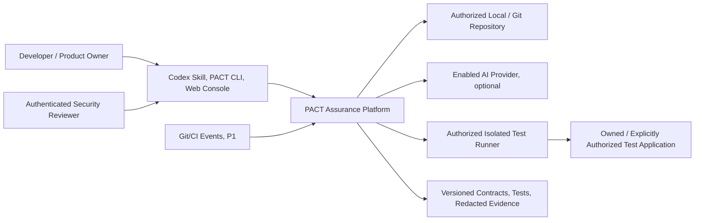
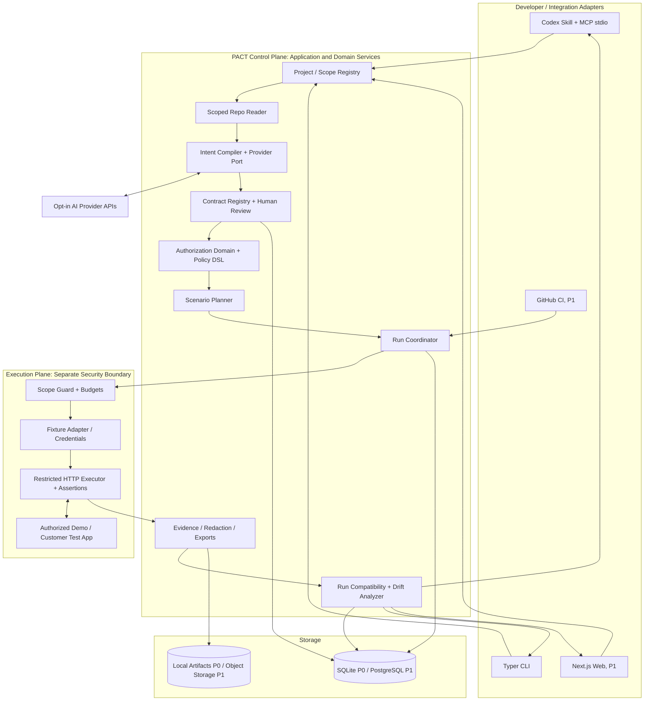
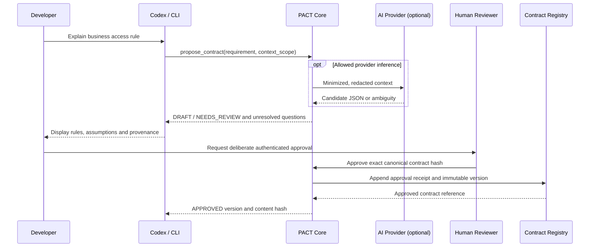
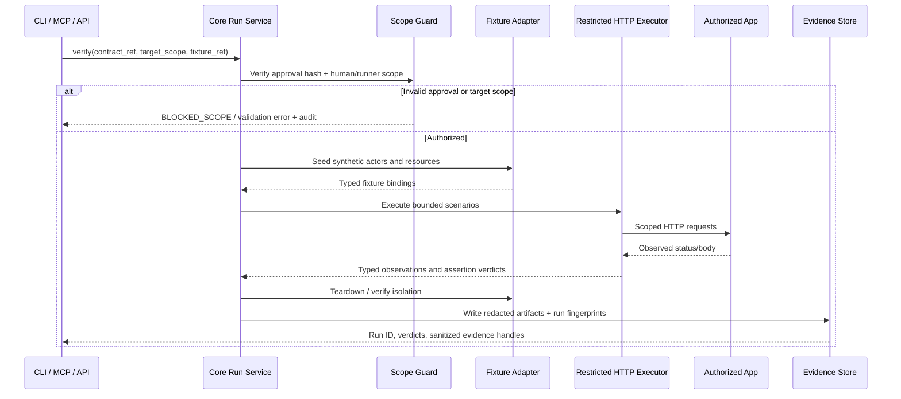
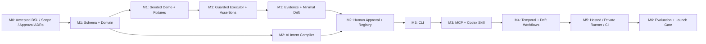

# PACT Security — Architecture & Incremental Implementation Plan

> **Document type:** Technical architecture, engineering work breakdown structure (WBS), verification gates  
> **Document version:** 1.0.0 (proposed)  
> **Date:** 2026-10-10  
> **Status:** DRAFT / NOT YET APPROVED — architecture decisions require ADR review  
> **Canonical repository path:** `docs/ARCHITECTURE.md` (this is the actual repository document; no delivery-copy file is implied)
> **Normative product requirements:** [`PRD.MD`](../PRD.MD) v1.0.0, especially §§4–9, 11–18  
> **AI coding rules:** [`AGENTS.md`](../AGENTS.md) v1.0.2
> **Product:** PACT Security — *Continuous Authorization and Security-Intent Assurance*  
> **Readers:** Codex, software engineers, security engineers, QA, architecture reviewers, and product owner

## 0. How to Use This Document

This document describes **HOW** to implement the **WHAT** stated in `PRD.MD`. `AGENTS.md` governs the coding agent's day-to-day behavior. **Neither this document nor a model's suggestions can approve a security policy or authorize a test target.**

### 0.1 Rules for interpretation

- **MUST** indicates an invariant or release requirement established in the PRD/AGENTS; **SHOULD** indicates guidance; **PROPOSED** indicates a design that requires owner-approved ADR before becoming binding.
- Every implementation ticket below has an ID, dependencies, concrete output, and **Definition of Done (DoD)**. Mark it complete only when the evidence exists in the actual repository and its tests have run successfully.
- P0, P1, and P2 follow `PRD.MD` §4. **No fixed deadline** is assumed. Implement vertical slices and enforce gates before expanding scope.
- The normative source of expected authorization is a **human-approved, immutable security contract**, not the app's source code, a prompt, or an LLM judgment.
- Verification verdicts derive only from **controlled, deterministic assertions** against a scope-authorized target, not from model-generated prose.
- Document decisions in `docs/adr/NNNN-title.md` (or `docs/DECISIONS.md`); do not mark an ADR `Accepted` without a genuine human architecture/security review.
- All examples, directory structures, commands, component names, endpoints and technology selections below are **proposed** until implemented and verified. Do not represent them as working code.

### 0.2 Precedence and traceability

1. Safety / explicit target authorization / applicable law and authenticated human approvals.
2. Current instructions from the product owner and approved project governance.
3. Normative PRD requirement IDs and acceptance criteria.
4. Accepted ADRs consistent with the PRD.
5. `AGENTS.md` engineering and agent-safety rules.
6. This architecture document as implementation guidance.

If an ADR would change a PRD requirement or relax a security boundary, **update and approve the PRD first**. Every code PR should cite `FR-...`, `NFR-...`, and relevant `AC-...`, plus its architectural work-item ID `M#-##`.

### 0.3 Product promise and hard boundaries

PACT helps developers describe business permissions, review and approve them, convert them into executable authorization tests, run them against **authorized** applications, preserve evidence, and catch **authorization drift** across software changes. PACT is **not** a general autonomous exploit agent, a pentest permission generator, an assurance of total security, or a mechanism for modifying production policies without review.

**P0 success path:** intent -> structured draft -> human approval -> safe fixture binding -> positive/negative tests -> evidence -> same-contract rerun -> compatible drift analysis -> CLI and Codex/MCP parity.

**P1 product vision:** hosted control plane + web console + Git/CI integration + private runners + team governance + temporal permission lifecycle verification; without duplicating core verification semantics.

---

## 1. Architecture Decision Summary / Proposed Technology Stack

The default shape is a **modular Python monolith plus ports-and-adapters** at P0; P1 adds a hosted control plane and separately isolated execution plane where justified by trust boundaries. Do **not** create microservices or a graph database before benchmarked need.

### 1.1 Technology matrix

| Layer | P0 preferred | P1/P2 evolution | Decision status / rationale |
|---|---|---|---|
| Language / runtime | **Python 3.12+** | Maintain supported Python matrix | **Proposed**; mature authorization-testing ecosystem |
| Python packaging | `uv` + `pyproject.toml` + committed lockfile | Published wheel / container image | **Proposed**; pin dependencies, reproducible developer setup |
| Domain schemas | **Pydantic v2**, Python enums/dataclasses, JSON Schema | Schema generation and migrations | **Proposed**; typed boundary contracts |
| Core orchestration | Pure Python application services + explicit ports | Durable run coordinator | **Proposed**; clear dependencies, low complexity |
| HTTP service | **FastAPI** | Versioned REST service under `/api/v1` | **Proposed**; typed endpoints and OpenAPI |
| CLI | **Typer** | Published `pact` binary via Python package | **Proposed**; interactive and JSON machine mode |
| Codex and agents | **MCP Python SDK** (local stdio) + Codex Skill | Authenticated remote MCP; other hosts | **Proposed**; single core for CLI/MCP |
| Local relational DB | **SQLite** with explicit persistence interfaces | **PostgreSQL** | **Proposed**; no hosted dependency in P0 |
| ORM / migrations | **SQLAlchemy 2.x**, Alembic when persistent schema stabilizes | PostgreSQL migrations, indexes, RLS where appropriate | **Proposed**; migration and audit trail discipline |
| HTTP verification | **HTTPX** + restricted scenario DSL + assertion library | Additional target adapters | **Proposed**; deterministic transport and output |
| Test framework | **pytest**, pytest-cov, Hypothesis where helpful | e2e / load / contract test matrix | **Proposed**; reproducible evidence |
| Formatting / linting | **Ruff** | CI required checks | **Proposed**; simple default |
| Type checking | **mypy** in strict core modules | Extend strictness through integrations | **Proposed**; domain correctness |
| Source inspection | Python AST and limited FastAPI route inventory | OpenAPI parser, typed language adapters | **Proposed**; read-only with provenance |
| Cloud AI | **OpenAI official SDK** as initial direct provider | Anthropic, Gemini, local models with conformance tests | **Proposed**; one provider at P0, no inference in verifier |
| Optional provider gateway | None required | LiteLLM after provider ADR, if justified | **Optional**; avoid unnecessary abstraction layers |
| Frontend | CLI + static HTML report | **Next.js + React + TypeScript**; styling/UI kit via ADR | **Proposed**; dedicated review and reporting console |
| Execution isolation | Restricted local runner with synthetic fixtures; disposable container when feasible | Customer-managed/private runner with hardened containers | **Proposed**; fail closed, scope and budget bound |
| Background jobs | Synchronous bounded local call | Durable queue/worker; implementation selected by ADR | **Undecided**; do not pre-select Redis/Celery/Kafka |
| Object storage | Private local artifact directory | Encrypted private **S3-compatible** storage | **Proposed**; normalized JSON/HTML + evidence handles |
| Authentication | OS-local interactive identity with verifiable local review | OIDC, org/project RBAC and scoped service auth | **Proposed**; approval != model-supplied flag |
| CI provider | Local test commands and artifact export | GitHub App/checks/webhook integration | **Proposed**; advisory by default |
| Observability | Structured sanitized JSON logs + correlation/run IDs | OpenTelemetry, metrics/traces and SLO after baseline | **Proposed**; no logging of secrets |
| Container/release | Docker for **authorized demo environment**, optional at P0 | Signed images, SBOM/provenance and hardened private runners | **Proposed**; no default Docker socket exposure |

**Version policy:** above are major-version families, not hard-coded latest patch versions. Before implementation, record compatible tested versions, license, vulnerabilities, and exact lockfile hashes. Do not assume an SDK, MCP transport, or model API feature without checking the installed version.

### 1.2 Architecture Decision Records needed before freezing implementation

| ADR | PRD open question | Decision needed | Required evidence |
|---|---|---|---|
| `0001-contract-dsl` | OQ-02 | Canonical JSON contract, relation predicates, DENY semantics, backward compatibility | Schema examples + rejecting arbitrary expressions |
| `0002-fixture-runner` | OQ-03, OQ-06 | Initial FastAPI fixtures, independent actor sessions, safe endpoint bindings, `404` denial profile | Vulnerable/patched demo prototype and error/redirect tests |
| `0003-human-approval` | OQ-04, OQ-14 | Real reviewer identity, canonical hash, immutability, CLI approval and audit | Forged imported `APPROVED` contract must fail |
| `0004-repository-and-stack` | PRD §8.3 | Python project layout, package tooling, migrations and target OS | Clean checkout bootstrap + dependency checks |
| `0005-mcp-host-boundary` | OQ-05 | Codex host reasoning vs PACT provider, MCP stdio transport, tool access | Codex host cannot self-approve via MCP |
| `0006-provider-egress` | OQ-10 | Provider SDK, consent model, redaction and no-second-model mode | Conformance fixtures, offline verifier test |
| `0007-hosted-runner` | OQ-08, OQ-13 | Job queue, private runners, token issuance, trust/egress | Threat model, deployment diagram, revocation test |
| `0008-ci-gate-and-audit` | OQ-11 | Advisory vs blocking CI, signed webhooks, audit custody | Invalid webhooks refused; no false green |
| `0009-evaluation` | OQ-12 | Independent fixture corpus and baselines | Reproducible methodology, agreed metrics |

If an ADR is not yet accepted, implement only reversible scaffolding or a focused spike; **stop before committing irreversible contract, approval, or runner trust semantics**.

---

## 2. System Context and Boundaries

### 2.1 C4 Level 1 — Context



### 2.2 C4 Level 2 — Components / control vs execution planes



**Dependency direction (mandatory):** `interfaces/adapters -> application services -> domain/ports`; `infrastructure` implements ports. Domain models must never import FastAPI, Typer, MCP SDKs, HTTPX transport, database ORM sessions, web UI or provider SDKs. All interfaces reuse the same verification and verdict services. MCP is an adapter, not an approval authority.

### 2.3 Runtime profiles

| Profile | Process boundary | External services | Data egress |
|---|---|---|---|
| P0 local/offline verifier | CLI/core + local SQLite + controlled demo runner | **None** during approved-suite rerun | No AI calls; no remote telemetry |
| P0 local/AI drafting | CLI/Codex -> core; isolated test app | One explicitly enabled provider as configured | Only authorized, minimized context |
| P1 hosted control plane | Web/API/workers/PostgreSQL/object storage | Hosted auth/CI and selected model services | Per-org consent, policies and retention |
| P1 private runner | Separate customer-managed identity and network | Test app accessible within approved customer sandbox | Redacted evidence + metadata to control plane |
| P2 enterprise/self-host | Deployable control plane + private runner | Configurable | Local-only possible if product mode supports it |

### 2.4 Trust boundaries (architecture-review checklist)

- **TB-01 Source -> Context:** repository/README/comments are untrusted data; prompt injection cannot override AGENTS, approvals, or scope.
- **TB-02 Context -> AI Provider:** explicit provider/egress consent; secrets excluded; no silent cross-provider fallback.
- **TB-03 Codex/MCP -> Core:** tool payloads are requests, not permission; validate caller identity, project and contract references.
- **TB-04 Core -> Runner:** use a short-lived authorized job descriptor bound to approved contract hash, target scope, fixture identity and execution budget.
- **TB-05 Runner -> Target:** validate destination before and during request; no arbitrary internet access, redirects, DNS rebinding or environment escalation.
- **TB-06 Evidence -> Store:** sanitize and minimize; prevent cross-project/tenant access and raw credential persistence.
- **TB-07 CI -> Control Plane:** signed webhook verification, replay protection, installation/repo scope checks.
- **TB-08 Human -> Approval:** authenticated, deliberate human act bound to reviewed bytes; CLI input/AI field is not a substitute for authentication and audit.

### 2.5 Non-negotiable execution policy

Only test resources under explicit authorization; default to seeded localhost/container demos. Reject public or unfamiliar targets until owner approval and runner policy genuinely grant scope. A runner MUST bound maximum requests, redirects, wall time, concurrent sessions, response bytes, write operations, and network destinations. Unsupported steps and dynamic unsafe input result in a blocked/error outcome, never silent execution. Avoid arbitrary OS shell, `eval`, user-supplied Python, unrestricted Jinja/template execution, or automatic exploitation.

---

## 3. Module Map and Interfaces

| Module / proposed package | Inputs | Outputs | Domain owner / constraints |
|---|---|---|---|
| `core/domain` | validated primitives | principals, resources, actions, rules, verdict enums | Pure typed models; no I/O |
| `core/contracts` | policy draft, reviewer action | approved immutable version, review record | Human approval and integrity boundary |
| `core/intent` | requirements, context, provider | proposed contract + unresolved questions | Model is untrusted; draft only |
| `core/projects` | repo path, scope config | validated project, endpoint inventory | Read-only scoped repo access |
| `core/scenarios` | approved contract, fixture capabilities | restricted scenario DSL, coverage map | No arbitrary code generation/execution |
| `core/verification` | authorized run spec, fixtures | normalized observations + verdicts | Deterministic assertions; fail closed |
| `core/evidence` | observations and metadata | redacted JSON/HTML, artifact hashes | No secrets; no fabricated observations |
| `core/drift` | baseline run, candidate run | compatibility result, drift status | Same contract + comparable fixtures/environments |
| `core/providers` | minimal enabled context | normalized proposed draft or structured error | Injectable interface; provider consent |
| `adapters/cli` | human commands | CLI and JSON output | Same core application services |
| `adapters/mcp` | typed tool inputs | handles, sanitized status and evidence | Never expose callable self-approval |
| `adapters/api` (P1) | OIDC principal and API request | scoped results and job handles | Tenant RBAC, idempotency, pagination |
| `runner/local` | authorized job token/scope | bounded HTTP/fixture run results | Isolated credentials/process/network |
| `runner/private` (P1) | authenticated leased job | signed results / diagnostics | Compromised runner must not impersonate organization |
| `web` (P1) | authorized server API | review, runs, findings and drift UI | No security authority in browser |

**Reusable port examples (conceptual):** `ContractRepository`, `HumanApprovalService`, `ScopeAuthorizer`, `FixtureAdapter`, `TestTransport`, `EvidenceRepository`, `ModelProvider`, `RunRepository`, `Clock`, `IdGenerator`. Keep SDK objects and ORM models out of the pure-domain interfaces.

---

## 4. Domain, Contract and Verification Semantics

### 4.1 Canonical authorization entities

- **Organization / Project / Environment:** ownership, permitted repositories, allowed execution target and policy.
- **Principal / Actor / Role / Tenant:** identity of the simulated requester, its role(s), tenant membership, and independent session.
- **Resource / Action / Relation:** object accessed; `read`, `write`, `delete`, etc.; relations such as `owns`, `member_of`, `shared_with`.
- **Rule / ContractDraft / ApprovedContractVersion:** expected behavior and its provenance, status, reviewers and immutable content hash.
- **FixtureBinding / ScenarioDefinition / ScenarioStep:** typed synthetic identity/resource bindings and executable logical steps.
- **Run / ScenarioResult / AssertionObservation / EvidenceArtifact:** what was tested, observed, redacted and stored.
- **RunCompatibility / DriftEvent:** whether baseline and current run may be compared, and if behavior contradicted the same approved rule.

### 4.2 Contract schema (proposed; detailed grammar needs ADR-0001)

Keep `schema_version`, logical `contract_id`, version, project/scope reference, resource/action definitions, source provenance, review status, policy rules, and rule-specific assertion profile separate. Validate ambiguous relations explicitly; no implicit ALLOW. The `target_binding` must identify a safe fixture and endpoint adapter; do **not** embed live credentials in a contract.

```json
{
  "schema_version": "1.0",
  "contract_id": "auth.orders.read",
  "version": 1,
  "resource_type": "order",
  "action": "read",
  "rules": [
    {"rule_id": "own-store", "condition": {"relation": "same_tenant"}, "expect": "ALLOW"},
    {"rule_id": "other-store", "condition": {"relation": "different_tenant"}, "expect": "DENY"}
  ],
  "assertion_profile": "http-api-object-read-v1",
  "target_binding": {"fixture_adapter": "demo-marketplace-v1", "route_template": "GET /orders/{order_id}"}
}
```

**This JSON is an illustrative *contract body*, not an approval record.** An imported field saying `approved: true` is not sufficient proof of review or authority. Approved version identity/hash and review receipt live in the trusted contract registry.

### 4.3 Contract approval finite-state machine

`DRAFT -> NEEDS_REVIEW -> APPROVED` or `REJECTED`; historical approved versions may be `SUPERSEDED` or `DEPRECATED`, without deletion/mutation. Revising content creates a **new draft/version** and invalidates any approval tied to the old content hash. AI/MCP tools may **request** review but must not complete one autonomously.

**Implementation invariants:**

1. Canonicalize contract bytes with a documented JSON representation before hashing (e.g., UTF-8, deterministic key ordering and separators; algorithm specified in ADR).
2. Store `contract_id`, version, hash, review receipt, reviewer identity, timestamp, project and audit correlation in trusted persistence.
3. Execute only if authoritative approval proof, exact hash, scope and fixture validity all match.
4. Refuse imported approval flags, stale/replayed review receipts, untrusted auth identity and edited approved contracts.
5. Preserve history and create a new version for intentional policy changes.

### 4.4 Restricted scenario DSL

Allow an explicit, finite list of typed operations in the first release:

- `fixture.setup` / `fixture.teardown` (synthetic fixtures; fixed adapters).
- `http.request` (allowed method + normalized path + actor fixture reference, no arbitrary destination override).
- Typed assertions: `access_decision`, `no_protected_resource_disclosure`, `response_schema` (where defined), `resource_state` (where supported).
- Future P1: controlled `fixture.grant`, `fixture.revoke`, `fixture.change_role`, `clock.advance` **only** for disposable, authorized environments.

Interpolation may reference **only typed preapproved fixture fields**, not arbitrary Python, shell, environmental variables, URL hosts or remote paths. Unsupported DSL steps are rejected during planning, not evaluated.

### 4.5 Verdict algorithm and failure precedence

| Verdict | Minimum meaning / when to use |
|---|---|
| `PASS` | All mandatory, relevant assertions match approved expected behavior; fixture, scope and environment valid |
| `VIOLATION` | Concrete reproducible observation contradicts an approved contract rule under valid test conditions |
| `INCONCLUSIVE` | Observation insufficient or cannot distinguish compliant/noncompliant behavior; **no claim of safety** |
| `ERROR` | Execution, authentication setup, infrastructure, fixture or transport failed; **no claim of safety** |
| `SKIPPED` | Scenario deliberately omitted and reason recorded; not coverage |
| `CANCELED` | Authorized user/system stopped scenario; not coverage |

Job state is independent: `QUEUED -> VALIDATING -> READY -> RUNNING -> COMPLETED`; alternatives `CANCELED`, `FAILED_INFRA`, `BLOCKED_SCOPE`, `EXPIRED`. `COMPLETED` is not synonymous with security passed.

- Expected `DENY` can be satisfied by approved semantics including an appropriate `403` or `404` **and** absence of protected data; mere response status is not enough for every profile.
- Expected `ALLOW` returning `500` is an error, **not** proof of correct authorization.
- If a protected object cannot be reliably distinguished from an unauthenticated/missing fixture, return `ERROR`/`INCONCLUSIVE`, not `VIOLATION`.
- A `200` response with unclear or insufficient body data may be `INCONCLUSIVE`; use explicit contract assertions rather than guessing.
- Reporting must include the rule ID, tested actor/resource, observation method and redacted evidence handle.

### 4.6 Compatible run comparison and drift

Only classify `PASS -> VIOLATION` as **possible implementation authorization drift** if the approved policy hash, relevant scenario spec version, actor/resource fixture semantics and environment/target compatibility match. `contract v1 -> v2` is a **policy change**, not same-policy drift. Changed fixture or environment is `NOT_COMPARABLE` or requires explicit reviewer evaluation. Keep both historical runs. Do not rewrite a failing baseline.

### 4.7 Core outputs

- `contracts/*.json`: reviewable, versioned contract body (no embedded secrets or forged approval).
- `scenarios/*.yaml` / generated reusable pytest as optional export; stable references to approved rules.
- `runs/*.json`: versioned results, status, scenario verdict and sanitized observations.
- `reports/*.html`: reader-friendly report generated from the same normalized result model.
- `drift/*.json`: explicit compatibility assessment and compared run IDs.

---
## 5. Proposed Repository Layout and Responsibility Boundaries

Match the structure in `PRD.MD` §14.1 unless an approved ADR changes it. Work items may create empty directories only alongside an executable deliverable and meaningful tests; directory scaffolding alone is **not** task completion.

```text
pact-security/
├── PRD.MD                         # Normative product requirements
├── AGENTS.md                       # Coding agent instructions
├── README.md                       # Only implemented/tested features
├── pyproject.toml                  # Root tooling/workspace (proposed)
├── uv.lock                         # Committed reproducible lock (proposed)
├── .env.example                    # Never include real credentials
├── .gitignore
├── packages/
│   ├── pact-core/
│   │   ├── pact_core/
│   │   │   ├── domain/             # Typed entities, semantics, state machines
│   │   │   ├── contracts/          # Review, immutable versions, hashing
│   │   │   ├── intent/             # Draft compiler, ambiguity detection
│   │   │   ├── providers/          # LLM provider port and implementations
│   │   │   ├── projects/           # Scoped repo and project readers
│   │   │   ├── scenarios/          # Restricted DSL and coverage planning
│   │   │   ├── execution/          # Authorization, fixtures, HTTP tests
│   │   │   ├── evidence/           # Normalization, sanitization, exports
│   │   │   ├── drift/              # Run compatibility and diff
│   │   │   ├── persistence/        # Storage ports/adapters
│   │   │   └── security/           # Execution-scope policy, guards, audit
│   │   └── tests/
│   ├── pact-cli/
│   │   ├── pact_cli/
│   │   └── tests/
│   ├── pact-mcp/
│   │   ├── pact_mcp/
│   │   └── tests/
│   └── pact-api/                   # P1 hosted REST adapter
│       ├── pact_api/
│       └── tests/
├── apps/
│   ├── demo-marketplace/           # Authorized, seeded local test app
│   └── web/                        # P1 Next.js console
├── integrations/
│   ├── codex-skill/                # Skill instructions; not privileged code
│   └── github/                     # P1 GitHub App / CI checks
├── fixtures/
│   └── authorization-benchmark/    # Golden safe/vulnerable/ambiguous cases
├── docs/
│   ├── ARCHITECTURE.md             # THIS document in repository
│   ├── DATA_MODEL.md
│   ├── API_SPEC.md
│   ├── SECURITY.md
│   ├── TEST_PLAN.md
│   ├── ROADMAP.md
│   ├── DECISIONS.md
│   ├── contracts/                   # Schema examples and policy fixtures
│   └── adr/
├── infra/
│   ├── docker/
│   └── migrations/                 # P1/when schema requires it
├── scripts/
└── .github/workflows/             # Once build/test tooling exists
```

### 5.1 Package import rules

- `pact_core.domain` imports no API framework, provider, ORM, or runner implementation.
- `pact_core.application` (may be added) coordinates only domain types and injected ports.
- Infrastructure adapters import domain interfaces **one way**; domain never imports infrastructure.
- `pact_cli`, `pact_mcp`, and `pact_api` share application services and serialized contract/verdict types, not duplicated rule checks.
- The demo marketplace is an **external test target**, not a trusted library imported into PACT domain/runner.
- The web UI accesses the authenticated API only; browser JavaScript never approves contracts or produces security verdicts.

### 5.2 Clean install and developer ergonomics (planned)

Minimum bootstrap should support a documented `uv sync` (or equivalent after ADR approval), `pytest`, `ruff check`, `ruff format --check`, and a configured `mypy` pass. Include deterministic demo seed/reset scripts, a command that proves offline test reruns work, and a CI job that executes the same checks. Shell examples in documentation must match commands actually implemented; do not claim success based on speculative scripts.

---

## 6. Execution Flows / Data Movement

### 6.1 New requirement to approved contract



**No automatic promotion from `DRAFT` to `APPROVED` by MCP, AI output, imported JSON, CI, or fixture configuration.** A successful draft is *not* authorization to run.

### 6.2 Approved contract to verified evidence



**Fault handling:** teardown executes after success/failure/cancellation where safe; cleanup failures are visible and must not rewrite observed results into PASS. A blocked run makes no outbound test requests.

### 6.3 Regression and intentional policy changes

- Save every run with `commit_sha`, `approved_contract_id/version/hash`, `scenario_schema_version`, `fixture_fingerprint`, `environment_fingerprint`, scope receipt and evidence IDs.
- Only compare compatible runs; explain incompatibilities explicitly and offer controlled rerun with pinned fixtures.
- A newly observed `PASS -> VIOLATION` on the same approved policy becomes **possible implementation drift**, with evidence.
- A deliberate rule revision creates reviewed version N+1. Never relabel the v1/v2 difference as same-policy regression.
- CI checks are advisory by default; blocking checks require genuine admin configuration and reliability review.

### 6.4 Handling ambiguous/failed tests

| Problem | Required action | Must NOT happen |
|---|---|---|
| Ambiguous requirement | Mark `NEEDS_REVIEW`, ask precise questions | Invent implicit admin exception / ALLOW |
| Provider returns invalid JSON | Structured validation error and optional safe re-draft | Store as approved rule |
| Missing login fixture | `ERROR` / `INCONCLUSIVE` with setup log | Treat 401 as verified cross-tenant denial |
| HTTP 500 on expected ALLOW | `ERROR` or failed expected-behavior assertion per ADR | Mark authorization PASS |
| HTTP 404 on expected DENY | Assert approved denial profile and no disclosure | Assume 404 is always compliant |
| Redirect leaves allowlist | Block request and audit | Follow redirect to arbitrary host |
| Test exceeded budget | Stop and mark non-PASS | Retry forever / hide truncation |
| Provider offline on existing test | Run stored approved suite offline | Require new LLM inference |
| Run contexts incompatible | Emit `NOT_COMPARABLE` / status change | Assert security drift |

---

## 7. Detailed Implementation Work Breakdown (WBS)

### Work-item protocol (use for *every* Codex ticket)

Every `M#-##` task is a **small reviewable PR** where practical. Split again if implementation, tests and reviewer guidance cannot be understood together. Each ticket must include:

```text
Work Item: M#-## / Short Title
Priority / Milestone: P0|P1|P2 / M#
Trace: FR-..., NFR-..., AC-...
Dependencies: M#-##, accepted ADR-...
Files allowed to change: <explicit paths>
Goal: <one observable behavior>
Out of scope: <things deliberately deferred>
Implementation: <bounded code and data change>
Tests / negative tests: <specific fixtures and assertions>
Definition of Done: <measurable evidence>
Review: <normal or security-sensitive>
```

**Status values:** `NOT_STARTED`, `BLOCKED`, `IN_PROGRESS`, `IN_REVIEW`, `DONE`, `DEFERRED`. This document lists **planned** work, not its current completion status. Track actual state in [root `todo.md`](../todo.md), the canonical progress and issue ledger; `docs/ROADMAP.md`, if present, may summarize or link to that ledger. Do not silently update source-of-truth requirement priority.

### M0 — Architecture, security and repository foundations (P0)

**Milestone deliverable:** accepted critical ADRs, testable source-of-truth definitions, safe plan for fixture/approval/evidence ownership, minimal quality tooling. **M0 gate:** a reviewer can explain, for a sample scenario, which exact approved bytes define `ALLOW`/`DENY`, who may authorize testing, how fixture setup works and what constitutes evidence.

| ID | Small task / dependencies | Concrete deliverable | Done when — acceptance evidence | Trace |
|---|---|---|---|---|
| **M0-01** | Inventory repository and reconcile docs; no dependencies | Repository inventory, gaps list, decision register | Actual paths checked; discrepancies against PRD/AGENTS recorded; no invented implementation claims | PRD §§0,14,17 |
| **M0-02** | Define core threat model; after M0-01 | `docs/SECURITY.md` initial assets, attacker paths, trust diagram | Covers injection, forged review, SSRF, runner escape, leaked evidence, tenant IDOR; reviewer signs off threat boundary before privileged code | NFR-SEC-001–005 |
| **M0-03** | Draft contract and policy DSL ADR; after M0-01 | `docs/adr/0001-contract-dsl.md` + valid/invalid examples | Includes typed relations, ALLOW/DENY, versioning and denial profiles; JSON parsing rejects executable expressions; approval requested | OQ-02, FR-AUT-001/002 |
| **M0-04** | Draft fixture/runner ADR; after M0-02 | `docs/adr/0002-fixture-runner.md` | Defines synthetic actors, safe test target, auth setup, teardown, 404 semantics, redirects and budgets; examples include negative paths | OQ-03/06, FR-TST-002 |
| **M0-05** | Draft human approval ADR; after M0-02/03 | `docs/adr/0003-human-approval.md` | Identity, exact hash, local review action, immutable history, untrusted import behavior and replay rejection documented; owner approval requested | OQ-04/14, FR-CON-001/002 |
| **M0-06** | Decide tooling and dependency boundaries; after M0-01 | ADR + proposed lock/build strategy | Python/OS matrix, SDK licensing/versions, pinning, test commands and package ownership described; unresolved alternatives visible | NFR-MAINT-001 |
| **M0-07** | Set up workspace baseline; after M0-06 | `pyproject.toml`, minimal importable packages, CI skeleton and lint/type/test config | Clean checkout installs from lock; one smoke test runs locally and in CI; import causes no side effects; no `.env` secret committed | FR-PLT-001, NFR-MAINT-001 |
| **M0-08** | Define traceability/test plan; after M0-03/04/05 | `docs/TEST_PLAN.md` + requirements/AC matrix | AC-001..017 each has planned test owner/fixture; `AC-014` correctly flagged P1; owner can identify release blocker | PRD §11 |
| **M0-09** | Specify initial data model and public interface boundaries; after M0-03/05 | Draft `docs/DATA_MODEL.md`, `docs/API_SPEC.md` | Names/semantics of contract, review, fixture, run, artifact and job IDs aligned; endpoints marked PROPOSED | PRD §§7,9,13 |

**Blocking dependency:** schema, fixture and approval semantics in M0-03/04/05 require owner-accepted ADRs before normative implementation. M0-07 may proceed with reversible build scaffolding.

### M1 — Deterministic verification core (P0)

**Milestone deliverable:** no-LLM end-to-end authorization verification with safe seeded targets and redacted evidence. Test-harness-only preauthorized contracts can be used for isolated engine experiments; **this is not production approval**. P0 human approval is completed in M2.

| ID | Small task / dependencies | Concrete deliverable | Done when — acceptance evidence | Trace |
|---|---|---|---|---|
| **M1-01** | Define typed domain; M0-03 | Enums/entities for actor, tenant, resource, relation, rule and verdict | Schema tests cover valid roles/tenants and reject unknown predicates, extra privileged fields and missing expected action | FR-AUT-001/002 |
| **M1-02** | Canonical contract schema and normalizer; M1-01 | Versioned Pydantic/JSON Schema + fixtures | Identical logical contracts hash identically under documented canonicalization; malformed/ambiguous contracts rejected; examples round-trip | FR-CON-001, FR-INT-002 |
| **M1-03** | Approval state-machine model (without fake trusted approval); M1-02 | Transition guards, immutable approved snapshot interface | Invalid transitions and modifying approved content fail tests; no untrusted JSON `APPROVED` bypass | FR-CON-001/002, AC-002 |
| **M1-04** | Seed local marketplace demo; M0-04 | Deterministic FastAPI app with seller A/B, order A/B, intentionally flawed vs fixed authorization variants | Repeated seeding reproduces resource ownership; independent identities isolated; both allow and deny examples exercised | FR-PLT-001, FR-TST-002 |
| **M1-05** | Restricted scenario DSL parser; M1-01/04 | Typed `fixture.setup`, `http.request`, assertions, teardown schema | Rejects arbitrary shell/Python/host interpolation; allows only typed references and declared paths; fuzz/negative tests pass | FR-TST-001/003, NFR-SEC-004 |
| **M1-06** | Fixture/session adapter; M1-04/05 | Safe seeded fixture registry and independent auth sessions | Actor A/B tokens genuinely distinct; invalid auth setup -> ERROR; each run restores baseline with cleanup evidence | FR-TST-002, AC-006 |
| **M1-07** | Scope guard and request-budget policy; M0-04/M1-05 | Strict target allowlist, destination/redirect checks, budget enforcing transport | Disallowed external URL, redirect, DNS/IP swap and unsafe path blocked **before** unapproved request; limits yield non-PASS outcome | NFR-SEC-001/005, AC-007/015 |
| **M1-08** | HTTP executor and authorization assertions; M1-05/06/07 | Bounded HTTPX runner and `ALLOW`/`DENY` evaluation | Vulnerable demo yields evidence-backed VIOLATION; patched yields PASS; valid 404-denial can PASS; expected ALLOW with 500 not PASS | FR-TST-004/005/006, AC-004/005/016/017 |
| **M1-09** | Evidence redaction + serializers; M1-08 | Normalized run model, JSON + HTML report, token scrubbers | Seeded API keys/bearer tokens/private fixture fields absent from logs, HTML, JSON and exceptions; same result is rendered consistently | FR-EVD-001/002/003/005, AC-011 |
| **M1-10** | Local run persistence and artifact pointers; M1-02/08/09 | SQLite-backed run records and local artifact directory | Query by run ID returns contract/fixture/commit identifiers and artifact checksum; re-run doesn't overwrite old artifacts | FR-DRF-001, NFR-REL-001 |
| **M1-11** | Minimal compatible-run comparator; M1-10 | Compatibility validator + drift JSON | Same-policy compatible PASS->VIOLATION reports **possible** drift; changed policy/env gives NOT_COMPARABLE; both run records preserved | FR-DRF-001/002, AC-008 |
| **M1-12** | P0 executor security regression gate; M1-05..11 | Golden and property tests, offline demo runbook | AC-004..008, 011, 015..017 demonstrably pass for constrained test-harness path; **zero AI calls**; no unapproved network requests | PRD §11, NFR-SEC-001–005 |

**M1 gate detail:** distinguish test-only manually seeded approved fixtures from actual trust-bound approval. M1 may verify assertions using a restricted trusted test harness; no CLI/MCP user may fabricate trusted approval from a serialized object. Failure of scope or leakage tests blocks M1.

### M2 — AI drafting and real human policy approval (P0)

**Milestone deliverable:** AI-generated proposal or explicit clarification -> deliberate authenticated human review -> stored hash-bound contract -> authorized verification, with safe failure conditions.

| ID | Small task / dependencies | Concrete deliverable | Done when — acceptance evidence | Trace |
|---|---|---|---|---|
| **M2-01** | Stable AI provider port; M1-02 | `generate_structured_contract` interface and fake provider | Typed valid draft/structured error contract; no provider SDK leaks into core/domain; offline mocks pass | FR-AI-001/002 |
| **M2-02** | Safe context selection; M0-02/M1-02 | Scoped source reader and privacy filter | Sample repo inventory includes file/line provenance but excludes `.env`, secrets, keys and unrelated files; prompt injection ignored as instructions | FR-PRJ-002, NFR-PRV-001 |
| **M2-03** | Initial OpenAI provider adapter; M2-01/02 | Configurable SDK adapter with explicit permission boundary | Valid response normalized; offline fake tests pass; disabled egress => no API call; timeout/bad response => structured non-success | FR-AI-001/002, AC-010 |
| **M2-04** | Intent parser and candidate generation; M2-01/02/03 | Candidate contract with role/resource/action/tenant and provenance | Merchant requirement creates same-tenant ALLOW and cross-tenant DENY as DRAFT; no agent-supplied approval; covers AC-001 | FR-INT-001/002/004, AC-001 |
| **M2-05** | Ambiguity/conflict review path; M2-04 | `NEEDS_REVIEW` and questions, conflict detection | Admin/ownership ambiguity and conflicting rules do not silently become enforceable; invalid model JSON fails closed | FR-INT-003, AC-010 |
| **M2-06** | Real authenticated local human review; M0-05/M1-03/M2-05 | Local review UI/CLI flow, hash-bound review receipt | Deliberate human approval yields immutable version; forged/imported/replayed/modified review cannot authorize test | FR-CON-001/002, AC-002/003 |
| **M2-07** | Trusted approval registry/audit; M2-06/M1-10 | Append-only audit events, reviewer provenance, immutable version reference | Audit shows who/what/when/hash; same content mutation creates new draft; denied/unapproved execution is logged | FR-CON-003, NFR-SEC-001 |
| **M2-08** | Offline verifier after AI drafting; M1-12/M2-06 | Full separation of draft-time LLM and run-time assertions | Remove model credentials after approval; existing fixture and suite still execute; verdicts identical to no-AI baseline | FR-AI-003, AC-013 |
| **M2-09** | Security and conformance review; M2-01..08 | Test report for prompt injection, provider failure, approval forgery and privacy | Relevant AC-001/002/003/010/013 pass; unresolved ambiguity never triggers tests | PRD §§11–12 |

### M3 — Developer experience: CLI + Codex Skill + MCP (P0)

**Milestone deliverable:** local installable CLI and Codex-hosted workflow share the same trusted core and produce equivalent authorization outcomes.

| ID | Small task / dependencies | Concrete deliverable | Done when — acceptance evidence | Trace |
|---|---|---|---|---|
| **M3-01** | CLI command skeleton; M2-09 | Typer `pact` with `init`, `inspect`, `propose`, `review`, `plan`, `verify`, `compare`, `export` | `--help` documented; invalid flags and noninteractive mode yield stable exit errors; no unexpected network work on import | FR-IFC-001 |
| **M3-02** | CLI project + policy journey; M3-01/M2-06 | `init`/`inspect`/`propose`/`review` CLI handlers | A local authorized project progresses through human-approved draft with clear `NEEDS_REVIEW`; no synthetic reviewer shortcut | FR-PRJ-001/002, FR-CON-002 |
| **M3-03** | CLI verification + export journey; M3-02/M1-12 | `plan`/`verify`/`compare`/`export`, `--json` | JSON matches serialized core models; success, VIOLATION, ERROR, BLOCKED_SCOPE exits distinguishable and documented | FR-IFC-001, FR-EVD-003/004 |
| **M3-04** | Restricted MCP server adapter; M2-09 | MCP `inspect`, `propose`, `get_contract`, `plan`, `run`, `get_run`, `compare`, `export` | Local stdio tool discovery works; schemas validated; no `approve_contract` privileged tool; untrusted caller cannot authorize targets | FR-IFC-002/004 |
| **M3-05** | Codex Skill instructions; M3-04 | `integrations/codex-skill/SKILL.md` | Skill gives Codex exact step order and prompt guidance; tool outputs cannot bypass approval or authorization gates | FR-IFC-003 |
| **M3-06** | CLI/MCP parity test; M3-03/04 | Adapter conformance suite against one approved run | Same pinned contract/fixture yields matching normalized verdict and evidence hashes (ignoring presentation metadata) via CLI and MCP | AC-012 |
| **M3-07** | Portable scenario/test export; M3-03 | JSON/YAML scenario and runnable pytest export with documented prerequisites | Exported suite reruns without model API; test expectations point to immutable approved rule versions; imports cannot forge approval | FR-EVD-004, AC-013 |
| **M3-08** | Installation and smoke demo; M3-05..07 | `README.md`, `.env.example`, platform installation instructions | Fresh checkout reproduces full flow on documented supported OS; clean demo finishes without claiming universal security | FR-PLT-001, NFR-COMP-001 |

### M4 — Continuous verification, drift, and temporal permissions (P1 on top of P0 drift)

**Milestone deliverable:** reliable baseline/commit comparison, approved lifecycle state changes and safe re-runs; no false implication that all policy changes are regressions.

| ID | Small task / dependencies | Concrete deliverable | Done when — acceptance evidence | Trace |
|---|---|---|---|---|
| **M4-01** | Run/commit metadata completeness; M1-10/M3-03 | Stable commit, policy hash, fixture and environment fingerprints | Comparing different fixture semantics is rejected or flagged; same pinned run can be reproduced | FR-DRF-001 |
| **M4-02** | Drill-down drift comparison; M4-01 | Rule/step-level evidence links and historical status | Compatible PASS->VIOLATION labels possible implementation drift; other transitions explicitly categorized | FR-DRF-002, AC-008 |
| **M4-03** | Intentional policy version change flow; M2-07/M4-02 | Policy diff, draft version N+1, human reapproval | Historical contract immutable; v1 vs v2 output says approved policy change, not same-policy drift | FR-CON-004, FR-DRF-005, AC-009 |
| **M4-04** | Typed temporal DSL; M0-03/M1-05 | Sequenced precondition/state-transition vocabulary | Can express grant/revoke/role change via approved synthetic fixture operations only; unsafe transitions refused | FR-AUT-003, FR-TST-008 |
| **M4-05** | Stateful fixture adapter; M4-04 | Grant -> read -> revoke -> read with stale session | Repeatable before/after expected decisions; tear-down resets state; wrong/stale session permissions caught | FR-DRF-006, J-04 |
| **M4-06** | Property/regression test suite; M4-04/05 | Positive/negative lifecycle corpus | Covers expiration, tenant transfer, sharing and role changes; ambiguous semantics are review-blocking | FR-DRF-006, FR-TST-009 |
| **M4-07** | Change-impact mapper; M2-02/M4-02 | Route/file-to-contract candidate mapping | Provides explanation/confidence; full-suite option always available; miss risk explicitly reported | FR-INT-005, FR-DRF-003 |
| **M4-08** | Baseline-preserving remediation journey; M4-02/03/05 | Before/after test workflow and immutable history | Code patch causes rerun to PASS without modifying contract; failed run remains accessible; human owns patch approval | J-02, J-03, AC-005 |
| **M4-09** | Repeatability/benchmark gate; M4-01..08 | Temporal golden fixtures + report | Separate compatible drift, policy change, infra error, not-comparable case all demonstrate expected outcomes; performance measured | NFR-REL-001, PRD §11 |

### M5 — Full hosted control plane, web console, Git integration, private runners (P1)

**Milestone deliverable:** multi-organization platform that orchestrates authorized verifications in isolated customer test environments. The web is a trusted **review interface**, not the verification authority; API enforces all identities, grants, and tenant scopes.

| ID | Small task / dependencies | Concrete deliverable | Done when — acceptance evidence | Trace |
|---|---|---|---|---|
| **M5-01** | Accept hosted threat model and architecture ADR; M0-02/M3-08 | Accepted ADR on queue/store/runner controls and identity | Reviewer approves control/execution plane boundaries and failure/replay handling; no premature compliance promises | OQ-08/09/13, NFR-SEC-006/007 |
| **M5-02** | PostgreSQL persistence and migrations; M1-10/M5-01 | SQLAlchemy mappings, Alembic migration/rollback plans | Fresh install migrates; old immutable contract versions and evidence relationships survive update; rollback/recovery documented | PRD §13, NFR-COMP-002 |
| **M5-03** | Organizations, projects and RBAC; M5-02 | OIDC integration and role-based project access | Org A cannot enumerate/read/change Org B contracts, runs or artifact handles; ID tampering rejected and audited | FR-PRJ-004, FR-PLT-002, AC-014 |
| **M5-04** | Service API v1; M5-03 | FastAPI versioned API, auth, errors, pagination, idempotent jobs | OpenAPI schema validated; unauthorized API action fails; create/run duplicates do not create unsafe duplicate executions | FR-IFC-006, NFR-SEC-007 |
| **M5-05** | Artifact retention and object storage; M5-02/03 | Private object store adapter, encryption config, short-lived downloads | Org-crossing artifact IDs denied; secrets redacted; deletion/retention respects policy and legal holds; export tested | FR-EVD-008, FR-PLT-006 |
| **M5-06** | Durable job coordinator; M5-04 | Queue-backed jobs with lease, retry, cancellation and crash recovery | Worker crash never marks PASS; cancellation stops/safely times out runner; idempotency protects repeated messages | FR-PLT-003, NFR-REL-002 |
| **M5-07** | Private runner registration and auth; M5-01/06 | Runner identity, short-lived scoped credentials, capability negotiation | Revoked runner cannot fetch jobs; unauthorized host/network execution fails; jobs cryptographically/operationally bound to project, scope and contract | FR-PLT-005, NFR-SEC-001/007 |
| **M5-08** | Harden runner isolation; M5-07 | Container/network/fs policies, scoped token access and secret rotation | Tests show no prohibited host mount/socket, redirect escape, uncontrolled DNS/IP destination, unauthorized writes or report exfiltration | NFR-SEC-004/005/006 |
| **M5-09** | Web app skeleton and auth; M5-04 | Next.js typed client and accessible navigation | Signed-in developer can list own projects; unauthorized org data not rendered; keyboard nav/labels assessed | FR-IFC-005, NFR-A11Y-001 |
| **M5-10** | Contract review + editor UI; M5-09/M5-03 | Version diff, review, approval provenance and ambiguity UI | Reviewer explicitly approves exact hash via backend; AI/caller cannot impersonate reviewer; intentional changes create new version | FR-CON-004/005, J-03 |
| **M5-11** | Run history / drift / evidence UI; M5-05/09 | Reports, findings, statuses, coverage and artifact viewer | Displays PASS, VIOLATION, INCONCLUSIVE, ERROR, SKIPPED, CANCELED without misleading green; run reproductions linked | FR-IFC-005, FR-EVD-003 |
| **M5-12** | GitHub App and CI checks; M5-04/06 | Scoped GitHub installation, verified webhook handler, PR annotations | Invalid signature/replay/mismatched repository rejected; checks include evidence link and non-PASS statuses; advisory default | FR-IFC-007, FR-DRF-004 |
| **M5-13** | Policy-based optional merge gate; M5-12/M5-03 | Admin-configured gate rules | Only authorized admin enables blocking; missing runs/infra errors not silently green; documented safe rollback of gate | OQ-11, FR-DRF-004 |
| **M5-14** | Provider registry and additional model adapters; M5-03/M2-01 | Gemini/Claude and optionally local-provider adapters | Same draft-or-error conformance cases pass; provider egress consent enforced; no unapproved fallback or hidden bills | FR-AI-004/005/006 |
| **M5-15** | Operational audit, quotas, traces; M5-04/06 | Structured audit stream, rate/quota limits, sanitized telemetry | Cost/run limits enforced; incident can be correlated without raw secrets; quotas isolate noisy organizations | FR-PLT-004, NFR-OBS-002 |
| **M5-16** | Hosted E2E / deployment security gate; M5-03..15 | Tested deploy/runbook + threat-review findings | J-01..05 on supported hosted profile; full RBAC/SSRF/runner/evidence tests pass; no critical/high unresolved release blockers | PRD §§5,11,15 |

**M5 release boundary:** do not claim enterprise data-residency guarantees, guaranteed SLOs, certifications or production-grade isolation before architecture audit, threat testing, operational monitoring and actually supported deployment modes justify them.

### M6 — Independent evaluation and evidence-backed differentiation (P1 / P2)

**Milestone deliverable:** benchmark that distinguishes the real merits of PACT from general coding agents and authorization-testing tools. Product marketing must not claim superiority unsupported by reproducible results.

| ID | Small task / dependencies | Concrete deliverable | Done when — acceptance evidence | Trace |
|---|---|---|---|---|
| **M6-01** | Pre-register benchmark protocol; M4-09 | Test protocol and metrics definitions | Definitions for correct contract, time-to-first-valid-test, precision/recall, false violation, cost and reproducibility approved before tuning | OQ-12, PRD §11.3 |
| **M6-02** | Independent authorization fixture corpus; M6-01 | Multiple seeded safe/vulnerable apps, temporal and ambiguous policy cases | Fixture answer keys independently reviewed; train/tuning examples separate from held-out tests | FR-DRF-006, PRD §11.3 |
| **M6-03** | Manual pytest baseline; M6-02 | Recorded manually written test workflow | Same requirements and app versions used; time, code volume, test validity and errors captured | G-10, PRD §11.3 |
| **M6-04** | Codex-only baseline; M6-02 | Coding-agent-only test-generation evaluation | Model access, prompts, context limits and allowed iterations documented; blinded held-out cases used where possible | G-10, PRD §11.3 |
| **M6-05** | Relevant tool baselines; M6-02 | StackHawk/Cerbos comparisons where applicable | Feature-scope mismatch documented; same target/fixtures, cost/time and limitations disclosed; no unfair feature-for-feature claim | PRD §1.4, §11.3 |
| **M6-06** | PACT run and statistical analysis; M6-02..05 | Reproducible evaluation report and raw redacted metrics | Results include errors, inconclusive cases, confidence/uncertainty, spend and setup overhead; claims match measured coverage | PRD §11.3 |
| **M6-07** | Usability/accessibility and security reviews; M5-16/M6-06 | Developer observation study, a11y review, security report | At least one full persona flow tested on actual setup; critical issues triaged; public limitations explicitly listed | NFR-A11Y-001, PRD §11 |
| **M6-08** | Launch/pivot review; M6-06/07 | Decision memo and prioritized backlog | Owner documents continue/refocus/pivot decision grounded in measurements; roadmap and PRD updated if product scope changes | OQ-12, PRD §22 |

### 7.1 Cross-milestone dependency chain (critical path)



Some P1 tracks can be researched in parallel (frontend accessibility, SDK capability studies, benchmark design), but **they must not block or weaken the P0 security-critical path**.

### 7.2 Suggested engineering lanes

| Lane | Primary ownership | Can proceed independently when... |
|---|---|---|
| Core/domain | DSL, contracts, schema, approval invariants | ADR-0001/0003 accepted |
| Test/security | Fixture app, HTTP transport, scope guard, assertions | ADR-0002 accepted and domain types available |
| AI/integrations | Provider port, context sanitation, CLI/MCP | Draft schema stable, explicit provider permission exists |
| Platform | PostgreSQL, web, jobs, Git, private runners | Core interfaces and M5 trust ADR agreed |
| QA/benchmark | Golden fixtures, property tests, benchmark comparisons | Test schema stable and independent ground truth reviewed |

For concurrent agents, **do not edit the same files without explicit ownership coordination**. Public interfaces require a reviewed schema/port proposal before implementation is parallelized.

---

## 8. P0 Acceptance Gate and Test Traceability

This section reflects `PRD.MD` §11.1. **No P0 release without every mandatory P0 acceptance criterion proven.** AC-014 is a P1 hosted criterion.

| AC ID | Primary implementing task(s) | Minimum test evidence |
|---|---|---|
| AC-001 | M2-04 | Business rule -> draft with own-tenant ALLOW, other-tenant DENY |
| AC-002 | M1-03, M2-06/07 | Rejected test run from unreviewed/forged contract + audit |
| AC-003 | M2-06/07 | Authenticated human approval bound to immutable exact hash |
| AC-004 | M1-08/09 | Vulnerable synthetic app -> redacted evidence and VIOLATION |
| AC-005 | M1-08, M4-08 | Patched app -> cross-tenant PASS; own-tenant stays PASS |
| AC-006 | M1-06/08 | Missing auth token -> ERROR/INCONCLUSIVE, never PASS |
| AC-007 | M1-07 | Out-of-scope external target blocked before outbound request |
| AC-008 | M1-11, M4-02 | Same-policy comparable PASS->VIOLATION -> possible drift evidence |
| AC-009 | M4-03 | Reviewed policy v2 distinguished from implementation regression |
| AC-010 | M2-05/09 | Malformed model output/conflicting rule -> review or error |
| AC-011 | M1-09 | Synthetic bearer token and private value absent from artifacts |
| AC-012 | M3-06 | CLI/MCP same normalized core verdict and expected hashes |
| AC-013 | M2-08, M3-07 | Offline/no-provider repeat run succeeds without inference |
| AC-014 (P1) | M5-03 | Org A ID tampering into Org B denied and audited |
| AC-015 | M1-07 | Out-of-scope redirect blocked (including rewritten/resolved destination) |
| AC-016 | M1-08 | Valid DENY via configured safe 404 profile -> PASS |
| AC-017 | M1-08 | Expected ALLOW but server returns 500 -> non-PASS |

### 8.1 Test pyramid by layer

| Level | Typical targets | Failure conditions that MUST be included |
|---|---|---|
| Unit / schema | Contract canonicalization, parser, rules, verdict enums | Unknown relation, malformed provider JSON, invalid status transitions |
| Property-based | Approval immutability, forbidden actor/resource combinations | No mutate-after-approval, no cross-tenant unintentional ALLOW |
| Integration / fixture | FastAPI seeded target and independent auth sessions | Missing session, stale resource, teardown failure |
| Transport / security | HTTPX scope guard, DNS/IP and redirect handling | SSRF, redirects, budget exhaustion, socket/host escape |
| E2E local | CLI, core, MCP, evidence | Unapproved policy blocked, no-provider rerun, matching verdicts |
| P1 hosted E2E | OIDC/API, jobs, private runners, web, GitHub | IDOR, webhook replay, revoked runner, crash recovery, evidence access |
| Benchmark | Held-out safe/vulnerable apps, manual and agent baselines | False positives, missed cases, inconclusive scenarios counted |

### 8.2 Default CI pipeline (planned)

```text
checkout -> dependency lock verification -> formatting/lint -> mypy
    -> unit/schema tests -> fixture integration tests
    -> security/SSRF/approval tests -> CLI/MCP parity
    -> report redaction scan -> package/build smoke test
```

- CI must use seeded local fixtures and fake AI SDK clients by default; no paid API key is needed for basic test jobs.
- Periodic opt-in provider integration tests should run only with explicit API consent and spend ceilings.
- Failure in approval, scope, secret redaction or false-PASS tests **blocks release**.
- Code coverage percentage is useful but not a substitute for correct security-negative tests; publish meaningful coverage metrics alongside test outcomes.
- Any unexecuted test must be labeled `NOT RUN` with reason, not included in successful counts.

### 8.3 Release gates

| Release gate | Required evidence | What blocks release |
|---|---|---|
| **G0 / M0: Architecture** | Approved critical ADRs; defined domain and trust model | Unknown approval/scope semantics |
| **G1 / M1: Deterministic core** | No-LLM positive/negative tests, redirects and redaction | False PASS, out-of-scope requests, leaked token |
| **G2 / M2: Trusted review** | Authentic human approval, version hashing, malformed-model rejection | Forged approval, model as authority |
| **G3 / P0 Release** | All P0 ACs; CLI/MCP parity; offline rerun; installation tests | Any mandatory P0 acceptance failure |
| **G4 / M4: Temporal/continuous** | Lifecycle, comparability, drift/policy change distinction | Incompatible run misreported as confirmed drift |
| **G5 / P1 Hosted** | Isolation, RBAC, private runner and webhook security, operational recovery | Critical/high unresolved findings or uncontained execution |
| **G6 / Product positioning** | Reproducible benchmark, cost/time/quality measurements | Unsupported superiority or security certification claims |

**Gates are objective quality controls, not suggested dates.** Milestones may be reorganized by accepted ADR, but mandatory ACs and safety invariants cannot be skipped.

---

## 9. Interface Contracts and API Design Guidelines

### 9.1 P0 application service contracts (proposed)

Define typed request/response DTOs that both CLI and MCP use. Illustrative operations:

| Operation | Request essentials | Output essentials | Precondition / security guard |
|---|---|---|---|
| `register_local_project` | `repository_root`, explicit scope | `project_ref` | Canonical path, in-scope files only |
| `inspect_project` | `project_ref`, selected files | inventory, confidence, provenance | Read-only; secret exclusion |
| `propose_contract` | requirement text, allowed context, provider config | draft, unresolved questions, provenance | Draft only; egress permission checked |
| `request_contract_review` | draft ID, immutable content hash | pending review handle | No approval side effect |
| `review_contract` | authenticated human reviewer + exact hash + decision | approved version or rejected draft | **Human-only privileged entrypoint**, not model callable |
| `plan_scenarios` | approved contract, fixture capabilities | typed scenarios and coverage gaps | Approved policy; no execution yet |
| `verify` | approved version, scope authorization, test fixture | run handle/results | Scope guard, budgets, no privileged bypass |
| `get_run` | run ID, project identity | sanitized normalized result | RBAC/scoped retrieval |
| `compare_runs` | baseline ID, candidate ID | compatibility and drift classification | Same-policy compatible comparisons only |
| `export_run` | run ID, allowed formats | artifact handle/path | Redaction/export permission |

### 9.2 MCP tool surface — nonprivileged by design

Following `PRD.MD` §9.2: `pact.inspect_project`, `pact.propose_contract`, `pact.get_contract`, `pact.plan_scenarios`, `pact.run_verification`, `pact.get_run`, `pact.compare_runs`, `pact.export_results`. Expose a `request_review` helper only if it cannot approve. **Do not expose an AI-callable `approve_contract` tool**. State-changing tools are still gated by core scope and genuine human execution authorization.

### 9.3 Hosted REST v1 (P1 planned)

Design `/api/v1/projects`, `/api/v1/contracts`, `/api/v1/verification-runs`, `/api/v1/drift-events`, and `/api/v1/runners` around versioned typed DTOs, authenticated organization membership, cursor pagination, idempotency, audit and opaque artifact references. Exact routes and error schemas should be finalized in `docs/API_SPEC.md` and relevant ADR before implementing public compatibility.

### 9.4 Versioning, data and compatibility

- Version contract JSON schema, scenario DSL, event schemas and REST API independently; log parser/compiler version as provenance.
- Include a stable `schema_version`, project ID, contract hash, run ID, scope ID and correlation ID in appropriate outputs; never expose internal secret IDs or credentials.
- Preserve historical approved contracts and evidence; write migrations that support reading old versions or return explicit unsupported-schema errors.
- Store model version/prompt version for *draft provenance* only. Verdict reproducibility depends on the approved contract/fixture/executor, not inference randomness.
- An imported file may contain policy rules but cannot import authority. Server/local trusted review state remains normative.

---

## 10. Security, Privacy, Performance and Operations

### 10.1 Minimum operational controls

| Area | P0 control | P1 strengthening |
|---|---|---|
| Approval | Exact hash-bound human review, immutable version | Org-scoped reviewer RBAC, signature/attestation |
| Authorized execution | Explicit scope, loopback/demo-safe default, network budgets | Short-lived leased private-runner token and revocation |
| LLM privacy | Provider consent, context minimization, secret redaction | Per-org provider allowlists, egress analytics and retention |
| Evidence | Sanitized normalized reports and local permission controls | Private encrypted storage, retention/export/delete governance |
| Isolation | Disposable synthetic fixture and bounded transport | Hardened runner process/container, network/filesystem isolation |
| Availability | Timeouts, aborts, structured non-PASS errors | Durable jobs, queue health, cancellation and recovery |
| Observability | Correlation IDs and sanitized structured logs | OTel traces/metrics, SLO after measured baseline |
| Supply chain | Locked deps and CI security tests | SBOM, verified release provenance, dependency scanning |

### 10.2 Privacy and sensitive data handling

- Never log raw bearer tokens, private keys, passwords, connection strings, session cookies, raw private resource bodies or customer secrets.
- Treat HTTP response bodies as **sensitive**; store only fields necessary for reproducible evidence, with a redaction policy and explicit opt-in for exceptional captures.
- Separate source repository read authorization from approval to send content to a third-party AI provider; users can forbid all external model egress.
- No plaintext private test credentials in scenario DSL, contract export, Git history, CI job logs, URLs or artifact filenames.
- Scope every artifact request to an authenticated tenant/project or local trusted process.

### 10.3 Runtime safety targets — configuration-based, not product promises

- Choose conservative maximum request count, response byte size, run timeout, concurrency and retry limits in runner policy; document values per deployment ADR and show them in diagnostic output.
- Explicit `CANCELED`, `EXPIRED`, `FAILED_INFRA`, `BLOCKED_SCOPE` and scenario `ERROR` statuses do not count as passing tests.
- Do not enable public SaaS targets simply by loosening hostname checks. Expanded execution must pass owner authorization and appropriate isolation review.
- Do not deploy a private runner inside a customer production VPC without approved network segment, audit, read/write isolation and emergency stop mechanisms.

### 10.4 Initial SLIs (measure before setting numerical SLOs)

| Metric | Why it matters |
|---|---|
| Time from requirement to **human-approved valid contract** | Compiler + review usability |
| Time from approved contract to **first valid test** | Developer value |
| Scenario setup/transport error rate | Tester reliability |
| Redaction leak findings | Evidence safety |
| Out-of-scope request attempts blocked | Scope enforcement |
| Baseline/changed-run comparison compatibility rate | Drift correctness |
| Per-provider tokens/latency/cost per valid contract | Economic feasibility |
| Runner queue delay, timeout, cancel completion | P1 operational health |

Do not hardcode numerical SLO claims from a toy application. Set baselines using real supported hardware/deployment and representative customer-like fixtures.

---

## 11. Development Workflow with Codex

### 11.1 Start of each implementation session

1. Inspect actual Git state and working tree. Preserve user changes.
2. Read `PRD.MD`, `AGENTS.md`, this canonical file, accepted ADRs and linked requirement IDs.
3. Select **one** WBS item (`M#-##`); check dependencies and approvals.
4. State exact files to change, what is out of scope, the acceptance test and security risks.
5. For unresolved decisions, write a *proposed* ADR and request the owner to accept/reject before freezing semantics.
6. Implement test-first when feasible, including failure/negative paths; then execute actual tests and record results.

### 11.2 Definition of Done for each engineering PR

- [ ] The selected WBS task delivers the promised working behavior, not just interfaces or folders.
- [ ] Relevant `FR-...`, `NFR-...`, and `AC-...` IDs are cited and behavior is traced to PRD.
- [ ] Requisite ADR decisions were genuinely accepted; a proposal is not silently treated as approved.
- [ ] Positive and negative/error/security tests were added and actually executed.
- [ ] Scope, human approval, provider egress and no-false-PASS invariants remain intact.
- [ ] No credentials or protected test data appear in code, logs, reports or CI artifacts.
- [ ] Schema/API changes have migration/version notes; docs/examples reflect **actual** supported features.
- [ ] Lint, type checks and unit/integration tests pass; if unavailable, they are reported as NOT RUN with reasons.
- [ ] Relevant interface equivalence and offline verification have not regressed.
- [ ] Handoff includes changed file list, test commands/output, risks, blockers and next WBS item.

### 11.3 Suggested Codex prompt to execute a single work item

```text
Read PRD.MD, AGENTS.md, and docs/ARCHITECTURE.md before editing.
Inspect the existing repository and relevant accepted ADRs.

Implement only work item <M#-##> from docs/ARCHITECTURE.md.
Trace all changes to its PRD requirement IDs and acceptance criteria.

Before coding:
1. Confirm dependencies are actually done and any ADR required is Accepted.
2. Show the exact files you intend to edit and a short implementation plan.
3. Identify security/trust boundaries and the required negative tests.

During implementation:
- Do not weaken approval, execution scope, model egress, or evidence assertions.
- Reuse the same PACT Core through CLI/MCP/API adapters.
- Keep LLM-generated proposals out of deterministic verification decisions.
- If an unresolved product/security decision blocks the task, stop and ask.

After implementation:
- Execute the focused tests and relevant full quality checks.
- Report actual pass/fail/not-run results and modified paths.
- Provide a PRD/AC trace, security impact, remaining gaps, and next work item.
- Do not claim implemented or secure if validation is missing.
```

### 11.4 Sample task handoff format

```text
Work Item: M1-07 — Scope Guard and Request Budgets
Status: IN_REVIEW | DONE | BLOCKED
PRD Trace: NFR-SEC-001, NFR-SEC-005, AC-007, AC-015
Changed files: <exact paths>
Tests run: <exact commands> -> <observed results>
Negative evidence: redirect outside allowlist -> blocked without outbound request
Approval / ADR: ADR-0002 status and reviewer
Remaining issues: <none or concrete unresolved issues>
Next task: M1-08 (only if M1-07 is verified)
```

---

## 12. Architecture Risk Register

| Risk | Severity if uncontrolled | Prevention / verification | Owner / stage |
|---|---|---|---|
| Hallucinated policy from AI | High | Mandatory human review; ambiguous draft questions; schema checks | AI + security / M2 |
| Forged/self-approved contract | Critical | Trusted identity, hash-binding, immutable review audit, MCP tool restriction | Core + security / M0–M2 |
| SSRF / unauthorized external testing | Critical | Destination allowlist, DNS/IP/redirect revalidation, outbound sandbox restrictions | Runner + security / M1/M5 |
| Cross-tenant evidence exposure | Critical | Per-org RBAC, scoped queries/artifacts, negative ID tampering tests | Platform / M5 |
| Test fixture setup masquerading as DENY | High | Independent sessions, identity verification, `ERROR`/`INCONCLUSIVE` outcomes | Executor / M1 |
| `404`/`200` misclassified as secure | High | Rule-specific semantic assertions and protected-data checks | Domain/testing / M1 |
| Malicious repo instructions | High | Untrusted context/data separation, limited source reader, no model-executed shell | AI/core / M2 |
| Sensitive evidence sent to model/store | High | Redaction, minimal provider context, project consent and tests | Privacy/core / M1–M5 |
| Invalid drift caused by changed fixtures | Medium–High | Fixture/environment fingerprints, explicit compatibility comparison | Drift / M1–M4 |
| AI provider lock-in / compatibility | Medium | Stable provider port, contract conformance, no fallback without consent | AI / M2/M5 |
| Runner job stuck/canceled late | High | Timeouts, bounded retries, durable state and cancellation | Platform / M5 |
| Feature creep vs core correctness | High | P0 gates, work-item DoD, explicit P1/P2 separation | Product/lead / all milestones |
| Claims stronger than evidence | Medium–High | Held-out benchmarks, UI disclaimers and limitations | Product/evaluation / M6 |

---

## 13. Immediate Next Actions (first coding sequence)

**Do these in order, not all at once:**

1. Put `PRD.MD`, `AGENTS.md`, and **one** canonical copy of this document at `docs/ARCHITECTURE.md` in the repository; confirm paths and Git state.
2. Run **M0-01** and produce an accurate repository/doc inventory.
3. Draft **M0-02 through M0-05** as reviewable architectural decisions: contract DSL, fixture/runner trust boundary, reviewer approval.
4. Obtain actual owner acceptance for blocking ADRs. Never mark a draft `Accepted` without approval.
5. Run **M0-06 and M0-07** to create reproducible Python tooling; make sure a clean checkout runs a genuine smoke test.
6. Define the minimal contract/fixture acceptance matrix (**M0-08/09**) before adding AI or MCP.
7. Start **M1-01**, then progress through M1 in small testable increments; prove vulnerable vs fixed behavior **without using any AI model**.
8. Add AI compiler, human approval, CLI and MCP only after the deterministic, safe foundation is reliable.

### Unresolved design decisions to ask the owner first

- **OQ-02 / ADR-0001:** exact grammar for contract rules, relation predicates, denial profiles and schema evolution.
- **OQ-03 + OQ-06 / ADR-0002:** which authorization/session model the initial FastAPI fixture adapter uses and how 404/no-disclosure is asserted.
- **OQ-04 + OQ-14 / ADR-0003:** which authenticated local reviewer flow signs/attests exact contract bytes.
- **OQ-10 / ADR-0006:** P0 OpenAI adapter vs Codex-host no-second-model flow; model selection and provider egress controls.
- **OQ-08/11/13:** queue, CI gate and private runner choices **only when M5 planning begins**.

### Document maintenance policy

- Architecture changes require corresponding ADR and, if normative behavior changes, an approved PRD revision.
- New packages/interfaces must update component maps, trust boundaries, test traceability and runbooks.
- Keep actual task state in [root `todo.md`](../todo.md) separate from architecture expectations; any roadmap summary must derive from that ledger and link to actual review/test evidence.
- Update the diagrams and examples when code is merged; distinguish implemented features from planned ones.
- Do **not** claim PACT is universally secure, autonomous without approval, or benchmark-superior without direct evidence.

---

## 14. Definition of Architecture Completion

This document is ready to guide development when the owner/security reviewer can confirm:

- [ ] The stack, repository layout and runtime profiles are understood as **proposals** until accepted ADRs decide them.
- [ ] Every milestone has small work items with dependencies, outputs and independently checkable DoD.
- [ ] Every required P0 AC maps to a task and a concrete negative/positive test.
- [ ] Core domain, AI draft, trusted human approval, runner scope and evidence boundaries are unambiguous.
- [ ] The Codex Skill and MCP interface cannot bypass trusted approval/scope checks.
- [ ] Offline deterministic test reruns and run compatibility are first-class architectural requirements.
- [ ] M0 first actions and owner decisions have been assigned before implementing security-critical production semantics.

**Architecture v1.0.0 — PROPOSED. The document is an implementation plan, not proof of working software or approved ADRs.**
