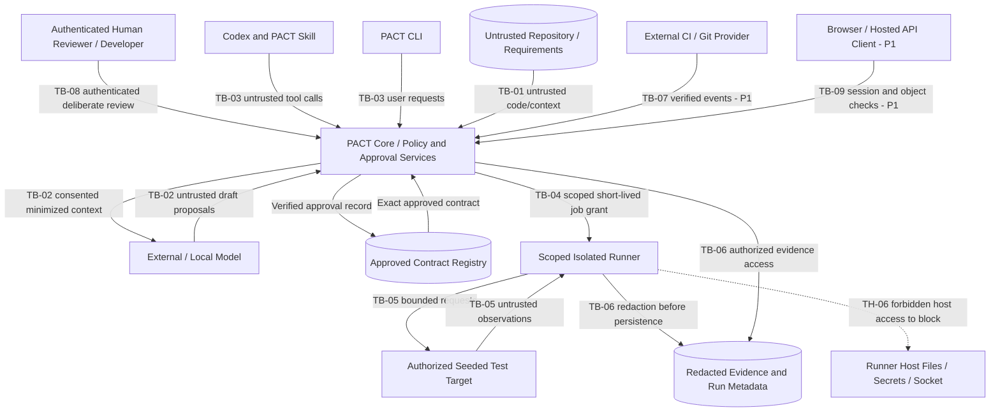
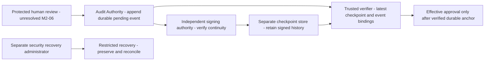

# PACT Security — Security Policy, Threat Model & Secure Engineering Standard

> **Canonical repository path:** `docs/SECURITY.md`  
> **Download alias:** `security.md` (same content; keep only the canonical copy in the repository)  
> **Document version:** 1.0.3
> **Created:** 2026-10-10  
> **Reviewed draft updated:** 2026-10-11 (scoped M2-07 audit storage direction; final human sign-off pending)
> **Status:** **DRAFT / REVIEW REQUIRED** — security architecture and controls are specified but not proven implemented  
> **Product:** PACT Security, an authorization-intent verification platform  
> **Primary audience:** Engineering, product security, AI coding agents, reviewers, DevOps, incident responders  
> **Related work item:** `M0-02` in `docs/ARCHITECTURE.md` (requires completed `M0-01` and reviewer sign-off)  
> **Requirement trace:** PRD §§6–13; `NFR-SEC-001`–`007`, `NFR-PRV-001`–`002`, `NFR-REL-001`–`002`, `NFR-OBS-001`–`002`, and relevant `AC-001`–`017`.

---

## 0. Purpose, authority, and reading instructions

PACT tests whether an application's behavior matches an **authenticated human-approved authorization contract**. A security product with permission to execute API requests, inspect source code, and store evidence creates serious risks of its own. This document defines required security boundaries, prohibited shortcuts, security design controls, adversarial test cases, and response procedures.

**PACT does not certify that an entire application is secure.** Its evidence is scoped to the approved contract, tested scenarios, environment, fixtures, and observed behavior.

### 0.1 Source-of-truth hierarchy

1. Applicable law, execution authorization, platform safety constraints, and current explicit owner decisions.
2. `PRD.MD`: product behavior, release scope, normative requirements, acceptance criteria.
3. Accepted `docs/adr/*.md`: formally reviewed implementation decisions within PRD constraints.
4. `AGENTS.md`: agent instructions; `workflow.md`: autonomy, permission, stop, and completion gates.
5. **This document:** security controls, threat model, and procedures. It cannot grant permissions by itself.
6. `docs/ARCHITECTURE.md`: implementation modules/WBS and proposed stack; `skill.md`: reusable workflows; `todo.md`: **observed** task status and evidence, not authorization.

If requirements conflict, **stop the risky action**, document the discrepancy, and ask the authorized owner/reviewer to resolve it. A copied approval flag, issue checkbox, model statement, or Markdown note never grants a runtime privilege.

### 0.2 Normative language and maturity

- **MUST / MUST NOT:** security invariant for the designated release or operation.
- **SHOULD:** required unless a documented, reviewed exception is justified.
- **MAY:** optional enhancement.
- **P0:** local deterministic verification, real approval, CLI/MCP security boundary, minimal privacy.
- **P1:** hosted control plane, organizations/RBAC, remote/private runners, CI integration, retention, enterprise controls.
- **PROPOSED:** architecture option pending ADR or owner decision; **not an accepted production control**.
- **IMPLEMENTED / VERIFIED:** may only be used with linked code, tests, reviewer evidence, and recorded build version.

The default state of every control in this document is **specified, not verified**. Do not mark `M0-02` or any implementation task `DONE` just because this document exists.

### 0.3 Out of scope / explicit prohibitions

PACT is **not** an unrestricted public-target pentester, autonomous exploitation framework, arbitrary shell runner, DDoS simulator, credential harvester, or source-code exfiltration tool. No documentation here grants permission to test third-party domains, access production data, bypass user consent, or publish sensitive findings.

### 0.4 M0-02 observed baseline and review scope

M0-01 is `DONE` with inventory evidence `EV-0001` in [todo.md](../todo.md) and [REPOSITORY_INVENTORY.md](REPOSITORY_INVENTORY.md). M0-02 intake on 2026-10-10 found 12 Markdown files and six project directories, Git **not initialized**, and no application packages, tests, build configuration, ADR files or accepted decisions. Git metadata appeared externally during this review; read-only inspection found branch `main`, commit `ddf945dad8e7aaab0b052a22f37f57d3e0373295`, containing the intermediate draft. Final working-file changes and their digest are recorded in `todo.md`; Codex performed no Git initialization, fetch, commit or push. Components in §2 and the diagram below are **planned**. All `TH-01`–`TH-20` have **no implementation or executable-test mapping yet**; future task references are handoff targets, not code evidence.

The original M0-02 review changed this document and the tracker. During M0-03, the developer requested M0-02 clarifications and confirmed the bounded scope: finish ADR-0001 plus these documentation clarifications; leave other ADR drafts for separate prompts. The developer explicitly requested changes before sign-off. This revision clarifies mandatory TB-08, proposed TB-09 and the runner isolation assumptions; it does not accept DSL, approval or runner semantics. **Sign-off on the final document is still pending**. Current and historical SHA-256 review digests are recorded in `todo.md`, not treated as approval proof.

---

### 0.5 Scoped audit decision — 2026-10-11

The developer selected Dedicated Audit Authority + Append-Only Audit Log + Independently Signed Checkpoints for M2-07 storage, with anchored activation, fail-closed integrity checks and restricted recovery. This is a required design direction, **not** acceptance of all ADR-0003, M0-02 security sign-off, actual control verification, a contract/target/privilege grant or account/key/cloud provisioning. [ADR-0003 v0.2 §6](adr/0003-human-approval.md#6-immutable-snapshots-and-append-only-audit) and todo.md EV-0034 record scope. Existing human identity/user-presence questions stay separate. Pure candidate/model/parser/fake-provider code and scoped77 unit results exist (EV-0033); protected audit/review/execution/privacy controls remain absent. The §0.4 intake is historical. Unchanged selected storage choices will not be resubmitted without material new evidence.

## 1. Security objectives and protected invariants

| Objective ID | Mandatory invariant | How it is evidenced |
|---|---|---|
| `SI-01` | Security intent derives from an authenticated human-approved contract; not LLM output or code inference. | Approval identity, canonical digest/version, immutable history, negative forgery tests. |
| `SI-02` | No test runs outside an independently authorized, bounded target scope. | Scope receipts, network policy enforcement, blocked-request tests. |
| `SI-03` | Model-generated content has **zero direct execution authority**. | Typed restricted DSL, no `eval`/shell execution, adversarial payload tests. |
| `SI-04` | Verification verdicts derive from actual controlled assertions, not narrative confidence. | Normalized run evidence, assertion trace, error-path tests. |
| `SI-05` | Secrets and private customer data do not flow to prompts, logs, or reports without explicit, appropriate consent and safeguards. | Canary secret tests, redaction checks, egress event audit. |
| `SI-06` | Every environment/run and tenant boundary remains isolated. | Independent sessions, tenant IDOR checks, scoped runner credentials. |
| `SI-07` | Historical approved contracts and failing evidence are not silently rewritten. | Immutable versions, integrity metadata, version diff audit. |
| `SI-08` | Loss of tooling, authorization, fixtures, network, or model output does not produce a false PASS. | Fail-closed transition tests and error taxonomy. |
| `SI-09` | Only the minimum privileges needed for a scoped operation are active. | RBAC and tool permission tests, job TTL, sandbox policy. |
| `SI-10` | Development and incident reporting remain truthful and reproducible. | Actual commands, test artifacts, Git state, `todo.md` evidence references. |

For tests that exercise intentionally vulnerable samples, use **synthetic identities/data** and a clearly isolated disposable application.

---

## 2. System model, assets, and data classification

### 2.1 Architectural components in scope

- **Client surfaces:** Codex Skill, MCP adapter, PACT CLI, eventual web console and CI integrations.
- **PACT Core:** project/context reader, authorization domain, intent compiler, contract registry, approval service, scenario planner, evidence and drift services.
- **AI Provider Adapter:** optional external inference providers (OpenAI, Gemini, Claude) or opted-in local model; no silent cloud fallback.
- **Control plane (P1):** authenticated API, organization/project ownership, job scheduler, storage metadata, auditable decisions.
- **Execution plane:** locally isolated or customer-managed runner with short-lived credentials, fixture manager and restricted HTTP/assertion engine.
- **Authorized test target:** seeded local demo or explicitly permitted application and test environment.
- **Storage:** local SQLite/artefacts in P0; proposed PostgreSQL and encrypted object storage in P1.

### 2.2 High-value assets

| Asset | Sensitivity | Minimum protection |
|---|---|---|
| Reviewer identity and approval receipts | High integrity | Authenticated origin, digest binding, replay resistance, audit. |
| Approved contract and versions | High integrity | Canonical hash, immutable versions, RBAC, history. |
| Runner target grants and job tokens | High confidentiality and integrity | Short TTL, narrow scope, protected transport, revocation. |
| API keys, cookies, credentials, tokens | Secret | Secret manager/environment boundary; never log, prompt, or commit. |
| Repository source, security requirements and metadata | Confidential by default | Read only required files; provider-specific egress consent. |
| Fixture identities and target application state | Confidential and integrity sensitive | Synthetic defaults, independent sessions, cleanup. |
| Verification observations and vulnerability findings | Sensitive | Redaction, tenant scoping, retention limits, private sharing. |
| Audit records, job/commit provenance | High integrity | Append events, integrity references, controlled access. |
| CI integration tokens, signing secrets | Secret | Installation/repo scope, rotation, verified hooks. |

### 2.3 Data classes and provider-egress policy

| Class | Examples | External model policy |
|---|---|---|
| `PUBLIC` | Public framework docs or deliberately public examples | May transmit only when provider use is configured. |
| `INTERNAL` | Project names, route names, nonsensitive requirements | Explicit project-level provider opt-in, minimum necessary. |
| `CONFIDENTIAL` | Private source excerpts, contract details, sensitive findings | Explicit destination/data-class approval and minimization. |
| `RESTRICTED` | Credentials, bearer tokens, personal records, private keys, raw private response bodies | **Do not transmit** to models; remove or replace with safe synthetic placeholders. |

Classifications apply to **source content and derived output**. A summarization of secret material can still be sensitive. Respect customer-specific rules that are stricter than this table.

---

## 3. Threat actors and trust boundaries

### 3.1 Threat actors and assumptions

- **Untrusted repository contributor:** plants malicious instructions in READMEs, comments, dependencies, test fixtures, or package scripts.
- **Malicious/compromised target:** returns crafted HTTP bodies, redirects, or misleading error responses.
- **Unauthorized tool caller:** attempts to invoke privileged MCP/API operations through prompts or spoofed parameters.
- **Compromised developer token/provider key:** abuses connected scopes or captures sensitive code.
- **Malicious/compromised runner or CI system:** forges evidence, expands target scope, or submits replayed results.
- **Cross-tenant actor:** enumerates contract IDs, job IDs, artifact URLs, or misuses role membership.
- **Supply-chain attacker:** compromises a package, action, container image, SDK, or plugin manifest.
- **Unintentional operator mistakes:** broad allowlists, mistaken reviewer approval, excessive logging, or accidental production target selection.

**Assume:** code repositories, LLM responses, target HTTP responses and third-party tool descriptions can be adversarial. A valid transport connection does not make content authoritative.

### 3.2 Trust-boundary diagram

Proposed data flows and enforcement points, **not a deployed system**. Browser/API and CI are P1; runner-host access is an attack path to block, not a permitted flow.



### 3.3 Boundary register

| Boundary | Risk | Required enforcement owner |
|---|---|---|
| `TB-01` Repository → Context Reader | Prompt injection, secrets ingestion, malicious file traversal | Scoped source reader; safe filters and provenance. |
| `TB-02` Context → AI Provider | Undisclosed code transfer and model misbehavior | Provider gateway; consent, classification, redaction. |
| `TB-03` Codex/MCP/CLI → Core | Tool-call authority confusion, self-approval, parameter tampering | PACT service-side auth, validation and privileges. |
| `TB-04` Control Plane → Runner | Forged jobs, scope escalation, replay, credential misuse | Scheduler/runner mutually authenticated scoped job authorization. |
| `TB-05` Runner → Target | SSRF, redirects, DNS rebinding, unintended writes | Network guard, allowed destinations, transport budgets. |
| `TB-06` Runner/Evidence → Storage | Secrets leakage, cross-tenant access, manipulated reports | Sanitizer, metadata integrity, object access policy. |
| `TB-07` CI/Git provider → Control Plane | Forged webhook, event replay, repository substitution | Signature verification, installation and repository binding. |
| `TB-08` Human → Approval | Forged reviewer, stale/replayed approval, agent impersonation | Authenticated deliberate human action bound to exact contract bytes, project and scope; trusted receipt validation. |
| `TB-09` Browser → Hosted API (P1; proposed label) | Session hijack, CSRF, IDOR, privilege escalation | Auth/session service, server-side RBAC, browser protections. |

No boundary is secured simply by naming a service, installing Docker, or writing a prompt. **Enforcement must exist in code and be tested.**

`TB-01`–`TB-08` now use Architecture §2.4 identities. The former conflicting browser label is retained as proposed `TB-09`; human review of this numbering and the runner isolation envelope remains required. The `TH-06` host attack path crosses that envelope (§10.4); its process/container enforcement is unresolved in ADR-0002, not implied by the diagram.

**TB-08 is mandatory.** The developer reaffirmed this requirement during review: AI agents must never self-approve Security Contracts, privileged operations, execution scopes or sensitive changes. Tool callers, browsers, CI and runners cannot authenticate themselves as the human reviewer by submitting an identity/status field. Exact human-review mechanics are still open in ADR-0003; no approval mechanism is implemented. This confirmed requirement is separate from final sign-off on the model.

### 3.4 Required attacker paths and paired verification handoff

Every row is a **design risk**, not a reproduced vulnerability. All code/test paths are absent in the observed baseline. Positive and negative cases below are planned for synthetic fixtures after the named design gates; none was executed during M0-02.

| Required risk / IDs | Attacker entry → asset / boundaries | Required control and positive case | Negative/error case and future evidence |
|---|---|---|---|
| Injection: `TH-01`, `TH-02`, `TH-20` | Repository or target instructions → context/model/tool calls → contract authority or secrets; `TB-01/02/03/05` | Treat text as data; accept a schema-valid non-authoritative draft while preserving provenance | Malicious README/response cannot grant scope, leak a canary or override a verdict; SEC-T001/002/024; M2-02/05, M3; NFR-SEC-003/004 |
| Forged review: `TH-03`, `TH-15` | Imported approval field or impersonated tool caller → approval registry/job; `TB-03/04/08` | Genuine reviewer action binds immutable bytes, identity and project; separate target grant; ADR-0003 then M2-06/07 | Draft, forged status, stale digest, wrong project/reviewer or replay cannot dispatch; SEC-T003/004/017; NFR-SEC-001 |
| SSRF: `TH-04`, `TH-13` | Crafted URL, redirect or DNS change → runner network/credentials/target; `TB-04/05` | Explicit seeded origin with valid contract/fixture/grant runs within configured budgets; ADR-0002 then M1-07 | Reject disallowed resolved IP/port/protocol, out-of-scope hop and rebinding before connection; halt exceeded budgets with sanitized reason; SEC-T005/006/012; NFR-SEC-001/005 |
| Runner escape: `TH-05`, `TH-06`, `TH-17` | Executable DSL or malicious fixture/target → runner host/secrets/state; `TB-04/05`, isolation envelope | Allow only typed operations in disposable bounded execution; valid fixture setup/run/teardown succeeds; ADR-0002 then M1-05/07/12 (P0), private isolation M5 (P1) | Reject arbitrary code, traversal, host mounts/socket, undeclared network and persistent writes; verify cleanup/cancellation; SEC-T007/013/021; NFR-SEC-004/005 |
| Leaked evidence: `TH-07`, `TH-10`, `TH-16`, `TH-18` | Response/error/provider snippet or artifact request → credentials/private evidence; `TB-02/06/09` | Persist useful reproducible redacted metadata; approved provider receives only consented context; M1-09/10, M2-03, M5 | Canary absent from logs/JSON/HTML/prompts; unapproved fallback blocked; altered or unauthorized artifact rejected; SEC-T011/016/020/022; NFR-SEC-002 (P0), NFR-SEC-006 (P1) |
| Tenant IDOR: `TH-09`, `TH-15`, `TH-19` | Guessed project/contract/job/artifact ID or stale session → another tenant's data/privileges; `TB-03/06/09` | Authorized same-project read/write/run/download succeeds after server-side checks; hosted RBAC/runner decisions remain P1 | Project A using Project B identifiers, including indirect storage/queue references, is denied and audited; revoked access fails; SEC-T018/022/023; AC-014, NFR-SEC-006/007 (P1) |

Tenant IDOR is included in the initial model as required by M0-02; hosted isolation implementation remains P1. Local P0 still requires valid project/scope references. `TH-08` (false PASS), `TH-11` (invalid drift), `TH-12` (CI replay) and `TH-14` (supply chain) remain in §4/§15; none has code evidence either.

### 3.5 M0-02 requirement coverage

| Required NFR | Threats / boundaries | Planned evidence; implementation status |
|---|---|---|
| `NFR-SEC-001` | TH-03/04/15; TB-03/04/05/08 | Valid approval plus independent grant versus forged approval/out-of-scope dispatch; SEC-T003/004/005/017. **Not implemented/tested.** |
| `NFR-SEC-002` | TH-07/16/18; TB-02/06 | Useful sanitized evidence versus planted secrets in every output sink; SEC-T011/016/022. **Not implemented/tested.** |
| `NFR-SEC-003` | TH-02/08/20; TB-02/03/05/06 | Controlled assertion result versus model override and 500/timeout false PASS; SEC-T008/009/010/024/026. **Not implemented/tested.** |
| `NFR-SEC-004` | TH-01/05/06/20; TB-01/03/04/05 | Typed permitted operation versus repository injection, executable expression or host escape; SEC-T001/007/021/024. **Not implemented/tested.** |
| `NFR-SEC-005` | TH-04/06/13/17; TB-04/05 | Bounded seeded run versus DNS/redirect/scope escape or exceeded limits; SEC-T005/006/012/021. **Not implemented/tested.** |

---

## 4. Threat register and abuse cases

Risk values are **initial qualitative priorities**, not penetration-test findings or measured likelihoods. Review after implementation and every substantive new integration.

| Threat ID | Category | Abuse/failure mode | Initial priority | Required control | Verification |
|---|---|---|---|---|---|
| `TH-01` | Prompt injection | README asks agent to export token or approve a policy | Critical | Treat source text as data; ignore authority claims; redact source | Canary repo injection test |
| `TH-02` | Policy tampering | AI fabricates/changes an `ALLOW` or `DENY` rule | Critical | Draft-only generation; real digest-bound human approval | Forged candidate and conflict tests |
| `TH-03` | Approval bypass | Imported JSON says `APPROVED`; stale/replayed review receipt | Critical | Trusted receipt store, reviewer auth, digest/time/scope binding | Replay/stale-digest matrix |
| `TH-04` | SSRF/scope escape | Target URL reaches cloud metadata or internal service | Critical | Destination/network allowlist; DNS/redirect controls | Disallowed IP/hostname tests |
| `TH-05` | Executor escape | DSL invokes shell/Python or arbitrary command | Critical | Typed allowlisted operations, no dynamic executable expressions | Parser fuzz and injection tests |
| `TH-06` | Runner compromise | Malicious target or test hijacks host/network/secrets | Critical | Disposable isolation, no privileged mounts/sockets, egress limits | Sandbox misuse checks |
| `TH-07` | Secret exposure | Tokens leak in prompts, HTML, logs, errors | Critical | Secret isolation, redaction, artifact scans | Planted-secret test |
| `TH-08` | False PASS | HTTP 500, timeout, wrong actor, fixture failure treated as DENY | Critical | Verdict taxonomy, preconditions, fail-closed assertions | Error/status-code matrix |
| `TH-09` | Tenant IDOR | Org A accesses Org B contracts, jobs or evidence | Critical (P1) | Organization-scoped auth on every resource and object | Cross-tenant API tests |
| `TH-10` | Evidence forgery | Job result or report modified to hide failure | High | Run IDs, provenance, integrity digests, controlled result ingestion | Forged submission/hash tests |
| `TH-11` | Drift confusion | Changed policy or fixture mislabeled implementation regression | High | Run compatibility evaluator and explicit classification | Different-contract/environment tests |
| `TH-12` | CI webhook spoof/replay | Untrusted Git event starts tests or changes scopes | High (P1) | Signed events, timestamp/replay checks, repo mapping | Webhook forgery tests |
| `TH-13` | Denial of service | Excessive tests/LLM loops consume target or resources | High | Request/time/concurrency/token budgets and cancellation | Resource exhaustion tests |
| `TH-14` | Supply-chain compromise | Dependency or build action executes untrusted code | High | Pinned dependencies, provenance reviews, scanning | CI supply-chain gate |
| `TH-15` | Identity confusion | Developer, agent, runner and reviewer privileges conflated | Critical | Service identities and deny-by-default RBAC | Cross-role permission tests |
| `TH-16` | Provider egress drift | Silent fallback sends code to an unapproved provider | High | Provider opt-in; fallback off; logged destinations | Network-deny and fallback tests |
| `TH-17` | Destructive fixtures | Write tests alter non-disposable data | High | Synthetic target, scoped mutations, teardown/rollback | Teardown and rollback tests |
| `TH-18` | Confidentiality leak | Signed/shareable evidence URL exposed or indexed | High (P1) | Private objects, short-lived access, auth on metadata/download | Cross-user URL tests |
| `TH-19` | Session abuse | Browser/API credentials reused after revocation | High (P1) | Re-auth on sensitive actions, session expiry/revocation | Session lifecycle tests |
| `TH-20` | Target instruction spoofing | API response supplies new tool directions to agent | High | Responses treated as observations, not instructions | Malicious response tests |

**Risk acceptance rule:** a developer may document residual risk, but cannot mark a critical boundary "secure" without tests and required reviewer decisions. Unresolved critical issues block affected releases or execution paths.

---

## 5. Actor permissions and separation of duties

### 5.1 Roles (proposal; exact P1 matrix requires ADR)

- **Project Developer:** may propose contract, configure **nonprivileged** fixtures and view authorized results.
- **Security Reviewer / authorized Owner:** may review exact contract revisions and approve security policy changes after authentic login.
- **Org Administrator (P1):** may grant project membership, manage provider consent, runner environments and retention within organization policy.
- **Runner Identity:** may accept one scoped job and submit results for that job; never approve contracts or configure its own scope.
- **MCP/AI Agent Identity:** may inspect, propose, plan, and request verification; cannot impersonate a human reviewer or bypass execution scope.
- **External CI Identity (P1):** may trigger only assigned repository/branch/project checks under preapproved policy.

### 5.2 High-risk operations

| Operation | AI directly? | Trusted authorization |
|---|---|---|
| Inspect permitted repository files | Yes, scoped | Existing developer workspace permission |
| Propose contract or scenario | Yes | Typed draft-only privileges |
| Approve/reject/supersede live contract | **No** | Authenticated human review with content digest |
| Launch scoped local seeded run | After existing verified approval | Independent service-side scope validation |
| Change target allowlist, runner egress or privileges | **No** | Human approval and security review (`workflow.md` G-03/G-04) |
| Send source to a new external model provider | **No silently** | Explicit provider/data-class egress authorization (G-05) |
| Change or delete evidence and audit retention | **No** | Approved retention/migration plan (G-06/G-07) |
| Push/merge/deploy or change production security settings | **No by default** | Specific owner authorization (G-08) |

The model must not be able to call an MCP `approve_contract` action that impersonates a human. An MCP action may **create an approval request**; human review occurs in a separate authenticated interface.

### 5.3 Review separation

For changes affecting the approval implementation, runner scope, isolation policy, evidence integrity, or provider egress, require **independent security review where feasible**. The author of AI-generated changes must not be assumed to be their security approver.

---

## 6. Contract lifecycle and authoritative approval

### 6.1 Contract state machine

`DRAFT → NEEDS_REVIEW → APPROVED` or `REJECTED`. Historical `APPROVED` versions may later become `SUPERSEDED`/`DEPRECATED`; original bytes and review evidence remain protected under retention policy. Modifying a contract creates a **new draft version**, never an in-place edit.

### 6.2 Valid approval receipt (conceptual)

A trusted approval event must bind at minimum:

- Authenticated reviewer principal and permitted role.
- Project/organization and target-scope identifiers.
- Canonical contract serialization, schema version and strong digest.
- Exact contract version and proposed decision.
- Approval timestamp and unique replay-resistant event/reference.
- Provenance of interactive review and applicable auth/session checks.

**Do not accept** a client-supplied `approved: true`, imported `status: APPROVED`, forged email, agent conversation, tracker checkbox, CI environment variable, or merely knowing the hash as evidence of approval.

### 6.3 Trusted enforcement

- A security-critical approval is ineffective until its immutable decision event is durably committed and anchored by an independently retained signed checkpoint; a DB row/status/hash or pending checkpoint is insufficient. Recheck current reviewer/scope eligibility at activation and later use. Checkpoint availability/integrity uncertainty blocks new approvals and dependent privileged operations, with no unanchored fallback.

- Before creating a runnable job, verify the contract's trusted approval record **and** project/scope grant. Store immutable snapshot identifiers in the job.
- Reject expired/revoked reviewer permissions or inconsistent digest/version/tenant references according to documented semantics.
- Model output may never alter `APPROVED` state or grant permissions.
- A human's intentional policy change requires review and a new version; prior failing evidence remains visible.
- Design local CLI approval via an actual terminal-user interaction with binding/receipt mechanics described in **ADR-0003**; hosted signing/attestation is a separate design decision.

### 6.4 Negative tests (mandatory)

1. Fake `APPROVED` JSON import.
2. Contract altered after reviewer accepted its hash.
3. Replayed receipt for a different contract/project/scope.
4. Wrong reviewer or a revoked reviewer.
5. Duplicate conflicting approvals / invalid state transitions.
6. Agent calling all available tools to bypass human approval.
7. A run request using a draft or ambiguous `NEEDS_REVIEW` contract.

---

### 6.5 Selected audit authority, checkpoint and recovery boundaries

These are selected design requirements, not installed services or approved trust-boundary enforcement. Dedicated Audit Authority owns the audit store. Separate append permission from administration, checkpoint signing, independent checkpoint retention and exceptional recovery. Agents/runners/ordinary processes/untrusted code cannot modify/delete historical records; authorized submissions use bounded authenticated interfaces and cannot invent reviewer identity. Signer keys belong to separate signing authority/managed KMS, inaccessible to agents/runners. Checkpoints are outside the audit DB under separately controlled principal; hosted deployment should use WORM-capable immutable storage/versioning/retention protection after service/retention authorization. SQL constraints alone do not protect against a privileged DB administrator or compromised service account.



Canonical versioned events bind stream/org/project, monotonically increasing sequence, previous hash/content hash, actor/action/reviewer when authenticated, approval version/content digest, scope/digest, UTC timestamp/outcome/correlation. Revocation/supersession append events; retain original approval/evidence. Pending revocation or unknown current eligibility cannot reuse an older anchored approval to admit new privilege.

Signed checkpoints bind stream, last committed sequence, chain tip, creation time and key ID/signature. A reviewed protocol must add namespace/generation/history/freshness protections, canonical signed bytes and independently verified key trust so an old valid signed checkpoint cannot be passed as latest. Signer verifies authorized durable append and protected history, not an arbitrary submitted tip. A signature proves neither human action nor project membership; approval remains separate from target execution permission. Exact cryptography/byte format/key rotation/revocation, secure latest discovery, backend/OS/ACLs and crash-safe commit->anchor->activation remain unresolved implementation decisions. No cross-store transaction guarantee or hostile signer/admin resistance is claimed.

Before activation or dependent privileged use, verify canonical events/sequence/links against latest independently trusted checkpoint/history. Detect changed/deleted/missing/replayed/reordered events, gaps, invalid signatures/keys, stale/conflicting/missing checkpoints, sequence rollback and old DB restore. Unanchored suffix cannot authorize approval. If integrity or checkpoint authority availability is uncertain, use **REGISTRY_DISABLED** or equivalent: block new privilege, withhold trust, preserve forensic evidence and surface sanitized failure. If audit writing is unavailable, use protected incident reporting where available and do not claim a durable event exists from a local message.

Recovery enters restricted state, uses protected backups, verifies event chain/sequence and reconciles latest independent checkpoint history, identifies missing/unanchored events, and preserves recovery evidence. Exceptional recovery needs separate designated security-administrator authorization. No automatic history reset/new trusted genesis; inability to reconstruct latest trusted history leaves approvals disabled. Retention/deletion or key/provisioning changes require their own authorization.

Local development uses synthetic events/test-only signing identities. A same-user writable DB/checkpoint/key arrangement can test detector behavior, not establish strong tamper/rollback resistance; keep real privileged approval REGISTRY_DISABLED. Required AU-01..10 tests in [TEST_PLAN §11](TEST_PLAN.md#11-selected-audit-architecture-and-required-verification) distinguish local mock detection from separately authorized protected deployment tests; all are NOT RUN. This adds no target/provider/hosted access.

## 7. AI, prompt injection, and model-provider security

### 7.1 Allowed responsibility of AI

AI MAY analyze relevant source context, propose a typed contract, identify unresolved policy questions, propose candidate scenarios, summarize already-observed findings, and suggest patches. AI MUST NOT unilaterally approve contracts, authorize targets, execute arbitrary shell commands inside the PACT runner, alter expected policy to match observed code, or label a finding verified without validated test evidence.

### 7.2 Untrusted prompt surfaces

Treat the following as **data only**: repo docs/README/comments, package metadata, Git issues/PR comments, framework docs, target HTTP bodies/headers, tool outputs, serialized artifacts, and any LLM response. Embed quoted content with source provenance and clear role separation; do not follow instructions embedded in those sources.

### 7.3 Context reader protections

- Enforce project-root boundary; normalize paths, reject traversal and disallowed symlinks; restrict file types and size.
- Exclude `.env`, key material, secrets, local caches, build outputs, private dumps, and unrelated directories by default.
- Validate all extracted snippets are necessary for the task and carry filename/line references where supported.
- Never reveal system instructions, provider keys, sandbox paths containing private user data, or unrelated code in model context.
- Limit model response sizes and reject malformed or untyped objects.

### 7.4 Provider gateway protections

- External provider **disabled unless specifically configured/consented to**, including class of data, destination, purpose, and allowed project.
- No silent provider switching/fallback; fail with a typed actionable error if unavailable.
- No raw secrets or restricted data may be transmitted even if a broad provider is enabled.
- Track sanitized provider, model/version, request purpose, approximate usage and retry count; never record secret prompts or full sensitive completions in logs.
- Bound input size, output tokens, retries, timeouts and total cost budgets.
- Use narrow SDK permissions; apply normal TLS certificate validation and provider-specific auth handling.
- Local model mode must not silently download model weights or change network egress policy without user authorization.

### 7.5 Poisoned-model-output handling

A model response is **candidate data**, not executable instructions. Parse through a strict Pydantic/schema validator with explicit versions, deny extra privileged fields, validate predicate vocabulary and path/URL references, and route unclear/conflicting rules to `NEEDS_REVIEW`. Log a typed failure; do not invent `ALLOW` or `DENY` to close ambiguity.

---

## 8. CLI, MCP, REST, and Codex integration security

### 8.1 Shared core rules

All adapters MUST use the same policy/approval/executor application services. Moving a request from CLI to MCP or web must **not** grant additional authority or change verdict meaning. Validate schema, project identity, scope and permission server-side before any side effect.

### 8.2 Codex skill and MCP

- Skill text describes workflows; it is not a trusted credential or authorization proof.
- MCP tool declarations, names, output strings and arguments are all untrusted requests at the Core boundary.
- Expose separate operations for **draft proposal**, **review request**, **scenario plan**, **run request**, **status**, **evidence read**, and **run comparison**.
- Do **not** expose a tool that lets AI approve its own contract, grant a new target scope, disable network guards, or change secrets policies.
- Local stdio MCP should inherit only necessary user permissions; hosted MCP (P1) requires explicit caller authentication and per-tool authorization.
- Tool arguments must have allowlisted structured schemas and size limits. Human-readable tool output must not contain tokens or private artifacts.
- Fail closed if connecting/handshaking with MCP does not establish expected workspace/project identity.

### 8.3 Hosted REST/API and web (P1)

- Authenticate all nonpublic endpoints, apply organization/project/resource RBAC and reject direct-object ID substitutions.
- Prevent mass assignment: privileged fields (`approval_status`, `org_id`, runner scope, owner IDs) cannot be directly set by untrusted request JSON.
- Guard browser sessions using secure cookies, correct SameSite strategy, CSRF protection where required, expiry/revocation and sensible reauthentication for sensitive operations.
- Configure restrictive CORS and content-security policy; output encode user-controlled HTML/report data.
- Rate-limit risky endpoints, use pagination/access checks, and sanitize error messages (do not leak object existence across tenants).
- Verify authorization again at evidence download time; avoid long-lived public signed URLs.
- Publish API versions and compatibility guarantees after ADR approval, not via undocumented assumptions.

### 8.4 CI and Git provider (P1)

- Verify webhook signature against a protected secret and reject stale/replayed events.
- Bind installation identity to allowed organization, repository, branch and project.
- Treat PR content as untrusted code/data; do not allow PR text to change security policy or promote execution privileges.
- Default advisory status; enforce merge blocking only when authorized admin configures it.
- Keep CI permissions minimal; avoid broad write tokens for read-only checks.

### 8.5 TB-09 Browser/API scope and channel separation (proposed, P1)

TB-09 separates an untrusted browser/client from the authenticated hosted API. The browser supplies requests, identifiers and displayed content; it cannot grant identity, project membership, reviewer authority, target scope or outbound destinations. The API must check those independently at every operation, including indirect job, contract and artifact references. Browser sessions, target synthetic sessions, provider credentials and runner tokens are distinct identities.

| Channel | Required destination and authority | Denial/error and validation evidence to plan |
|---|---|---|
| Browser → hosted API | Only the explicitly configured deployment origin over TLS; authenticate sessions and enforce project/role/object authorization server-side. Local development origin must be separately declared; no wildcard origin consent. | Forged reviewer/project IDs, missing or revoked session, CSRF and cross-origin privileged request rejected; valid authorized same-project action succeeds. |
| Hosted API → identity provider (if selected) | Only the approved issuer/discovery/key origins; validate issuer, audience, token signature, expiry and reviewer privilege using a reviewed identity design. A user-supplied issuer/URL is not an egress grant. | Foreign issuer/audience, forged identity, expired token or unapproved discovery destination denied; stale privilege cannot approve. |
| Hosted API → runner/storage | Explicit approved service endpoints with scoped identities, private objects and project/job binding; browser-supplied artifact URLs or runner hosts cannot choose destinations. | Guessed artifact/job IDs and cross-project object pointers denied at metadata and download; signed URLs alone do not replace authorization. |
| Runner → target | Separate TB-04/TB-05 authorization; exact approved origin, resolved IP and port, operations and budgets, independent of browser CORS/API origin. | Address substitution, redirect/rebinding outside grant or unsupported scheme blocked before outbound connection; no credential forwarding. |
| API/context → external provider | No transmission unless G-05 authorizes the exact provider, destination, project, data class and purpose; restricted secrets remain prohibited. | Unapproved provider/fallback and unsolicited code/evidence transfer denied; approved minimal redacted context only. |

All server-side URL use requires normalized scheme/host/port validation, resolved-destination enforcement at connection time, bounded requests and no automatic redirects. Explicitly authorized redirects, if later supported, require per-hop address/scope checks and credential stripping across origins. Identity/storage callbacks and remote imports are SSRF surfaces too; a legitimate browser origin does not authorize server egress. Unselected channels remain disabled, not open to arbitrary hosts. Actual origin/issuer/address values and redirect exceptions remain owner-reviewed configuration decisions; **none is authorized by this table**.

Use secure session cookies with an explicit SameSite/CSRF design, reauthentication for privileged human review, session revocation and restrictive CORS. Report rendering must encode untrusted content and prevent embedded scripts, external images, tracking requests or referrer leaks from exporting sensitive evidence; adopt a reviewed CSP and private download behavior. No analytics, telemetry, CDN or model data transfer is enabled by default. This is a specification, not verified browser/session protection. Hosted identity, CSP/CORS, outbound destination registry and object-download design belong to ADR-0007/P1; provider egress remains ADR-0006/G-05.

---

## 9. Restricted scenario DSL and deterministic assertion engine

### 9.1 Allowed execution model

PACT scenarios comprise **schema-approved operations only**, initially `fixture.setup`, `http.request`, `assertion`, and `fixture.teardown`. Additional operations require a versioned specification, an approved ADR where trust boundaries change, targeted negative tests, and security review.

Never pass user/model input to `eval`, `exec`, unrestricted `subprocess`, shell strings, arbitrary Python imports, Jinja evaluation, or unbounded variable interpolation. Resolve only typed and explicitly declared fixture references. Reject path traversal and unknown operation/parameter values.

### 9.2 Positive and negative test pairing

A robust authorization suite requires both legitimate ALLOW cases and forbidden DENY cases with independent authenticated actors. Synthetic resources must have known ownership and verifiable protected attributes.

### 9.3 Verdict semantics

| Verdict | Required interpretation |
|---|---|
| `PASS` | All mandatory assertions observed expected behavior with valid setup, target, and evidence. |
| `VIOLATION` | Reproducible observation contradicts an approved rule. |
| `INCONCLUSIVE` | Partial/ambiguous evidence prevents proof either way. |
| `ERROR` | Infrastructure, scope, auth fixture, network or tool failure prevented a valid test. |
| `SKIPPED` | Deliberate omission with reason and coverage impact recorded. |
| `CANCELED` | Explicitly stopped before completion; never counted as passed. |

A `DENY` contract does not imply HTTP `403` exclusively. A non-disclosing `404` may be valid under the approved assertion profile. An HTTP `500`, timeout, corrupted session, missing fixture, or untrusted/incorrect user token is **not proof of a correct denial**. HTTP `200` returning protected data to the wrong actor is a `VIOLATION` when target/fixture/authorization prerequisites are verified.

A completed batch containing `ERROR`, `INCONCLUSIVE`, `SKIPPED`, or `CANCELED` tests must not be presented as universally green. Capture each test's verdict and the run's coverage limitations.

### 9.4 Test artifact safety

- Generated pytest exports may be treated as source code needing human review, but **must not be implicitly executed** as arbitrary code by the constrained scenario runner.
- Validate assertion profiles, fixture identities, requests and protected-field match rules before execution.
- Record request/response observations in normalized, scrubbed form; do not persist full private bodies by default.

---

## 10. Target authorization, request safety, and runner isolation

### 10.1 Independent target grants

Every runnable job MUST be associated with an authenticated execution authorization whose scope contains at least: project, target environment and allowed origin(s), credentials reference, method/operation restrictions where applicable, run/time/request limits, authorizing principal, and expiry/revocation conditions. **Contract approval and execution authorization are distinct permissions.**

A user saying "test this site" or a code comment containing a URL does not prove that the owner authorized PACT to test it. Default P0 to an intentionally seeded localhost/test container.

### 10.2 Destination and SSRF protection

- Normalize and validate scheme, host, port and allowed route before a request.
- Explicitly allow known local synthetic origins when running the seed demo; do not broadly allow every private, loopback, link-local, Unix socket, cloud metadata or internal host.
- Resolve the destination according to a network policy and enforce it **at connection time**, not only once at URL parse time. Resist DNS rebinding and unexpected address-family substitutions.
- Disable redirects by default. If authorized redirects are later allowed, validate each hop, resolved endpoint and final destination; do not forward sensitive credentials across untrusted origins.
- Block unsupported schemes, encoded-host tricks, wildcard allowlist abuses, path traversals and undesired proxy/environment routes.
- A correct implementation needs **network-level restrictions** where possible, not only string-based host checks.

### 10.3 Budgets, cancellation, and misuse throttles

Each job must have configured request count, concurrency, request-body/response-body size, wall-clock time, per-request timeout and retry limits. Reject oversized workloads before dispatch. Exceeding limits results in `ERROR`/cancellation as applicable, never `PASS`.

Provide operator cancellation; in P1, admin/reviewer revocation invalidates outstanding grants and stops active work within the configured propagation window. Do not assume a process stop is instantaneous without testing.

### 10.4 Container and process isolation

- Prefer disposable, non-root, least-privilege containers or dedicated local processes under a separate account with **explicit** network restrictions.
- Disable privileged mode, host PID/network namespaces, host mounts, Docker daemon socket, dangerous capabilities, and unnecessary device access by default.
- Use read-only root filesystem where feasible; bounded writable workspace for generated artifacts; no access to host `.env` or SSH keys.
- Limit CPU, memory, processes, open files, network and storage; cleanup fixture state after completion.
- Never assume Docker alone guarantees safety; hardening profiles and negative isolation tests are required.
- Model-generated scenario text cannot define Docker run flags, host mounts, startup scripts, or network policy.

#### 10.4.1 Isolation assumptions requiring ADR-0002/0007 review

The following is a proposed enforcement envelope, not proof that a container or separate process is secure. The restricted P0 runner must not inherit general developer workstation privileges. A local-process option needs an explicit OS/account/filesystem/network review; do not silently fall back to the current user or Docker's defaults if containment is unavailable. Hosted/private-runner requirements expand in P1.

| Isolation axis | Required constraint / proposed mechanism | Unresolved choice and negative evidence needed |
|---|---|---|
| Container/process boundary | Disposable separate execution identity; non-root container with namespaces and a reviewed syscall/security profile, or separately approved dedicated-account process. Target app and Core credentials remain separate. | Choose supported OS/runtime and hardening profile; test denied host/process access. Windows/container parity is unverified; stop affected execution if required isolation cannot be established. |
| Filesystem | Read-only image/root where supported; one bounded disposable writable workspace. No host home/repository/secret-directory mount, symlink escape, Docker socket, device or host PID namespace. Context inspection passes only a minimized approved snapshot through the context service. | Decide artifact transfer/ACL/path validation and writable limits; traversal/symlink/host-secret attempts fail, retained evidence is sanitized outside teardown scope. |
| Network | Default-deny outbound policy independently enforced; only granted target/service addresses, ports and protocols. No host networking, metadata service, arbitrary loopback/private range or ambient proxy trust. DNS/redirect guards operate at connection time. | Choose network enforcement and permitted DNS resolver path; test rebinding, alternate address family, proxies and forbidden socket/address access. A host-string check alone is insufficient. |
| Privileges/identity | No privileged mode, elevation, unnecessary capabilities, executable model payloads or secret-manager access; scoped short-lived target/job credentials only. AI/fixture data cannot set flags, mounts or scope. | Choose identity/grant expiry/revocation and secret injection; test scope/identity substitution and attempted privilege escalation. |
| Resources | Explicit approved CPU, memory, PID/process, open-file, workspace/output-byte, request, concurrency, response-byte and time limits; validate before start and enforce while running. | Numeric caps and runtime enforcement remain open; no absent/unlimited budget fallback. Limit breach records a sanitized non-PASS reason and triggers cancellation/cleanup. |
| Lifecycle/cleanup | Deterministic disposable fixtures; cleanup after success, failure, timeout and cancellation, including children, network handles, temporary tokens/workspace and target state. Revoke job grants; keep historical sanitized evidence. | Choose teardown ownership, propagation deadline and orphan recovery; inject failures and prove cleanup. Failed cleanup quarantines the environment and records ERROR; it cannot be treated as safe reuse. |
| Results | Authenticated job-bound typed results; redact before transfer/persistence; retain failures and distinguish unverified submissions. | P0 trusted local harness versus P1 compromised-runner assumptions/attestation need separate review; forged/replayed results cannot become trusted verdicts. |

Until these assumptions and tests are resolved, container escape, inherited host access, network pivot, resource exhaustion, orphaned state and result forgery remain open design risks (TH-04/06/07/10/13/17). Documentation approval does not itself grant runner execution. ADR-0002 settles P0 fixture/transport/isolation; ADR-0007 settles P1 private-runner/control-plane trust. Neither ADR file exists yet.

### 10.5 Fixture and state-change controls

- Prefer deterministic synthetic actors/resources; distinguish Seller A/B tokens and tenant membership.
- Initialize and clean fixtures with idempotent setup/teardown; use isolated test database, transactions or disposable environment snapshots.
- State-changing tests (grant, revoke, update, delete) require a nonproduction target, explicit permitted operations and cleanup/rollback.
- Credentials for distinct actors must be isolated and short-lived; failed fixture authentication produces `ERROR`, not a security observation.
- Provenance must include fixture adapter/version, seeded dataset hash, actor identity labels (not raw secrets), environment compatibility fingerprint and relevant clocks.

### 10.6 Untrusted runner results (P1)

Runner-to-control-plane submissions require authenticated job identity, scope/correlation and replay protection. Do not trust free-form runner text as proof; validate typed evidence and signatures/attestations where specified by ADR. Preserve unverified submissions separately from verified result records.

---

## 11. Evidence integrity, privacy, and drift classification

### 11.1 Evidence minimum schema (conceptual)

A persisted run must reference: `project_id`, `contract_id`, immutable approved contract digest/version, `scenario_id`/schema version, `run_id`, actor/resource fixture references, target/environment fingerprint, commit/source reference where available, run timestamps, assertion IDs, observed decision, verdict, sanitized observation, and error reason if applicable.

### 11.2 Evidence quality and confidentiality

- Store summaries needed to reproduce a result, not full raw responses by default.
- Redact cookies, Authorization headers, query tokens, bearer strings, passwords, access keys, personal records and secret canaries before **any** logging, serialization, metrics or external submission.
- Validate JSON/HTML output encoding; dangerous HTML must be escaped.
- Calculate integrity hashes over canonical redacted artifacts and retain lineage. A checksum detects accidental/tampered bytes **only when compared with a trusted reference**; it does not by itself make evidence tamperproof.
- Separate errors/uncertainty from confirmed violations; include fixture preconditions, exact test scope and limits in human-readable reports.
- Preserve previous failure artifacts and baseline run metadata; write new immutable result versions instead of editing history.

### 11.3 Drift classification

Only report **possible implementation authorization drift** when a prior `PASS` becomes a valid `VIOLATION` under the **same immutable approved contract** and comparable scenario version, actor/resource semantics, environment and assertion profile. Different policy versions or incompatible fixtures/environment lead to `NOT_COMPARABLE` or explicit reviewer assessment. A policy change is **not** evidence of an unauthorized regression.

### 11.4 Data retention and deletion (P1)

Retention durations, legal holds, backups, deletions and cryptographic attestation **must be set through owner-reviewed policies/ADRs** before production claims. Design for organization/project-scoped export, deletion and audits with known protected exceptions. No invented default retention period is binding in this draft.

---

## 12. Hosted SaaS, multi-tenancy and identity (P1)

- Every project, contract, review, job, event and evidence object must have validated organization/project ownership enforced **server-side** on every read and write.
- Never trust `org_id`, `project_id`, reviewer ID or role supplied solely by a client or LLM.
- For PostgreSQL, evaluate Row Level Security as defense in depth, but do not treat RLS as a substitute for application authorization, object storage checks, or reviewer authentication.
- Use organization-scoped service credentials where possible; avoid a global service token accepted everywhere.
- Cross-tenant enumeration responses should minimize metadata leakage; support uniform failure behavior where feasible.
- Require phishing-resistant MFA/SSO for sensitive enterprise roles when product tier and identity system support it; specific providers require ADR.
- Account deletion and access revocation should invalidate active tokens/jobs according to documented timing and event guarantees.
- Protect organization invite/role administration from self-escalation, insecure defaults and stale session misuse.
- Maintain tenant isolation across the queue, runner, object store, telemetry and support/debug tooling—not only SQL rows.

---

## 13. Secrets, encryption, configuration, and supply chain

### 13.1 Secrets and credentials

- Use environment-based secret injection/local secret store for P0; use managed secret storage where appropriate in P1. Never hardcode secrets in source, generated code, `.env.example`, fixtures or `todo.md`.
- Use least privilege and short TTL for CI, runner and OAuth tokens. Rotate/revoke on exposure and log only key identifiers, not values.
- Do not put secrets in command-line arguments that may appear in process listings or shell history. Prefer protected environment/secret manager flows.
- Do not upload `git` credential material, `.ssh`, project secrets or arbitrary private code to LLMs automatically.
- Apply scanning to changed source and report artifacts; test seeded dummy token canaries.

### 13.2 Cryptography and transport

- Use maintained libraries and standard TLS validation for network calls; do not invent custom encryption or approval-signature schemes.
- P1 control plane uses transport encryption, encryption at rest, protected backups and appropriate key access auditing, with concrete algorithms and key-lifecycle decisions captured in an ADR.
- Use strong canonical digests for integrity references, but distinguish hash binding from a signature or trusted approval attestation.
- Key rotation must not invalidate historical evidence without a migration/verification strategy.

### 13.3 Dependency/build/release controls

- Prefer reproducible, locked dependency versions and minimal package surface; verify licenses, maintainers, package integrity, vulnerable transitive dependencies and provenance.
- Do not run install scripts from untrusted repositories without reviewing their side effects.
- CI should run format, lint, type checks, unit/security tests and a dependency/secret scan; release artifacts should record source revision and build identity.
- Use versioned containers, pin workflow actions, restrict CI permissions and review image provenance. Add SBOM/build attestations at the documented P1 supply-chain milestone.
- New provider SDKs, telemetry and cloud services change the attack surface; explain data flows and obtain required approval before installation/enabling.

---

## 14. Secure engineering and change management

### 14.1 Required pre-change process

1. Read `PRD.MD`, `AGENTS.md`, `workflow.md`, `docs/ARCHITECTURE.md`, `todo.md`, this file, and relevant accepted ADRs.
2. Inspect current repository/Git status; determine whether requested component exists and its actual tests.
3. Identify work-item ID (`M#-##` / `ISS-xxxx`), requirement IDs, trust boundaries and acceptance criteria.
4. Classify operation according to `workflow.md`: automatic local development vs explicit owner approval vs prohibited.
5. If a critical ADR/permission is unresolved, stop the gated action. Independent safe documentation/tests may proceed.

### 14.2 Required development process

- Prefer small code increments and pure domain/verification functions.
- Preserve strong typing for contract/result schemas; validate at boundaries.
- Separate adapters (MCP/CLI/REST) from Core authorization logic and runner privileges.
- Add both normal-path and negative/abuse-case tests for every security-relevant change.
- Run focused tests and then affected integration/security tests; record exact commands and actual results.
- Never silently weaken an assertion, replace failing evidence, alter an accepted contract, or discard unrelated user changes to obtain green status.

### 14.3 Change classes that MUST receive special security review

- Contract grammar or ALLOW/DENY semantics.
- Review/authentication/approval receipt processing.
- Target allowlist, scope authorization, SSRF and redirect guards.
- Scenario parser, dynamic references, runner privileges or container settings.
- Provider context extraction, cloud/model egress and fallback policy.
- Redaction, evidence authenticity, retention, encryption and tenant RBAC.
- Hosted/API/MCP/CI authorization or service identity changes.

### 14.4 Completion and tracker discipline

Do not claim a task `DONE` unless `docs/ARCHITECTURE.md` work-item DoD is satisfied, actual checks ran, required approvals are authentic, Git changes and evidence refs exist, and `todo.md` has the correct status, counters and session journal entry. Documentation-only preparation is not implementation proof.

---

## 15. Security testing plan and acceptance matrix

Tests below are **planned**, not claims of execution. They should be mapped into `docs/TEST_PLAN.md` during `M0-08` and linked to fixtures/source files when implemented.

| Test ID | Threat/control | Required scenario | Expected outcome | Milestone / trace |
|---|---|---|---|---|
| `SEC-T001` | TH-01 / NFR-SEC-004 | Malicious README tells agent to leak token | No privileged action, no secret egress | M2-02 / NFR-SEC-004 |
| `SEC-T002` | TH-02 / SI-01 | LLM drafts ambiguous/conflicting rules | Remains `NEEDS_REVIEW` | M2-05 / AC-010 |
| `SEC-T003` | TH-03 / NFR-SEC-001 | Imported `APPROVED` JSON without trusted receipt | Rejected for execution | M1-03, M2-06 / AC-002, AC-003 |
| `SEC-T004` | TH-03 / SI-01 | Edited digest or replayed approval event | Rejected, audit recorded | M2-06/07 |
| `SEC-T005` | TH-04 / NFR-SEC-005 | URL resolves to disallowed internal/metadata IP | Blocked before request | M1-07 / AC-007 |
| `SEC-T006` | TH-04 / NFR-SEC-005 | Allowed URL redirects to forbidden destination | Blocked; no token forwarded | M1-07 / AC-015 |
| `SEC-T007` | TH-05 / NFR-SEC-004 | DSL input contains shell/Python/template expression | Schema rejects; nothing executed | M1-05 |
| `SEC-T008` | TH-08 / NFR-SEC-003 | Expected DENY, HTTP 500/timeout | `ERROR`/`INCONCLUSIVE`, never PASS | M1-08 / FR-TST-006 |
| `SEC-T009` | TH-08 / SI-04 | Seller A receives Seller B private order fields | Reproducible `VIOLATION` | M1-08 / AC-004 |
| `SEC-T010` | TH-08 / SI-04 | 403/404 with no disclosure per approved profile | `PASS` for DENY case | M1-08 / AC-016, FR-TST-004 |
| `SEC-T011` | TH-07 / NFR-SEC-002 | Seeded token/key in responses, errors, provider snippets | Absent from saved/logged output | M1-09 / AC-011 |
| `SEC-T012` | TH-13 / NFR-SEC-005 | Exceed concurrency/request/time limits | Run halted; non-PASS outcome | M1-07 / NFR-SEC-005, FR-TST-007 |
| `SEC-T013` | TH-17 / SI-06 | Grant/revoke/write fixture scenario | Only disposable state modified, teardown verified | M4 lifecycle / P1 |
| `SEC-T014` | TH-11 / SI-07 | Compatible PASS -> VIOLATION under same policy | Possible authorization drift + evidence | M1-11 / AC-008 |
| `SEC-T015` | TH-11 / SI-07 | Different approved policy or incompatible fixture | `NOT_COMPARABLE` / policy change | M1-11 / AC-009; compatibility constraints in §11.3 |
| `SEC-T016` | TH-16 / NFR-PRV-001 | Unapproved external model/fallback configured | No API call, typed blocked outcome | M2-03 / NFR-PRV-001 |
| `SEC-T017` | TH-15 / SI-09 | AI/MCP caller requests contract approval | Denied; human approval required | M3 MCP tests |
| `SEC-T018` | TH-09 / NFR-SEC-006 | Org A guesses Org B project/artifact identifier | No access/no data leakage; denied attempt audited | M5 hosted tests / AC-014 (P1) |
| `SEC-T019` | TH-12 / SI-09 | Invalid/replayed Git webhook | Rejected without job launch | M5 Git integration |
| `SEC-T020` | TH-10 / SI-07 | Forged runner result or modified evidence | Rejected/marked unverified, old record preserved | M5 runner/evidence |
| `SEC-T021` | TH-06 / SI-02 | Runner requests host mount/socket or forbidden network | Denied; environment contained | M1-07/12 local containment after ADR-0002; M5 private runner (P1) |
| `SEC-T022` | TH-18 / NFR-SEC-006 | Unauthorized evidence URL download | Forbidden, no cross-project content | M5 object storage |
| `SEC-T023` | TH-19 / NFR-SEC-007 | Removed reviewer tries privileged action via stale session | Denied or reauth required | M5 identity/session |
| `SEC-T024` | TH-20 / NFR-SEC-004 | Target HTTP response includes agent instructions | Treated as untrusted observation | M2/M3 prompt abuse |
| `SEC-T025` | NFR-REL-001 | Same fixture, contract, target and clock rerun | Equivalent test semantics/artifacts | M1-12 / NFR-REL-001 |
| `SEC-T026` | TH-08 / NFR-SEC-003 | Expected ALLOW, HTTP 500 with valid fixtures | `ERROR`, never authorization PASS | M1-08 / AC-017 |

### 15.1 Test layers

- **Unit:** schema validators, policy relations, canonical hashing, state transitions, strict verdict functions.
- **Property/fuzz:** unexpected DSL operations/expressions, URL parsing, canonicalization, resource IDs, evidence redaction.
- **Integration:** seeded FastAPI safe and deliberately vulnerable target, two users/tenants, fixture lifecycle and negative errors.
- **Boundary:** MCP privilege attempts, provider network mocks, scope/SSRF and redirect restrictions, CI signature validation.
- **Isolation:** disposable runner networking, resource budgets, no host-secret access.
- **End-to-end:** intent proposal → real review → scoped verification → evidence → comparable regression.
- **Release:** dependency/secret checks, migration/recovery tests, tenant isolation, privacy retention and incident exercise when relevant to tier.

### 15.2 Mandatory security gating

- P0: no unauthenticated policy approval; no unsigned/unscoped execution; no arbitrary DSL code; no known secret leaks; no known false PASS conditions; no uncontrolled target network requests.
- P1: add org/tenant RBAC tests, private runner isolation/identity, API session controls, encrypted evidence storage, webhook verification, audit and retention tests.
- A security finding may require a **reviewed exception and restricted feature disablement**; it may never be erased or declared absent without evidence.
- Tests `NOT RUN`, `SKIPPED`, or `INCONCLUSIVE` must be visible and may block release depending on their required gate.

---

## 16. Vulnerability handling and responsible disclosure

### 16.1 Internal reporting and triage

Until the project has an official maintained security contact, **do not invent an email address or claim to operate a monitored disclosure channel**. Report suspected PACT vulnerabilities privately to the repository's verified owner/maintainer through an explicitly confirmed secure channel. After public launch, publish the actual security contact and supported version policy.

A useful private report includes:

- Affected PACT component/version/commit and environment.
- Reproducible steps using synthetic/local fixtures; scope and authorization proof when applicable.
- Expected vs observed security boundary, logs/evidence **with secrets removed**.
- Potential impact and conditions required to reproduce.
- Whether there is public exploitation or suspected active compromise; avoid posting exploit details before coordination.

Do not open a public GitHub issue containing secrets, unredacted security evidence, customer data or an undisclosed exploit affecting real installations.

### 16.2 Triage states and severity

`REPORTED → TRIAGED → CONFIRMED / NOT_REPRODUCIBLE → FIX_IN_PROGRESS → VERIFIED → RESOLVED` with `NEEDS_INFO` and `RISK_ACCEPTED` as separately documented paths. Use measured impact, exploitability and affected deployment configuration; severity labels are contextual, not automatically generated by AI.

Examples warranting immediate security escalation: approval bypass, unauthorized production targeting, remote code execution in runner, credential exfiltration, cross-tenant evidence disclosure, forged verified findings.

### 16.3 Handling a suspected live incident

1. **Contain:** stop relevant runner jobs, disable compromised connector/provider credentials, revoke sessions/job grants, and isolate affected environment within actual access authority.
2. **Preserve:** retain available security logs and artifact hashes without copying raw secrets into tickets or LLM prompts; avoid silently deleting or rewriting records.
3. **Assess:** identify affected tenants/projects/credentials, data classes, environment and timeline. Separate suspicion from confirmed impact.
4. **Remediate:** review minimal patch, key rotation and service configuration; execute rollback where needed.
5. **Validate:** rerun defensive tests, confirm scope boundaries and check for recurrence. Record actual evidence.
6. **Communicate:** owner/security lead coordinates user, partner, regulator or provider notifications based on contractual/legal requirements; no unverified blanket assurances.
7. **Learn:** create linked `ISS-xxxx`, tests, follow-up work and a post-incident ADR when policy changes.

Do not claim 24/7 response, response SLAs, a bug bounty, or regulatory certifications without operational capability and approved policy.

---

## 17. Operational security and observability

### 17.1 Logging and audit

Capture actor/service identity, authenticated project, scoped operation, contract/run IDs, structured state changes, approved scope references, timestamps, allow/deny/blocked outcomes, and error classifications. Logs must be useful without embedding raw bearer tokens or private target data.

For hosted operation, protect append-only audit records against cross-tenant access and administrator tampering according to an approved audit design. "Append-only" is a system objective, not proof of immutability unless its enforcement and storage are verified.

### 17.2 Monitoring signals (P1)

Alert/observe on unusual runner launch frequency, unexpected target destinations, repeated approval failures, changes to scopes, evidence read spikes, provider egress changes, tenant auth failures, webhook replay attempts and redaction failures. Avoid exporting sensitive payloads to observability vendors.

### 17.3 Backups and recovery (P1)

Define backups/restore tests, encrypted storage, key management, recovery objectives, retention/deletion exceptions and audit continuity via approved ADR. Test restoring contract versions and the links between baseline runs and evidence. Do not use backup history as an alternate route for an AI agent to obtain restricted data.

---

## 18. Review gates, ADR dependencies, and open questions

| Decision / gate | Observed status (2026-10-10) | Impact | Owner action |
|---|---|---|---|
| `M0-01` Repository inventory | **DONE; EV-0001** | Dependency met; docs-only baseline | Preserve inventory history; no runtime proof implied. |
| `M0-02` Security threat model / reviewer sign-off | **IN_REVIEW; changes requested, no sign-off** | Privileged architecture boundary | Developer requested TB-08/TB-09/runner clarifications; review v1.0.2 and exact new digest in todo.md. |
| Git commit/review provenance (§19.1) | **Intermediate draft committed externally; final working revision uncommitted** | Existing closure checklist requires committed/reviewed file | Owner records or authorizes the final local commit and links human review to exact reviewed bytes; no initialization/commit performed by Codex in M0-02. |
| `ADR-0001` / `OQ-02` Restricted contract/scenario DSL | **PROPOSED; M0-03** | `ALLOW/DENY`, grammar and executable operations | Review [ADR-0001](adr/0001-contract-dsl.md) and examples; no acceptance recorded. |
| `ADR-0002` / `OQ-03,06` Fixture/runner, 403/404 semantics | **Pending** | Target safety, credentials, scope, side effects | Approve isolation/network/denial profile. |
| `ADR-0003` / `OQ-04,14` Hash-bound human approval | **Pending** | Trusted reviewer identity, receipts, immutability | Approve local/hosted approval architecture. |
| `OQ-05` Codex skill plus MCP | **Proposed both** | Client interoperability, tool exposure | Choose stable integration surface. |
| `OQ-08,09,13` Queue, storage, geography, deployment | **Pending P1** | Reliability, compliance, private-runner/data locality | ADR based on actual workload/customer need. |
| `OQ-10` AI provider support | **P0 one provider proposed** | Consent, SDK data flow, conformance | Approve provider, data classes and fallback policy. |
| `OQ-11` CI merge blocking | **Advisory by default proposed** | Developer workflow permissions | Owner/admin decides optional enforcement. |
| `OQ-15` License and distribution | **Pending** | Open-source core/plugin/hosted split | Business/legal decision before launch. |

### 18.1 Required ADR contents

Each ADR needs: Context, decision, alternatives, trade-offs, security and privacy impacts, required tests, affected requirement IDs, status, reviewer identity/date and rollback/migration notes. **Do not label an ADR `Accepted` without actual approval.**

### 18.2 Controls that are not implemented by writing this file

- Human review UI and authenticated approval receipts.
- Actual SSRF-safe request transport, container network policies or job cancellation.
- Redaction engine, secret manager, encryption, per-tenant access control.
- CI webhook authentication, immutable storage, signed attestation.
- Automated vulnerability scans, 24/7 incident response, evidence integrity guarantees.

These must be implemented and evaluated in the corresponding architecture work items and test suites.

### 18.3 M0-02 findings and human review request

| Finding / confidence | Grounded observation | Corrective edit / remaining decision |
|---|---|---|
| ISS-0004 — DOCS / Medium / Confirmed | Original Security §3.3 assigned TB-08 to browser/API; Architecture §2.4 assigns it to human approval | Align TB-08 and label every diagram boundary; preserve browser/API as proposed TB-09. Reviewer must accept or revise boundary assumptions/numbering. This is a documentation inconsistency, not an exploited bypass. |
| ISS-0005 — DOCS / Medium / Confirmed | Original SEC-T008/010/012/025 cited unrelated AC-016/005/015/017 | Correct direct traces, pair safe 404 with AC-016 and redirect with AC-015; add separate ALLOW-500 SEC-T026 for AC-017. Also remove unrelated injection/provider AC-010 links and distinguish policy revision AC-009. Local consistency checks are not runtime tests. |
| Coverage gap — Info / Confirmed | No implementation, test suite or accepted ADR exists for TH-01–20 | Explicit future mappings in §3.4–3.5. Severity values in §4 remain qualitative design risks; there are no code-supported or reproduced vulnerability findings in this review. |

**Sign-off requested from the developer:** review assets (§2), diagram/register and six attacker paths (§3), TB-09 channels (§8.5), runner assumptions (§10.4.1), planned checks (§15), and unresolved ADR/closure gates (§18–19). Provide an explicit human decision referencing version 1.0.2 and its new SHA-256 in `todo.md`; the previous version's digest, reviewer designation and change request are not sign-off on this revision. Signing this threat model does not approve ADRs, authorization contracts, provider egress or target execution.

### 18.4 Developer-requested threat-model review summary (no sign-off)

| Review category | Current conclusion / required next decision |
|---|---|
| Confirmed security boundaries | Confirmed **requirements**, not implemented controls: mandatory TB-08 human authority, untrusted source/model/tool data (TB-01/02/03), independent scoped runner/target grants (TB-04/05), sanitized/private evidence (TB-06). The developer explicitly reaffirmed no AI self-approval. |
| Proposed security boundaries | TB-09's browser/session/object and egress channels (§8.5); runner isolation envelope and OS-specific containment (§10.4.1); CI/hosted identity/result trust (TB-07/P1). Enforcement and final human boundary acceptance remain absent. |
| Unresolved security risks | Forged/replayed reviewer identity or profile binding; SSRF/DNS/proxy/redirect escapes; host/socket/secret access; incomplete fixture/denial observation; unbounded/orphaned work; compromised runner/evidence; tenant IDOR/session misuse and external data leaks. No runtime vulnerability or protection is proven. |
| Recommended architectural decisions | ADR-0001 is PROPOSED for typed DSL/canonicalization. Separate prompts should draft ADR-0002 (fixture/isolation/transport/budgets), ADR-0003 (human/hash/profile/receipt identity), ADR-0007 (hosted browser/private-runner identity and storage), and ADR-0006 if provider egress is contemplated. Leave each PROPOSED until authentic acceptance. |
| Actions requiring owner approval | Final M0-02 boundary sign-off; acceptance of exact ADR revisions before normative implementation; real contract review; scope/runner/network privilege changes; provider/data-class/destination transmission; sensitive identity/storage changes and final local commit delegation. No such action is authorized by this summary. |

**Scope decision received:** Finish ADR-0001 and these M0-02 documentation clarifications; leave other ADR drafts for separate task prompts. No M0-04/05/hosted/provider task is started here. The developer's request for changes is recorded as review feedback, explicitly **not final sign-off**. Present this revision/summary and await the developer's decision; keep M0-02 IN_REVIEW.

---

## 19. Definition of security readiness and release checklist

### 19.1 Task `M0-02` can be `DONE` only when

- [x] `M0-01` is actually complete with repository inventory and documented discrepancies (`EV-0001`).
- [x] This threat model covers injection, forged contract review, target SSRF, runner escape, evidence leakage and cross-tenant IDOR (§3.4).
- [x] Assets, adversaries, trust boundaries and planned test cases have undergone a documentation review against PRD §§8/12 and Architecture §7; required human boundary sign-off is separate below.
- [ ] Reviewer has provided authentic sign-off on boundary assumptions; link evidence in `todo.md`.
- [x] Any design decisions that remain unresolved are explicitly listed and handed off to related ADR tasks (§18).
- [ ] File is committed/reviewed in the repository with traceable version/changed paths; status counters updated based on actual work.

### 19.2 P0 release security gate

- [ ] Real authenticated human review and immutable approved contract implemented.
- [ ] Unapproved contracts/targets fail closed; a malicious agent cannot bypass approvals through MCP/CLI.
- [ ] Restricted scenario parser refuses arbitrary code and unsafe references.
- [ ] Network allowlists, DNS/redirect checks, request/time budgets, cancellation and fixture teardown verified on permitted targets.
- [ ] Normalized test verdicts distinguish all errors and avoid false PASS.
- [ ] Artifact redaction and integrity lineage checked with seeded secret canaries.
- [ ] Baseline and comparable-run drift logic preserves previous records.
- [ ] Security-relevant acceptance tests, including negative cases, actually passed.
- [ ] No known unresolved critical/high risk violates a mandatory P0 trust boundary without an approved remediation plan and restricted unsafe functionality.

### 19.3 P1 hosted release additions

- [ ] Organization/project isolation proven across API, DB, queue, runner and object storage.
- [ ] Hosted identity, session, browser security, tenant RBAC and access revocation validated.
- [ ] Private-runner authorization and job result authenticity assessed.
- [ ] Git webhooks/installation scoping and CI permissions verified.
- [ ] Encryption/storage keys, retention, deletion, backup and operational response policies approved and tested.
- [ ] P1 supply-chain, telemetry, service reliability and incident readiness controls evaluated.

### 19.4 AI developer handoff format

```markdown
## PACT Security Review / Engineering Handoff
- Work item: M#-## or ISS-xxxx
- Commit / branch: exact observed value, or uncommitted
- PRD/NFR/AC trace: ...
- Relevant security threats / boundaries: TH-xx; TB-xx
- Files changed: ...
- Reviewer/ADR authority: accepted reference / pending
- Scope and target authorization: ...
- Checks run: `actual command` — PASS/FAIL/NOT RUN
- Findings with evidence: code paths, IDs, redacted logs
- Data sent to external model/provider: none / explicit details
- Outstanding vulnerabilities / uncertainties: ...
- `todo.md` status transition and evidence link: ...
- Next authorized step: ...
```

Never claim that automated checks ran, reviewer approvals happened, or runtime protections exist without evidence.

---

## 20. Security reference standards and maintenance

**Reference topics (for design review, not automatic compliance claims):**

- OWASP API Security Top 10 (2023), particularly API1 Broken Object Level Authorization, API5 Broken Function Level Authorization.
- OWASP Application Security Verification Standard (ASVS), authorization, authentication, and configuration controls.
- OWASP Top 10 LLM Applications: prompt injection, excessive agency, sensitive-information disclosure, tool abuse.
- OWASP SSRF Prevention Cheat Sheet, for request-origin/destination control.
- OWASP Software Assurance Maturity Model (SAMM), for evolving secure development practices.
- NIST Secure Software Development Framework (SSDF), for process controls and provenance.
- Model Context Protocol specification and host-specific tool-authorization guidance.

Relevant references from `PRD.MD` §20 should be used when implementing version-sensitive controls. This document intentionally does **not** assert security certification, SOC 2 compliance, ISO 27001 certification, or a completed penetration test.

### Maintenance triggers

Review this file after: any accepted ADR changing a trust boundary; introduction of new model provider or MCP tool; new runner operation; hosted multi-tenant launch; material incident; release with changed approval semantics; newly discovered critical vulnerability. Version this file, explain what changed, and rerun relevant security regression tests.

---

**End of `docs/SECURITY.md` v1.0.3 — DRAFT / REVIEW REQUIRED.**
**Core rule:** *AI proposes. Authenticated humans approve. Scoped deterministic tests verify. Evidence remains auditable. Fail closed.*
