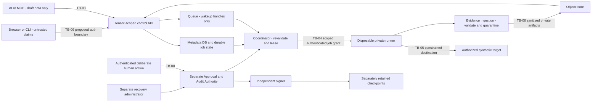

# ADR-0007 — Hosted control plane and private-runner trust

> **Status: PROPOSED — developer/security review requested; NOT ACCEPTED**
> Version: 0.1 / 2026-10-11
> Author / task: Codex / M5-01, documentation-only draft
> Decision owner / security reviewer: repository developer; review pending
> Trace: OQ-08/09/13, NFR-SEC-006/007; supporting NFR-SEC-001–005, NFR-REL-002, FR-PLT-003/004/005/006, AC-002/003/014/015

## 1. Context, actual prerequisites and authority

[Architecture M5-01](../ARCHITECTURE.md) requires M0-02/M3-08 and an **Accepted ADR on queue/store/runner controls and identity**. Exact DoD: **Reviewer approves control/execution plane boundaries and failure/replay handling; no premature compliance promises**. M0-02 is IN_REVIEW without final human sign-off; M3-08 is NOT_STARTED with no clean full-flow installation/demo. The current prompt explicitly authorizes drafting, not agent acceptance or hosted implementation. M5-01 remains BLOCKED at handoff while dependencies/review are unresolved.

Intake: main HEAD 145f89f6c1123d6ae245390a6bd83e55c05efcbe, 57 files/19 directories; existing modified todo and untracked M4 report preserved. Actual core has domain, provisional parser and fake-provider packages only. No hosted API, identity service, queue/coordinator, DB/artifact store, trusted review registry, runner or hosted tests/configuration exist. require_authenticated_approval always rejects untrusted domain claims. Missing controls are confirmed implementation gaps, not reproduced exploits.

[ADR-0001](0001-contract-dsl.md) specified DSL choices and the developer's canonical-data/opaque-ID/job directions are accepted within their scope. [ADR-0002](0002-fixture-runner.md), [ADR-0003](0003-human-approval.md), [ADR-0004](0004-repository-and-stack.md) remain PROPOSED. Dedicated Audit Authority + append-only log + independently signed checkpoints is already the selected storage direction; this proposal preserves it and does not ask to decide it again. Older intake paragraphs in [SECURITY](../SECURITY.md) claiming absent ADRs/no code are historical and do not override the actual tree or owner decisions.

Only this document and [todo.md](../../todo.md) change. No accounts, credentials, keys, KMS, regions, cloud services, queue/store/runner SDKs, containers, migrations, target requests, provider egress or deployment are created/enabled. An architectural review is distinct from a Security Contract, target grant, production authorization or verification result.

## 2. Proposed decision and deployment profile

Use a modular control-plane application with shared domain/services, authenticated tenant-scoped APIs and **separately enforced security principals** for private execution, protected human approval/audit, signing/checkpoint custody and recovery. A module boundary or shared process alone is not privilege separation.

For OQ-13, recommend a staged **local/private-runner pilot first**, using disposable synthetic fixtures in an explicitly authorized non-production segment. Any hosted pilot needs the same tenant/identity/scope enforcement; one customer is not an isolation waiver. Do not build general hosted target execution or assume customer production-VPC access. Multi-tenant SaaS breadth follows actual P0/prerequisite and hosted security evidence, not this draft.

For OQ-08, define durable queue/private-store semantics below before selecting products. PostgreSQL is the existing hosted metadata proposal; a private encrypted S3-compatible object store is the object-interface candidate. No queue library, vendor, service tier, concrete ORM/SDK version or backend is selected/approved here. Choose them after workload, region, operational ownership, cost/license and recovery evidence; exact dependency acquisition remains gated.

For OQ-09, region/residency is **UNSELECTED**. Real hosted tenant-data ingress and storage stay disabled until an owner-approved placement/retention/egress profile covers every copy and processor. No cross-region failover, compliance certification, enterprise residency guarantee, SLO or production isolation claim is made.

## 3. Assets, adversaries and trust boundaries

Assets: organization/project membership, human review and immutable policy, execution grants, synthetic sessions, source context, jobs/leases, evidence, audit/checkpoints, signing keys, backups and operational access. Adversaries: cross-tenant callers, untrusted MCP/AI/imported data, stolen browser/runner credentials, hostile target responses, duplicated/stale queue messages, compromised worker/runner and misconfigured operator/storage permissions. Host/cloud administrators and signer compromise remain explicit residual trust assumptions.

HT identifiers below are local to this PROPOSED ADR, not renumbering global TB identities.

| Local boundary / global mapping | Required validation | Failure behavior / risk |
|---|---|---|
| HT-01 browser/API; proposed TB-09 | Authenticated current principal, issuer/audience/session, org/project membership and per-operation rights; human approval separate | Missing/stale/foreign claims rejected; no tenant metadata enumeration |
| HT-02 human/audit; TB-08 | Deliberate protected user action, exact version/hash/project/scope, fresh one-use challenge and independently durable audit anchor | No AI/tool/CI self-approval; REGISTRY_DISABLED on unestablished trust |
| HT-03 control state/queue; TB-04 preparation | Queue message is untrusted notification; load immutable authoritative bindings and current permission, expiry, revocation and quotas | Forged/replayed/stale handles cannot grant execution |
| HT-04 coordinator/private runner; TB-04 | Enrolled current runner identity, project capability, fresh attempt/lease/fence and bound grant | Revoke/expire denies fetch/start; stale result/heartbeat cannot extend privilege |
| HT-05 runner/target and host; TB-05 | Approved fixture/capability/origin/methods, connection-time DNS/IP checks, isolated process/filesystem/network and budgets | Out-of-scope request or escape attempt blocked; fail/stop and preserve evidence |
| HT-06 result/private objects; TB-06 | Tenant/job/attempt/rule provenance, byte limits, sanitization, artifact hashes, authorized access and immutable history | Withhold/quarantine incomplete/forged/leaked evidence; no unsupported PASS |
| HT-07 source/model; TB-01/02 | Scoped context provenance and privacy, untrusted comments/responses; provider consent OFF by default | No automatic vendor fallback or source/token transmission |
| HT-08 administration/incident/audit custody | Separate least-privilege roles, explicit human recovery authorization, protected checkpoint history and evidence | Stop affected privilege; no silent history reset or new trusted genesis |

## 4. Identity and tenant authorization

Propose standards-based hosted OIDC through a reviewed provider/profile; concrete provider, enrollment, human user-presence mechanism and MFA/step-up rules remain unresolved. Server validates issuer, audience, signature/key trust, freshness, session/token type and revocation. A pasted org/project/reviewer ID, environment flag or valid opaque ID never establishes authority. Browser sessions need reviewed cookie/CSRF/origin controls, exact review display and protected deliberate confirmation; authentication alone does not approve a contract.

Separate human reviewer, org/project administrator, ordinary member, API machine caller, coordinator, evidence ingester, runner, target synthetic actor, Audit Authority, signer, checkpoint custodian and recovery administrator. Capabilities are bounded per operation/project; no global runner or MCP token accepted as reviewer. Enrollment, role changes, recovery and support access cannot be delegated to an LLM or supplied in a scenario.

Enforce org/project ownership on every list/read/write/run/export and every indirect reference: contract/review, fixture, job/run/attempt, artifact, queue handle, checkpoint and recovery record. Derive tenancy from authenticated context plus authoritative relationships; reject conflicting foreign IDs before lookup or dispatch and minimize disclosure. Application authorization is mandatory; proposed PostgreSQL RLS is defense in depth under non-bypass roles, including pooled-connection context-reset tests, not a substitute for object/queue authorization. API, CLI and MCP use the same core guards; no callable approve_contract, generic privileged service dispatch or receipt-import shortcut.

Membership/reviewer/runner revocation must invalidate future privileged admissions and safely cancel or expire outstanding grants under a measured, reviewed propagation window. Never claim instantaneous revocation. Uncertain current identity/permission must not reuse a cached approval to start a job.

## 5. Protected human review and audit

Preserve ADR-0003 and the existing selected storage direction: dedicated authority controls append-only canonical monotonic events and immutable snapshots; append/admin/sign/checkpoint-retention/recovery roles are separate. Independently retained signed checkpoints outside the audit DB bind stream, committed sequence, tip, time and key identity. The exact canonical signed bytes, namespace/generation, key trust/rotation, latest/freshness discovery and commit->anchor->activation protocol still need review and verified enforcement.

Human approval is pending and non-effective until its exact durable event is independently anchored and current eligibility verified. Revocation/supersession append events rather than rewrite history. An agent-writable DB/hash chain or a valid old signature cannot establish rollback resistance or human presence. The runner and ordinary app receive no signing/admin/recovery secrets. On integrity/checkpoint outage use REGISTRY_DISABLED for affected privilege; retain pending/denied diagnostics without claiming an audit write succeeded when storage failed.

Local tests may use synthetic events/test-only signing identities. Same-OS-user control of DB/checkpoints/keys cannot prove strong tamper resistance. Hosted approval remains disabled until genuine authority separation, M2-06 human mechanisms, latest-checkpoint and recovery evidence exist. No unchanged storage direction is reopened.

## 6. Durable job/queue and replay handling

Keep authoritative job/attempt transitions in durable metadata. Propose a transactional outbox for commit-to-notification consistency; queue carries only minimal opaque handles, schema/message identifiers and bounded expiry, with no policy authority, credentials or raw evidence. Enforce broker/workload access as well as application guards. Messages are at-least-once and may duplicate/reorder; no exactly-once execution guarantee is claimed.

On each delivery load the pinned specification and revalidate tenant access, anchored contract version/hash, separate target grant, trusted fixture capabilities, runner eligibility, schema/profile, expiry/revocation and quota. Invalid/stale/replayed delivery cannot create execution authority. Atomically claim a fresh attempt with lease/fencing generation; dispatcher and ingester validate the current fence. A heartbeat cannot silently renew grant scope, expiry, policy or budgets. Outbox/backlog/reconciliation failures are explicit non-success.

Each executed retry gets its own immutable run/evidence lineage, pinned contract/version/scope/fixture/environment, revision metadata, timestamps and verdicts. Preserve prior attempts. The accepted one-job/one-run **per verification attempt** convention remains: a retry is a linked new attempt/job/run, not overwrite of the earlier run. An idempotent resubmission of the same admitted attempt returns the same handle; a different payload under the same scoped idempotency key conflicts. Jobs rejected before execution retain a job/admission record and reason without pretending a verification run occurred.

A lost lease or worker death fences subsequent results and prevents unauthorized restart; fencing alone does not stop an already-running process. Runner watchdog, credential expiry, network controls and cancellation must bound residual work. Never automatically retry an uncertain side-effecting operation: require verified disposable reset/cleanup and a fresh permitted attempt, or block for review. Cancellation races are reconciled against current durable state; expired/revoked/canceled grants cannot be resurrected by duplicate queue messages. Time/budget/attempt ceilings and clock/skew tolerances need measured accepted values before execution.

Use PRD job outcomes (CANCELED, FAILED_INFRA, BLOCKED_SCOPE, EXPIRED as appropriate); completion never implies all PASS. Missing auth/fixture, crash, timeout, unavailable evidence/audit or incomplete observation is ERROR/INCONCLUSIVE/non-success under the reviewed classifier, not authorization PASS or an unverified VIOLATION. Dead-letter queues and retries are bounded, access-scoped, redacted and residency-controlled.

## 7. Private storage, evidence and secrets

Propose private encrypted metadata/object storage with TLS in transit and separately controlled secrets/key custody; exact algorithms, provider APIs, region and key rotation/recovery are not selected. Use server-generated tenant-scoped immutable object identifiers and content hashes, never caller filesystem paths or public ACLs. Do not overwrite historical artifacts on retry; reconcile metadata-to-object publication so missing/partial/mismatched objects are unavailable and non-success, not green.

Default downloads to an authenticated service that rechecks current membership and artifact ownership. Short-lived narrowly scoped signed URLs are an alternative only after explicit review of bearer leakage, revocation window, origin/referrer, caching and residency; a secret URL is not tenant authorization. No public listing, shared tenant namespace or arbitrary object key/upload destination is accepted from a runner. Logs, debug/support access, exports, CDN/cache, DLQ and backups must obey the same data boundary.

Sanitize before upload/persistence and enforce byte/count/content-type limits. Strip tokens/session cookies/private fixture fields; escape inert HTML and quarantine uncertainty. Verify job/attempt/fence/spec/artifact digests and rule/scenario/step lineage. A runner signature authenticates origin, not truthfulness of a compromised runner's verdict; unverifiable observations must be quarantined/untrusted or independently reproduced before evidence-backed claims. Do not certify a target from queue completion or a submitted PASS string.

Runner receives only short-lived project/attempt-scoped target-session and upload permissions through a reviewed credential path, never DB admin, bucket-wide access, provider API keys or audit-signing authority. Rotation/revocation invalidates new grants; enrollment/bootstrap, key recovery and service-account creation require separate authorization. Retention/deletion/legal-hold durations and protected audit exceptions remain owner decisions; do not equate deleting an object with deleting backups or audit history.

## 8. Runner isolation and target transport

Recommend dedicated private-runner workload identity and outbound authenticated control-plane communication limited to pinned reviewed destinations; no general inbound command endpoint. Untrusted code/model output cannot enroll a runner, request new scopes or select a shell command. Execute only versioned validated declarative operations bound to approved synthetic fixture capabilities. No arbitrary Python/shell/eval/dynamic imports/templates, repository install hooks or unreviewed exported pytest inside the privileged constrained runner.

Disposable non-root execution with separate account/workload sandbox, read-only root filesystem, bounded writable temporary workspace, no host filesystem/secrets/Docker socket/devices, no privileged mode/host PID/network namespaces, minimal capabilities and reviewed syscall restrictions. Bound CPU/memory/PIDs/storage/open files, requests/bytes/concurrency/wall time/per-request timeouts/retries. Container isolation alone is not hostile-host or kernel-escape proof; supported hardened profile and threat assumptions require real isolation tests.

Default deny outbound network. Allow only explicitly authorized target origins and necessary exact control/evidence endpoints under separate destination classes. Block cloud metadata, unrelated internal/link-local/loopback services and unexpected protocols/ports unless a separately reviewed synthetic binding specifically needs them; private-runner placement grants no whole-VPC access. Honor no ambient proxy/environment/redirect trust. Resolve and verify all allowed address families at connection time, pin/check the connected peer against grant, and revalidate DNS/IP changes. Redirects disabled by default; any later allowed hop must pass full destination/scope checks and cannot forward credentials across origins.

Independent actor sessions must be genuinely distinct and setup validated; a missing resource/invalid route/failed login cannot prove DENY. Approved 403/404 denial profiles require no protected disclosure/state mutation and valid positive controls. Use disposable synthetic writes only; teardown verifies fixture baseline and ownership, destroys sessions and temporary data, revokes scoped credentials and records residual failures. Stop/quarantine a contaminated runner; failure to clean is not PASS. A kill request is not cleanup proof.

## 9. Residency, processors and retention assumptions

No cloud/region/jurisdiction inferred from developer locale or machine timezone. Before hosted real data, owner selects a complete placement profile for DB/replicas, queue/outbox/DLQ, artifacts/caches, audit and checkpoints, keys/signing, backups/recovery, telemetry/support and any subprocessors/providers. Document all permitted egress endpoints, data classes, retention and cross-region access; deny unknown placements and automatic region/vendor fallback.

Pilot assumption is minimized synthetic metadata/evidence with no production customer records or mandatory full source upload. Real source/context upload and external AI remain OFF by default and separately consented; no provider access implied by hosted identity or this ADR. If an approved region/storage authority is unavailable, block affected work or perform explicitly authorized recovery within its placement policy; availability does not override residency. Encryption is not proof of jurisdictional compliance. No SOC2/ISO/GDPR/residency/SLO certification or compliance promise is made.

## 10. Incident, recovery and administrative boundaries

Designate human security incident/recovery administrators before deployment; no such hosted identity is provisioned here. Coordinator may stop admissions and runner may fail closed under an existing policy; neither may broaden scope, approve contracts, rewrite audit history or automatically establish a new trust root.

On cross-tenant disclosure, forged/stale grant, runner escape suspicion, audit/checkpoint integrity uncertainty, token compromise or region violation: restrict affected admission/registry, revoke/expire scoped credentials, isolate runner, preserve redacted forensic evidence/checkpoints and correlate incident without leaking tenant data. Distinguish suspected compromise from confirmed test findings; do not publish unsupported customer claims.

Recovery uses protected backups and independently trusted checkpoint history under separate authorization: restricted recovery state, chain/sequence/latest-anchor reconciliation, missing/unanchored event identification, immutable recovery event and explicit security-administrator release after verification. No silent genesis reset, unanchored approval downgrade or privileged resume if latest history cannot be reconstructed. Separate investigator/support read from signing, deletion/retention and exceptional recovery; cross-tenant break-glass access needs a bounded human grant and durable audit.

## 11. Alternatives, trade-offs and unresolved choices

| Choice / OQ | Proposed default | Alternatives | Security trade-off / remaining decision |
|---|---|---|---|
| Profile / OQ-13 | Staged local/private-runner pilot before broad hosted execution | Hosted synthetic-only runner; full multi-tenant SaaS; self-hosted enterprise | Private deployment reduces target exposure, not compromised-runner/host or control-plane trust. Owner must accept supported profile; no execution grant |
| Queue / OQ-08 | Durable authoritative job state + transactional outbox + at-least-once notification/leases/fences; provider-neutral port | Managed durable queue; PostgreSQL-backed queue/leases; in-memory queue | In-memory-only cannot support required durability/recovery. Concrete backend requires workload/order/retention/ACL/recovery/license evidence; no service selected |
| Artifacts / OQ-08 | Private encrypted immutable objects, authenticated downloads; S3-compatible candidate interface | Self-hosted private store; signed URL delivery | Public buckets rejected; signed URL bearer/revocation risks need separate acceptance. Product/backend/SDK/key/retention profile open |
| Hosted metadata | PostgreSQL candidate, tenant guard + RLS defense in depth | Per-org DB/store; shared tables without RLS | Pool/role/RLS-bypass risks and recovery/cross-object transactions need tests; no migration/configuration here |
| Identity | Reviewed OIDC/current membership; separate human approval, workload and target-session principals | Supported hosted SSO provider or self-hosted identity; machine-only identity | Identity provider/enrollment/MFA/user-presence and protected local review remain open; machine claims cannot approve |
| Audit | Existing selected dedicated authority and independent signed checkpoints | Same-user/local hash chain for synthetic detector tests only | Selected direction unchanged; crypto/latest trust/commit-anchor/recovery profile and protected enforcement still open |
| Runner | Hardened disposable private workload, least privilege, deny-by-default egress | Stronger VM/microVM separation; hosted disposable synthetic-only worker | Container/kernel/host-owner risk explicit; actual OS/image/egress/budget/cancel profile requires review and negative tests |
| Region / OQ-09 | UNSELECTED; real tenant ingress/placement disabled | Customer-approved single region; explicitly scoped replicas/recovery regions | All processors/copies, retention/support/legal commitments require actual owner selection. No automatic cross-region failover |
| Incident | Restricted fail-closed admission and separate human recovery authority | Availability-first unanchored/resume fallback | Fallback rejected for privileged integrity/residency uncertainty; define measured revocation/RTO/RPO without promising unmeasured SLOs |

Reversible after compatibility review: port implementation/backend replacement, operational packaging and isolated test harness choices, provided immutable IDs/schema/evidence semantics and selected authority separation survive migration. Security sign-off required before changing principal custody, identity/approval, tenant isolation, execution/capabilities, network/SSRF/cancellation limits, audit/key trust, result trust, residency/retention or recovery. This draft selects no actual service or numeric operational threshold.

## 12. Required positive and adverse verification

HD identifiers are planned case families, not actual test functions. All are **NOT RUN**. Owners are proposed functional roles to be assigned: identity/API, coordinator/storage, runner, evidence/audit and designated independent developer/security reviewer. Mock tests may exercise detectors; they cannot prove hosted ACLs, crypto, tenant isolation, true user presence, networking or recovery.

| Case | Positive control | Adverse/failure control | Required result and retained evidence / owner | Runtime status |
|---|---|---|---|---|
| HD-01 tenant objects | Authorized own-project API/DB/object/job access | Foreign org/project/indirect ID, list/enumeration, pooled context or RLS-bypass role | Deny bytes/metadata/mutation/dispatch; sanitized attempted-access record; AC-014/API-storage | NOT RUN |
| HD-02 human review | Current permitted human deliberately binds exact hash/version/scope | AI/MCP/machine self-approval, imported APPROVED, changed bytes, stale/replayed challenge or missing presence | No authority until genuine protected review and durable anchor; old immutable history retained; AC-002/003/identity-audit | NOT RUN |
| HD-03 identity lifetime | Eligible reviewed issuer/audience/session and runner enrollment | Forged/wrong audience/expired/revoked credential, role self-elevation or stale cache | Reject before privileged admission; measured revocation/propagation and attempted-action evidence; identity-runner | NOT RUN |
| HD-04 queue duplicate/replay | One valid delivery claims one admitted attempt | Duplicate/reordered/foreign/stale message, conflicting scoped idempotency payload | No duplicate authority/execution; same accepted resubmission stable, conflicting input rejected; coordinator | NOT RUN |
| HD-05 crash/outbox/fence | Durable ready attempt and current lease | Crash before/after commit/delivery/start/result, expired lease, stale worker/result or lost response | Recover recorded state idempotently; no stale activation/result; retain every attempt, never claim exactly-once side effects; coordinator | NOT RUN |
| HD-06 cancel/quotas | Bounded admitted run completes valid observations | Revocation/cancel race, timeout, clock skew, request/byte/concurrency/CPU/memory budget overrun | Stop or safely expire within measured profile; non-PASS and cleanup/residual evidence; runner-coordinator | NOT RUN |
| HD-07 target network | Exact granted origin/port/path and checked peer | SSRF/metadata/internal pivot, DNS/IP/address-family swap, redirect/proxy bypass or cross-origin credential forwarding | No unapproved request/credential egress; destination decisions and controlled network observations; runner | NOT RUN |
| HD-08 executable payload | Declared typed fixture/request operations | Shell/Python/template/import/install hook, undeclared mutation/capability | Reject before execution; zero arbitrary command launch under tested supported profile; runner | NOT RUN |
| HD-09 containment | Disposable non-root bounded workspace | Host mount/socket/secrets/device, privileged/host namespace, syscall or other-tenant workspace access | Independently enforced denial; tested OS/image/network limits, residual kernel/host assumptions disclosed; runner | NOT RUN |
| HD-10 fixture/auth/cleanup | Independent actor A/B sessions, reproducible baseline | Wrong/missing token/resource, contamination, revoked old session, setup/teardown failure or uncertain write retry | Invalid preconditions ERROR/non-success; no false DENY PASS; preserve cleanup/residual state and no unsafe replay; runner | NOT RUN |
| HD-11 assertions | Valid own-resource ALLOW and accepted protected 403/404 DENY | ALLOW 500, protected disclosure despite denial status, missing observations or submitted PASS label | Deterministic reviewed classifier; no infra/unknown-to-PASS; rule/step evidence; evidence-runner | NOT RUN |
| HD-12 result provenance | Current attempt/fence/spec and complete redacted observation | Compromised validly signed runner claims, wrong project/version/hash, stale result, partial object/checksum mismatch | Quarantine/withhold unverified evidence; authentic origin alone not truth; immutable old artifacts; evidence-storage | NOT RUN |
| HD-13 private evidence | Authorized authenticated download/export and scoped upload | Public ACL, guessed object/path, leaked URL, expired/revoked access or cross-tenant cache/support read | No protected bytes/metadata or overwrite; download/upload/access-log evidence; AC-014/storage | NOT RUN |
| HD-14 privacy/egress | Synthetic sanitized log/HTML/JSON/queue/DLQ data | Seeded fake tokens/private fields/errors/prompts; unconsented provider/telemetry/fallback | Canary absent at every persisted/transmitted boundary; zero prohibited egress; privacy-evidence | NOT RUN |
| HD-15 audit/checkpoints | Current independently anchored history and eligible review | Modification/deletion/gaps/replay, forged/stale checkpoint, DB rollback, signer/store outage or append failure | REGISTRY_DISABLED on uncertain integrity; no unanchored activation; protected key/authority negatives plus AU-01..10; audit | NOT RUN |
| HD-16 placement/retention | Every copy/processor within approved region/data-class/retention profile | Missing placement, cross-region failover, stray backup/DLQ/telemetry, unauthorized delete/hold override | Block unapproved transfer/recovery/deletion; inventory/access/placement evidence; storage-security | NOT RUN |
| HD-17 incident/recovery | Separately authorized restricted restore reconciles latest trusted checkpoint | Missing/unanchored events, older backup, compromised key, unavailable latest history or unauthorized recovery/break-glass | Preserve forensic history; privilege disabled until verified authorized recovery, no automatic genesis; audit-security | NOT RUN |
| HD-18 no-provider path | Already genuinely approved suite runs without model credentials | Malformed/injected model/target/repository instructions attempt authority/scope change | Draft/review-only data or fail closed; runner/verdict no model dependency or call; provider-runner | NOT RUN |

Planned levels: pure guards/unit/mock ports first; authenticated API/DB/queue/store integration and race/fault injection next; independently enforced identity/key/network/container/restore tests on a separately authorized hosted profile before acceptance of operational guarantees. Test commands are **NOT AVAILABLE/NOT RUN** because implementation, accepted tooling/configuration and protected environments do not exist. Historical 77 component tests are not HD evidence and are not rerun for this docs-only change.

## 13. Bounded implementation and acceptance gates

1. Review this exact proposal and supported pilot direction; keep M0-02/M3-08 and other prerequisites unresolved until genuinely closed.
2. Separately select concrete identity, queue/store backend, region/retention, protected signing/latest-checkpoint/recovery, runner hardening and measured budgets/propagation profiles. Record new choices with actual workload/provenance/licensing and human review; do not re-request unchanged selected audit storage architecture.
3. Under separate bounded tasks, implement pure schema/guard/mock tests with privileged functionality disabled; define real protected integration environments and setup permissions before provisioning. No next task is implemented here.
4. Obtain prerequisite/architecture/security decisions before hosted trust-boundary code or authority setup, then execute HD/AU integration negatives and genuine human positives with retained evidence, cleanup and independent reviewer assessment.
5. Accept operational/release readiness only with real evidence; no task/ADR/status/hash/model response alone authorizes a contract or target.

Missing dependency/review is a blocker, not cured by accepting only a pilot direction. Even ADR acceptance does not authorize service provisioning, deployment, targets, provider egress or every concrete implementation profile. M5-02..16 remain separate tasks.

## 14. Review request and decision record

Developer is the designated human security reviewer in this conversation. Please accept the **architecture proposal only**, request changes, or defer this exact v0.1 after reviewing §§3–10 boundaries and queue failure/replay cases, §§11–12 open choices/tests and §13 gates. Identify the accepted scope and any profile changes. New architecture review is consolidated; prior unchanged ADR-0002/0003/M0-02 decisions are not resubmitted or inferred.

Review binding: raw file SHA-256 in todo.md EV-0036. There is **no reviewer acceptance recorded**. Status remains PROPOSED and M5-01 BLOCKED until actual prerequisites and genuine reviewer criteria are met. Concrete OQ-08 vendor/workload and OQ-09 region/compliance choices remain open even if proposal direction is later accepted. No compliance promise, trusted product approval or hosted implementation is claimed.
