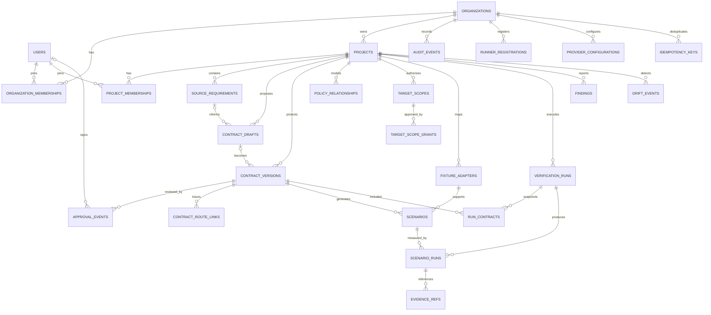
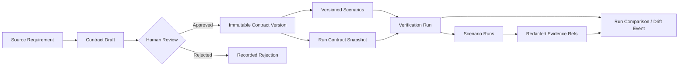

> **Historical/reference notice — 2026-10-10:** The developer accepted docs/DATA_MODEL.md as the canonical reference for proposed PACT domain and wire structures. This file is retained historical storage/RLS/migration context, not a competing authoritative model. Its original v1.0.0 content follows unchanged; earlier canonical/identical-copy wording is historical. Current requirements and genuinely accepted ADRs take precedence; this notice approves no schema, migration or runtime control. See [DATA_MODEL.md](DATA_MODEL.md) and todo.md EV-0011.

---

# PACT Security — Database Schema, ERD, RLS & Migration Specification

> **Document:** `schema.md` (downloadable root copy; canonical repository location: `docs/DATA_MODEL.md`)  
> **Version:** 1.0.0 — Draft / Architecture Review Required  
> **Date:** 2026-10-10  
> **Product:** PACT Security — Continuous Authorization & Security Intent Assurance  
> **Basis:** `PRD.MD` v1.0.0 §6–7, §11, §13; `AGENTS.md` v1.0.2; `docs/ARCHITECTURE.md` v1.0.0; `docs/SECURITY.md` v1.0.0; `workflow.md`; `todo.md`.  
> **Owner/reviewer:** TBD — no ADR or security sign-off is asserted by this document.  
> **Scope:** P0 local persistence, P1 PostgreSQL hosted control plane, and forward-compatible extension points.  
> **Maturity:** SPECIFICATION ONLY. No migrations, tables, RLS policies, or production security controls are asserted to exist.

---

## 0. How Codex MUST use this document

1. Read `PRD.MD` (especially §13), `AGENTS.md`, `workflow.md`, `docs/ARCHITECTURE.md`, `docs/SECURITY.md`, `todo.md`, **then** this schema specification and applicable accepted ADRs.
2. Treat **approved security-contract versions** as the source of expected behavior. Database rows, imported JSON and AI output are **not proof of human approval** on their own.
3. Distinguish **P0 local** from **P1 hosted**. Do not introduce organizational SaaS machinery into the deterministic P0 verifier without a task dependency; do not assume local SQLite supplies PostgreSQL RLS guarantees.
4. **Do not run migrations or change a database** based only on this draft. First obtain accepted architecture/security decisions and the appropriate execution authorization under `workflow.md`.
5. For every database task, cite `M#-##`, related `FR-...` / `NFR-...` / `AC-...`, affected tables, migration revision, tests actually run and an evidence entry in `todo.md`.
6. Prefer a **single canonical file** at `docs/DATA_MODEL.md` inside the Git repository. `schema.md` is an identical delivery copy, not a competing source of truth.
7. Sample SQL is a **design reference**, not a complete, reviewed, directly deployable migration. In particular, RLS + session context are defense in depth, **not an authorization system by themselves**.

### Terminology and version rules

- `P0`: local verification engine, deterministic fixtures, contracts, evidence and CLI-oriented storage.
- `P1`: hosted multi-organization control plane, authenticated users, PostgreSQL RLS, private runners, Git/CI, web and retention controls.
- `P2`: advanced graph/evaluation/storage scaling after demonstrated need.
- **Proposed:** choice waiting for ADR/reviewer decision. A proposed feature is not an implementation claim.
- **Org tenant**: a **PACT SaaS organization**; **target-app tenant**: a merchant/store/customer organization *inside an application being tested*. These are **different security domains and must never be conflated**.
- `org_id` refers exclusively to a PACT organization. Target-app tenant identities stay in contract/scenario/fixture data, not in PACT's organization membership tables.
- ULID/UUID choice and exact timestamp representation are proposed; SQL examples use PostgreSQL `uuid`, `timestamptz`, and `jsonb`.

---

## 1. Storage strategy & technology stack

| Layer | P0 local | P1 hosted | Design rationale / condition |
|---|---|---|---|
| Domain model | Pydantic v2 + pure Python types | Same shared contracts | No ORM dependency within the security domain |
| Relational database | SQLite (local-only) | PostgreSQL (version pinned by ADR) | SQLite has no PostgreSQL-native RLS; use strict local process/file permissions |
| Persistence | SQLAlchemy 2.x repositories (proposed) | SQLAlchemy 2.x async/sync choice via ADR | One set of domain ports; dialect-specific security adapters |
| Migrations | Alembic once durable P0 data introduced | Alembic with explicit SQL for RLS/policy migrations | Migration artifacts reviewed and tested |
| Object/evidence | Local private, redacted artifact folder | Encrypted private S3-compatible store | DB keeps metadata and digests; no raw secrets in objects |
| Secrets | OS secret/env provider | Managed secret references and scoped KMS/secret manager | `secret_ref` only; never plaintext credentials in SQL |
| Queues | In-process bounded local jobs | Queue and idempotent delivery chosen via ADR | DB stores run status and lifecycle, not a universal execution queue |
| Authorization | Local verified user + explicit scope approval | Application RBAC **and** PostgreSQL RLS | Never delegate owner/reviewer authorization to an LLM |
| ORM/JSON | Versioned schema + compatibility adapters | Same; indexed JSONB for extensibility | Stable core columns relational; do not bury joins and permissions in JSON |
| Graph | Relational relationship edges | Same initially | Dedicated graph DB requires measured query need |

**Hard boundary:** an execution-plane runner must not require direct superuser/table-owner database access. Prefer scoped API/job credentials; runner responses are untrusted until verified and normalized.

### Recommended local-to-hosted repository arrangement (proposed)

```text
pact-security/
├── PRD.MD
├── AGENTS.md
├── workflow.md
├── todo.md
├── skill.md
├── docs/
│   ├── ARCHITECTURE.md
│   ├── SECURITY.md
│   ├── DATA_MODEL.md         # canonical copy of this specification
│   ├── API_SPEC.md           # future API request/response details
│   └── adr/
│       ├── 0001-contract-dsl.md       # pending owner acceptance
│       ├── 0002-fixture-runner.md     # pending owner acceptance
│       ├── 0003-human-approval.md     # pending owner acceptance
│       └── 0010-database-rls.md      # proposed new ADR
├── packages/pact-core/pact_core/
│   └── persistence/{models,repositories,migrations}/
├── tests/{db,security,integration}/
└── apps/demo-marketplace/
```

`0010-database-rls.md` is a **recommended** new ADR, not a file that currently exists. The architecture's original ADR IDs `0001–0009` remain unchanged.

---

## 2. Domain invariants the database MUST enforce or support

| ID | Invariant | Primary enforcement | Negative test / evidence |
|---|---|---|---|
| DB-INV-01 | PACT org A cannot read, modify, or execute against org B's resources. | Org/project FKs, app RBAC, RLS, object-store authorization | Cross-tenant ID tampering and joins denied |
| DB-INV-02 | A project always belongs to exactly one PACT organization. | `projects.org_id NOT NULL`, composite foreign keys | Cross-org child FK rejected |
| DB-INV-03 | Contract drafts are never approved merely because imported JSON says `APPROVED`. | Separate approval service and append-only review events | Forged status rejected |
| DB-INV-04 | Approved contract content/hash/version cannot be overwritten. | Transactional approval + immutable-field trigger/privileged write path | Mutated approved payload fails |
| DB-INV-05 | Only authenticated eligible humans can approve contracts. | Application auth/RBAC + reviewer receipt + DB least privilege | Agent/service principal cannot approve |
| DB-INV-06 | Exact contract version and digest are attached to each verified run. | Run-to-contract snapshot/junction | Run referencing stale/mismatched digest is rejected |
| DB-INV-07 | Each scenario and evidence item has an unambiguous project/org chain. | Composite FKs, restricted RLS | Attach org A artifact to org B run fails |
| DB-INV-08 | `ERROR`, `INCONCLUSIVE`, `SKIPPED` and `CANCELED` do not become `PASS`. | Enum/typed status + deterministic assertion logic | Timeout/invalid fixture retains non-pass state |
| DB-INV-09 | Evidence and audit history are not silently overwritten. | Append-only event model, restricted UPDATE/DELETE, retention workflow | Unauthorized evidence/audit mutation denied |
| DB-INV-10 | Target scopes are explicit, bounded, human-authorized and revocable. | Independent scope grant records + runtime check | Expired/revoked/out-of-scope run blocked |
| DB-INV-11 | Provider keys and test actor tokens never appear in DB content, logs or evidence. | Secrets-by-reference, redaction controls | Canary strings absent from storage |
| DB-INV-12 | Same-policy drift requires comparable contract, fixture, scenario and environment fingerprints. | Immutable run snapshot + compatibility decision | Incompatible runs => `NOT_COMPARABLE` |
| DB-INV-13 | Deletion/export/retention respect scope and an approved retention policy. | Service authorization, FK deletion strategy, audit | Cross-org export, illegal delete denied |
| DB-INV-14 | LLM-generated data is untrusted input; schema and semantic checks precede persistence or execution. | Pydantic + strict allowlist + DB constraints | Unknown predicate and shell expression rejected |

**Authority chain:** raw requirement → model-generated `contract_drafts` → authenticated human review event → immutable `contract_versions` → scenario specs → authorized verification → redacted evidence → comparable regression evaluation. Each arrow has an explicit trust boundary.

---

## 3. Entity Relationship Diagram (ERD)

### 3.1 Hosted control-plane ERD (conceptual)



**Notes:** this ERD intentionally omits many repeated `org_id` and `project_id` columns to keep the diagram readable. They are required in hosted P1 for enforceable scope and composite foreign keys. `APPROVAL_EVENTS` ties to the reviewed draft/hash and resulting contract; the exact optionality of `contract_version_id` is described below. `IDEMPOTENCY_KEYS` is P1 only.

### 3.2 Contract and verification lineage



### 3.3 Data ownership rules

- **Organization-owned:** `organizations`, `organization_memberships`, `runner_registrations`, `provider_configurations`, `audit_events`, `idempotency_keys`.
- **Project-owned:** `projects`, `project_memberships`, `source_requirements`, `contract_drafts`, `contract_versions`, `policy_relationships`, `target_scopes`, `target_scope_grants`, `fixture_adapters`, `scenarios`, `verification_runs`, `run_contracts`, `scenario_runs`, `evidence_refs`, `findings`, `drift_events`, `contract_route_links`.
- **Global identity:** `users`, with minimal identity-provider data. User access to an org does not imply access to every project within that org.
- **Target application fixtures:** synthetic target-app actors, resources and target-app tenants are represented **within controlled fixture adapter storage**; do **not** create PACT SaaS users or memberships for synthetic Seller A/B.

---

## 4. Table catalog and ownership

**Status column:** `P0` means a local functional analog is needed (not necessarily all hosted fields); `P1` means hosted schema and RLS planned. Some listed P0 entities can initially be JSON or SQLite records as long as the domain invariants are preserved.

| Table | Key fields beyond `id` | Primary relationships | Release | Responsibility |
|---|---|---|---|---|
| `organizations` | `name`, `slug`, `settings_json`, `created_at` | 1:N projects, memberships | P1 | PACT tenant boundary |
| `users` | `identity_provider_subject`, `email`, `created_at` | 1:N memberships, reviews | P1 | Authenticated human identities |
| `organization_memberships` | `org_id`, `user_id`, `role`, `status` | FK org, user | P1 | Organization role and lifecycle |
| `projects` | `org_id`, `name`, `repo_ref`, `framework` | FK org | P0 local / P1 | Security project and source bindings |
| `project_memberships` | `org_id`, `project_id`, `user_id`, `role`, `status` | FK project/org/user | P1 | Project-specific visibility and permissions |
| `source_requirements` | `org_id`, `project_id`, `text`, `source_ref`, `created_by` | FK project/user | P0/P1 | Human security intent and provenance |
| `contract_drafts` | `project_id`, `schema_version`, `proposed_json`, `status`, `model_ref`, `lock_version` | FK project, requirement (nullable) | P0/P1 | Untrusted/reviewable proposals |
| `contract_versions` | `project_id`, `contract_key`, `version`, `rules_json`, `content_hash`, `approved_by`, `approved_at`, `status` | FK project, draft, reviewer | P0/P1 | Approved, versioned authoritative policies |
| `approval_events` | `contract_draft_id`, `contract_version_id?`, `reviewer_id`, `digest`, `decision`, `reviewed_at`, `review_nonce` | FK draft/version/reviewer | P0/P1 | Trusted human review receipt; **additional** |
| `policy_relationships` | `project_id`, `subject`, `predicate`, `object`, `validity_json` | FK project, optional contract version | P1 | Authorization intent graph edges |
| `contract_route_links` | `contract_version_id`, `route_ref`, `confidence` | FK approved version | P1 | Requirement-to-route traceability |
| `target_scopes` | `project_id`, `env`, `allowlist_json`, `expires_at`, `status`, `scope_hash` | FK project | P0/P1 | Immutable or versioned target authorization envelope |
| `target_scope_grants` | `scope_id`, `reviewer_id`, `decision`, `granted_at`, `expires_at`, `scope_hash` | FK scope/reviewer | P0/P1 | Independent target permission events; **additional** |
| `fixture_adapters` | `project_id`, `kind`, `config_ref`, `schema_version`, `fixture_hash` | FK project | P0/P1 | Synthetic identity/resource adapters |
| `scenarios` | `contract_version_id`, `scenario_key`, `spec_json`, `spec_hash`, `fixture_adapter_id` | FK contract/fixture | P0/P1 | Restricted executable test plans |
| `verification_runs` | `project_id`, `target_scope_id`, `runner_id?`, `commit_sha`, `environment_fingerprint`, `contract_set_hash`, `status`, `started_at`, `ended_at` | FK project/scope/runner | P0/P1 | Immutable run context + mutable lifecycle |
| `run_contracts` | `run_id`, `contract_version_id`, `approved_content_hash`, `scenario_set_hash` | FK run/version | P0/P1 | Exact contract snapshot used in a run; **additional** |
| `scenario_runs` | `run_id`, `scenario_id`, `verdict`, `reason_code`, `started_at`, `ended_at` | FK run/scenario | P0/P1 | Result per scenario, not blanket 'secure' |
| `evidence_refs` | `scenario_run_id`, `object_key`, `content_hash`, `redaction_profile`, `media_type` | FK scenario run | P0/P1 | Redacted artifact metadata; not raw tokens |
| `findings` | `project_id`, `rule_ref`, `first_seen_run_id`, `current_status`, `severity` | FK project/run | P0/P1 | Deduplicated verified findings and triage |
| `drift_events` | `project_id`, `baseline_run_id`, `current_run_id`, `compatibility`, `diff_json` | FK project + two runs | P0/P1 | Evidence-backed comparison of compatible runs |
| `audit_events` | `org_id`, `project_id?`, `actor_id?`, `action`, `outcome`, `metadata_json`, `created_at` | FK org/project/user | P0 local audit / P1 | Append-only security/accountability journal |
| `runner_registrations` | `org_id`, `public_key_ref`, `capabilities_json`, `status`, `revoked_at` | FK org | P1 | Scoped private runner identity |
| `provider_configurations` | `org_id`, `provider_type`, `model_allowlist_json`, `secret_ref`, `egress_policy`, `enabled` | FK org | P0 config / P1 | External model consent and secrets refs |
| `idempotency_keys` | `org_id`, `project_id?`, `actor_id?`, `operation`, `request_hash`, `response_ref`, `expires_at` | FK org/project/user | P1 | Safe retries of create/run operations; **additional** |

**Original PRD names remain stable.** `approval_events`, `target_scope_grants`, `run_contracts`, and `idempotency_keys` are explicit additions needed to normalize safety/provenance semantics. The first three have P0 analogs even if implemented as append-only local records.

### 4.1 Common hosted columns (project-owned entities)

Unless otherwise noted, project-owned tables should have:

- `id UUID PRIMARY KEY`.
- `org_id UUID NOT NULL` and `project_id UUID NOT NULL` (denormalized **for enforceable FKs and RLS**, not as a client-supplied trust source).
- `created_at TIMESTAMPTZ NOT NULL DEFAULT now()`; mutable tables may add `updated_at`.
- Composite FK `(org_id, project_id)` → `projects(org_id, id)` backed by `UNIQUE (org_id, id)`.
- Child composite FK to its parent using `(org_id, project_id, parent_id)` with a corresponding parent unique constraint where applicable.
- DTO creation ignores/rejects client-supplied org ownership for records; server obtains ownership from the already-authorized project.
- UUID primary keys for opaque references, but **opaque IDs are not authorization**.

`organizations`, `users`, and `organization_memberships` have their own ownership model; do not invent a fake `project_id` for organization-level events. Use a schema constraint for every actual parent chain, not merely a comment.

### 4.2 Identity and membership rules

- `users`: `UNIQUE(identity_provider, identity_provider_subject)` preferred over assuming a subject is globally unique across providers; email is metadata, **not** a trusted reviewer lookup key.
- `organization_memberships`: `PRIMARY KEY(org_id, user_id)`; `role ∈ {OWNER, ADMIN, SECURITY_REVIEWER, DEVELOPER, VIEWER}` subject to accepted RBAC ADR; `status ∈ {ACTIVE, INVITED, SUSPENDED, REVOKED}`.
- `project_memberships`: `PRIMARY KEY(org_id, project_id, user_id)`; role set appropriate to project; project users must have valid membership/eligibility in owning org, enforced transactionally by application services and reconciliation (a simple cross-table FK cannot enforce `status=ACTIVE`).
- An organization OWNER/ADMIN does **not automatically become a security-contract reviewer** unless explicit product policy accepts that rule. Do not implement a shortcut without ADR.
- Revocation must block **new authorized operations** even when an old browser token or job request is retried; define handling for already-running jobs in runner ADR.

### 4.3 Contract lifecycle tables

`contract_drafts`:

- `status ∈ {DRAFT, NEEDS_REVIEW, REJECTED, CONVERTED}`; `CONVERTED` is a storage-specific marker after a successful approval, **not** `APPROVED` imported from a model.
- `proposed_json JSONB NOT NULL`, plus `schema_version`, `candidate_contract_key`, `based_on_contract_version_id?`, `source_requirement_id?`, `model_ref?`, `lock_version ≥ 0`.
- Draft editing uses optimistic compare-and-swap; **content hash changes upon edit** and voids any pending review receipt.

`contract_versions`:

- `UNIQUE(project_id, contract_key, version)` and scoped FK constraints.
- `approved_content_hash`, `canonical_schema_version`, immutable `rules_json`, `approved_by`, `approved_at`, `source_draft_id`.
- `status ∈ {APPROVED, SUPERSEDED, DEPRECATED}` is a **derived lifecycle label**. Editing content is forbidden; changing status should occur only via a controlled, audited transition or an event-derived projection (select one in an ADR).
- `approved_by` must be a verified **human reviewer ID** tied to an `APPROVED` event for the exact digest, scope and project. A forged row or imported flag must fail the approval service.

`approval_events`:

- Insert-only review receipts: `id`, `org_id`, `project_id`, `contract_draft_id`, `contract_version_id NULL` (e.g. rejected draft), `reviewer_id`, `action`, `content_hash`, `schema_version`, `scope_binding_hash`, `review_nonce UNIQUE`, `reviewed_at`, `auth_context_ref`, `audit_correlation_id`.
- No direct agent/service account insert permission for an approval decision; use a separately protected reviewer transaction path.
- The event/contract binding and unique nonce **must be checked in the same transaction**. Hash possession alone is not proof of human authorization.

### 4.4 Authorization scope and execution tables

`target_scopes`:

- Stores requested allowlist/environment, canonical `scope_hash`, proposed version, expiry, `status ∈ {PENDING, ACTIVE, REVOKED, EXPIRED}`. Policy enforcement checks current, valid authorization events, not a user-controlled `ACTIVE` flag.
- Raw URL/user-supplied IP strings alone are never trusted to authorize a destination. Runtime runner checks DNS, resolved IP, redirects, egress allowlist and rebinding rules.

`target_scope_grants`:

- Stores authenticated human authorization decisions bound to exact `target_scopes.scope_hash`, reviewer and expiry. Revocation is a new event; do not delete historical grants.
- A scope grant is **independent of contract approval**. Approved policy does not permit testing an arbitrary target.

`verification_runs`:

- Store `schema_version`, `commit_sha`, `environment_fingerprint`, `fixture_fingerprint`, `target_scope_id`, `scope_authorization_ref`, `engine_version`, `execution_image_digest?`, `requested_by`, `status`, `queued_at`, `started_at`, `ended_at`, `error_code?`, `correlation_id`.
- `status ∈ {QUEUED, VALIDATING, READY, RUNNING, COMPLETED, CANCELED, FAILED_INFRA, BLOCKED_SCOPE, EXPIRED}`. `COMPLETED` means job finished, **not** that every scenario passed.
- Store immutable snapshot fields at enqueue/start according to ADR. Do not silently update run fingerprints when reusing a run ID.

`run_contracts`:

- `PRIMARY KEY(org_id, project_id, run_id, contract_version_id)`; binds a run to exact approved contract hash and scenario-set hash. The run snapshot prevents policy swaps during asynchronous execution.

`scenario_runs`:

- Composite references ensure `scenario_id` and `run_id` belong to **the same organization/project**. Application service additionally asserts the scenario's contract belongs to `run_contracts`.
- `verdict ∈ {PASS, VIOLATION, INCONCLUSIVE, ERROR, SKIPPED, CANCELED}` plus `reason_code`, `assertion_summary_json`, `started_at`, `ended_at`; no uncontrolled result-edit permissions.

`evidence_refs`:

- `object_key` is an internal opaque storage key, **never a presigned URL**, and never inserted into a public UI without authorization.
- `content_hash`, `redaction_profile`, `byte_size`, `media_type`, `verification_status`, optional `encryption_key_ref`; no plaintext passwords, cookies, bearer tokens or response bodies directly in relational tables.

`drift_events`:

- Pairs baseline/current runs and stores `compatibility ∈ {COMPARABLE, NOT_COMPARABLE, NEEDS_REVIEW}` plus `classification ∈ {POSSIBLE_IMPLEMENTATION_DRIFT, STATUS_CHANGE, INTENTIONAL_POLICY_CHANGE, NO_CHANGE, INCONCLUSIVE}` and reason. `POSSIBLE_IMPLEMENTATION_DRIFT` requires compatible baseline `PASS -> VIOLATION` under the **same approved policy**.

### 4.5 Data classification & deletion behavior

| Class | Examples | Storage rule | Deletion/retention approach |
|---|---|---|---|
| Public/internal metadata | Project display name, schema version | Relational with RBAC | Authorized project lifecycle |
| Confidential product data | Human requirements, contracts, route links | Encrypted storage + scoped queries | Policy retention, legal holds where applicable |
| Sensitive security information | Findings, run evidence, drift reports | Redacted and limited, no direct public buckets | Separate evidence retention with audit |
| Highly sensitive credentials | Runner signing keys, provider token, fixture auth | **Secrets manager / external key refs only** | Key rotation and emergency revocation |
| Integrity-critical | Approvals, contract hashes, audit events | Append-only/immutable-field controls, backups | Tamper-resistant retention and formal deletion exception policy |

Delete patterns must be selected explicitly per FK. **No implicit `ON DELETE CASCADE`** from `projects` to approved contracts, evidence or audit. Prefer explicit soft-delete/tombstone + controlled retention deletion; user-account erasure may pseudonymize non-essential identity fields while retaining legally permitted audit integrity. Exact durations and legal-hold mechanics are open decisions, not invented defaults.

---

## 5. PostgreSQL keys, constraints and indexes (P1 proposal)

### 5.1 Composite tenant-safe foreign keys

Example **illustrative SQL**, not the full schema or an approved migration:

```sql
CREATE TABLE organizations (
  id UUID PRIMARY KEY,
  slug TEXT NOT NULL UNIQUE,
  name TEXT NOT NULL,
  settings_json JSONB NOT NULL DEFAULT '{}'::jsonb,
  created_at TIMESTAMPTZ NOT NULL DEFAULT now()
);

CREATE TABLE projects (
  id UUID PRIMARY KEY,
  org_id UUID NOT NULL REFERENCES organizations(id),
  name TEXT NOT NULL,
  repo_ref TEXT,
  framework TEXT,
  created_at TIMESTAMPTZ NOT NULL DEFAULT now(),
  UNIQUE (org_id, id)
);

CREATE TABLE contract_versions (
  id UUID PRIMARY KEY,
  org_id UUID NOT NULL,
  project_id UUID NOT NULL,
  contract_key TEXT NOT NULL,
  version INTEGER NOT NULL CHECK (version > 0),
  rules_json JSONB NOT NULL,
  canonical_schema_version TEXT NOT NULL,
  approved_content_hash TEXT NOT NULL,
  approved_by UUID NOT NULL,  -- FK to users created in its own migration
  approved_at TIMESTAMPTZ NOT NULL,
  status TEXT NOT NULL CHECK (status IN ('APPROVED','SUPERSEDED','DEPRECATED')),
  created_at TIMESTAMPTZ NOT NULL DEFAULT now(),
  FOREIGN KEY (org_id, project_id) REFERENCES projects(org_id, id),
  UNIQUE (org_id, project_id, id),
  UNIQUE (project_id, contract_key, version)
);

CREATE TABLE scenarios (
  id UUID PRIMARY KEY,
  org_id UUID NOT NULL,
  project_id UUID NOT NULL,
  contract_version_id UUID NOT NULL,
  scenario_key TEXT NOT NULL,
  spec_json JSONB NOT NULL,
  spec_hash TEXT NOT NULL,
  created_at TIMESTAMPTZ NOT NULL DEFAULT now(),
  FOREIGN KEY (org_id, project_id) REFERENCES projects(org_id, id),
  FOREIGN KEY (org_id, project_id, contract_version_id)
    REFERENCES contract_versions(org_id, project_id, id),
  UNIQUE (org_id, project_id, id),
  UNIQUE (contract_version_id, scenario_key)
);
```

The final DDL must be generated through Alembic and reviewed by a human. **Add composite FKs for every child of a scoped parent**, not only the sample tables. Ensure approved content immutability with a trigger or a privilege-separated writer; RLS alone does **not** prevent an authorized writer from rewriting a hash.

### 5.2 Index plan

| Table | Index / constraint | Why |
|---|---|---|
| `organization_memberships` | PK `(org_id, user_id)`; index `(user_id, status)` | User-to-org access |
| `project_memberships` | PK `(org_id, project_id, user_id)`; index `(user_id, status)` | Member-to-project access |
| `projects` | unique `(org_id, id)`; index `(org_id, created_at DESC)` | Org project listing and composite FKs |
| `contract_versions` | unique `(project_id, contract_key, version)`; `(org_id, project_id, approved_at DESC)` | Latest approved revisions |
| `contract_drafts` | `(org_id, project_id, status, created_at DESC)` | Review queue |
| `approval_events` | unique `review_nonce`; `(org_id, project_id, reviewed_at DESC)` | Replay resistance and review audit |
| `source_requirements` | `(org_id, project_id, created_at DESC)` | Source-intent browsing |
| `target_scopes` | `(org_id, project_id, status, expires_at)` | Authorized scope lookup |
| `target_scope_grants` | `(org_id, project_id, scope_id, granted_at DESC)` | Current scope authorization check |
| `scenarios` | unique `(contract_version_id, scenario_key)` | Stable scenario reference |
| `verification_runs` | `(org_id, project_id, queued_at DESC)`; `(org_id, project_id, commit_sha)` | Results and PR comparisons |
| `run_contracts` | `(org_id, project_id, contract_version_id, run_id)` | Contract regression history |
| `scenario_runs` | `(org_id, project_id, run_id, verdict)` | Results aggregation |
| `evidence_refs` | `(org_id, project_id, scenario_run_id)`; optional unique `(org_id, object_key)` | Artifact lookup and isolation |
| `findings` | `(org_id, project_id, current_status)` | Triage |
| `drift_events` | `(org_id, project_id, current_run_id)` | Review by commit/run |
| `audit_events` | `(org_id, created_at DESC)`; `(org_id, project_id, created_at DESC)` | Auditable timeline |
| `idempotency_keys` | unique `(org_id, actor_id, operation, key_hash)` with defined actor-null semantics | Prevent duplicate unsafe requests |

Use `EXPLAIN (ANALYZE, BUFFERS)` on representative **non-sensitive** data before adding GIN JSONB indexes. Index actual high-cardinality lookup fields and foreign keys; avoid indexing every JSON field by default. Selective partial indexes and partitioning are **P2 optimizations**, not initial requirements.

### 5.3 Enum/type and JSON versioning

- Stable state strings are listed in §4; use Python `Enum`/typed DTO and validated SQL `CHECK` or versioned lookup tables. Native PostgreSQL enum changes require explicit migration planning; do not use them impulsively.
- Required JSON payloads have a `schema_version` and are validated before DB write, with read-time compatibility and upcasters where needed.
- Migrations must never reinterpret historical `ALLOW`/`DENY` semantics without contract versioning and reapproval.
- Reject unknown properties that could carry privilege escalation (`approved_by`, `override_scope`, model-generated commands) at the untrusted DTO boundary.

---

## 6. Row-Level Security (RLS) — P1 PostgreSQL

### 6.1 Security objective and limits

RLS is **additional defense in depth** after authenticated user identity, organization/project RBAC, scoped repository functions, and application security checks.

- P0 SQLite does **not** have PostgreSQL RLS: do not claim P0 offers database-enforced SaaS isolation.
- The **real app user's identity** comes from verified OIDC/session credentials, not from `org_id` in request JSON, model output, MCP tool text or a direct browser database connection.
- Use a dedicated PostgreSQL application role, **without** `SUPERUSER`, `BYPASSRLS`, table ownership, DDL grants or arbitrary admin powers. Migration/ownership roles stay separate.
- Enable `FORCE ROW LEVEL SECURITY` where applicable; PostgreSQL superusers and roles with `BYPASSRLS` still bypass it. Test actual production connection roles, not only policy definitions.
- Every project-scoped row must pass **read and write** tenant policies (`USING` and `WITH CHECK`) and application-level permission checks; broad `org_id = ...` alone is insufficient for project-private records.
- Prefer server-side queries using an authenticated principal + permitted project IDs. Do not allow arbitrary SQL or untrusted raw SQL execution via the PACT API/MCP.

**Critical caveat:** PostgreSQL custom session variables (`pact.user_id` etc.) are not cryptographic identity proof. A SQL-injection-capable attacker or overly privileged DB user may manipulate them. They MUST be set only by trusted API code from verified auth, used inside a transaction, with least-privilege SQL exposure. RLS must **not** be the sole protection against SQL injection or reviewer impersonation. Consider authenticated security-definer access functions or restricted connection patterns in the RLS ADR after threat review; audit ownership and `search_path` before adopting them.

### 6.2 Request context and pooled connections

**Proposed pattern for pooled transaction-scoped context:**

```sql
-- Execute after authenticating the human user in the API tier,
-- inside a DB transaction for that request; sample only.
BEGIN;
SELECT set_config('pact.user_id', :verified_user_id, true);
SELECT set_config('pact.org_id', :verified_org_id, true);
-- Application then performs separately authorized parameterized queries.
-- All row-access queries must run in this same transaction.
COMMIT;
```

- The final adapter must type-check UUIDs and reject absent/invalid context; in a helper function, `NULLIF(current_setting('pact.user_id', true),'')::uuid` yields null if not set, and invalid UUID errors must fail the request closed.
- `is_local=true` in `set_config` limits scope to transaction and avoids leaking identity into a pooled connection's next request. Do **not** rely on session-scoped `SET` with pools.
- The `org_id` config is a **requested scope selector**, not a verified grant. Permission policy still checks membership/project access. No context → no rows.
- Worker and runner write contexts use separately authenticated **scoped machine identities** and protected API paths, not counterfeit human `user_id` values.

### 6.3 Policy design by table family

| Family | SELECT | INSERT/UPDATE/DELETE | Extra guard |
|---|---|---|---|
| `organizations` | Active member may see own org | Owner/admin only through approved service | Prevent org slug enumeration |
| `organization_memberships` | User sees own membership; admins via privileged audited management path | Owner/admin operation only | Users may not grant themselves reviewer role |
| `projects` | Authorized project member, or owner/admin according to accepted RBAC | Explicit project admin permission | No cross-org project ID joins |
| `project_memberships` | Own row; management visibility by authenticated admin | Privileged audited membership service | No self-elevation |
| `source_requirements`, `contract_drafts` | Project reader per role | Developer drafts; not untrusted direct table writes | Draft privilege ≠ approval privilege |
| `contract_versions`, `approval_events` | Project permitted viewer/reviewer | Approval via protected reviewer service only | Immutable content/receipt |
| `target_scopes`, `target_scope_grants` | Project member with scope permission | Reviewer/admin path only | Target authorization independent of policy |
| `fixture_adapters`, `scenarios` | Project reader | Constrained service operations | Never raw secrets or arbitrary commands |
| `verification_runs`, `run_contracts`, `scenario_runs` | Project reader | Scoped orchestration/runner result service | Runner can't choose arbitrary org/project |
| `evidence_refs`, `findings`, `drift_events` | Project access + evidence classification check | Result ingest/triage service only | Object-store second authorization check |
| `audit_events` | Authorized auditor for org/project | Protected append path; DELETE denied by default | Tamper protection/retention |
| `runner_registrations` | Organization admin | Runner admin registration/revocation | Never exposes private signing key |
| `provider_configurations` | Admin; sanitized view to developer where needed | Consent/admin path only | `secret_ref` hidden from general readers |
| `idempotency_keys` | Internal service | Internal service only | Not browser/agent readable |

### 6.4 Illustrative PostgreSQL policy templates

The following template demonstrates a **fail-closed SELECT pattern**; adapt after a security-reviewed RBAC ADR. It does not implement protected write paths, authenticated human approval, or all tables.

```sql
-- P1 only. Create a non-owner role with least-privilege grants.
CREATE ROLE pact_app NOLOGIN NOSUPERUSER NOBYPASSRLS;
-- Real LOGIN role and role inheritance policy must be defined in deployment ADR.

ALTER TABLE organization_memberships ENABLE ROW LEVEL SECURITY;
ALTER TABLE organization_memberships FORCE ROW LEVEL SECURITY;
CREATE POLICY own_active_org_membership_read
ON organization_memberships
FOR SELECT TO pact_app
USING (
  user_id = NULLIF(current_setting('pact.user_id', true), '')::uuid
  AND org_id = NULLIF(current_setting('pact.org_id', true), '')::uuid
  AND status = 'ACTIVE'
);

ALTER TABLE project_memberships ENABLE ROW LEVEL SECURITY;
ALTER TABLE project_memberships FORCE ROW LEVEL SECURITY;
CREATE POLICY own_active_project_membership_read
ON project_memberships
FOR SELECT TO pact_app
USING (
  user_id = NULLIF(current_setting('pact.user_id', true), '')::uuid
  AND org_id = NULLIF(current_setting('pact.org_id', true), '')::uuid
  AND status = 'ACTIVE'
);

ALTER TABLE projects ENABLE ROW LEVEL SECURITY;
ALTER TABLE projects FORCE ROW LEVEL SECURITY;
CREATE POLICY project_read_via_membership
ON projects FOR SELECT TO pact_app
USING (
  org_id = NULLIF(current_setting('pact.org_id', true), '')::uuid
  AND EXISTS (
    SELECT 1 FROM organization_memberships om
    WHERE om.org_id = projects.org_id
      AND om.user_id = NULLIF(current_setting('pact.user_id', true), '')::uuid
      AND om.status = 'ACTIVE'
  )
  AND (
    EXISTS (
      SELECT 1 FROM project_memberships pm
      WHERE pm.org_id = projects.org_id
        AND pm.project_id = projects.id
        AND pm.user_id = NULLIF(current_setting('pact.user_id', true), '')::uuid
        AND pm.status = 'ACTIVE'
    )
    OR EXISTS (
      SELECT 1 FROM organization_memberships om
      WHERE om.org_id = projects.org_id
        AND om.user_id = NULLIF(current_setting('pact.user_id', true), '')::uuid
        AND om.role IN ('OWNER', 'ADMIN')
        AND om.status = 'ACTIVE'
    )
  )
);

ALTER TABLE contract_versions ENABLE ROW LEVEL SECURITY;
ALTER TABLE contract_versions FORCE ROW LEVEL SECURITY;
CREATE POLICY approved_contract_read
ON contract_versions FOR SELECT TO pact_app
USING (
  org_id = NULLIF(current_setting('pact.org_id', true), '')::uuid
  AND EXISTS (
    SELECT 1 FROM projects p
    WHERE p.id = contract_versions.project_id
      AND p.org_id = contract_versions.org_id
  )
);

-- Separate, explicit WITH CHECK policies and limited grants are required for writes.
-- Do not grant blanket INSERT/UPDATE/DELETE on approvals or evidence.
```

**Review before deployment:** membership policy recursion, role inheritance, privilege boundaries, trigger execution permissions, `search_path`, role grants, and performance of RLS subqueries all need test coverage. The sample gives each principal only its own membership rows; admin member-list functionality must use separately approved, narrowly scoped management endpoints, not by weakening general membership RLS. Also validate table privileges: **a policy granting visibility does not itself grant SELECT**.

### 6.5 Example of an RLS `WITH CHECK` write gate (P1)

A `SELECT` policy does **not** prevent unsafe inserts. For a non-privileged drafting table, an explicit write policy must check the new row and the authenticated project membership. This is illustrative and assumes the earlier membership/project policies plus correct grants and schemas exist:

```sql
ALTER TABLE source_requirements ENABLE ROW LEVEL SECURITY;
ALTER TABLE source_requirements FORCE ROW LEVEL SECURITY;

CREATE POLICY source_requirement_read
ON source_requirements FOR SELECT TO pact_app
USING (
  org_id = NULLIF(current_setting('pact.org_id', true), '')::uuid
  AND EXISTS (
    SELECT 1 FROM projects p
    WHERE p.org_id = source_requirements.org_id
      AND p.id = source_requirements.project_id
  )
);

CREATE POLICY source_requirement_insert_for_developers
ON source_requirements FOR INSERT TO pact_app
WITH CHECK (
  org_id = NULLIF(current_setting('pact.org_id', true), '')::uuid
  AND EXISTS (
    SELECT 1 FROM project_memberships pm
    WHERE pm.org_id = source_requirements.org_id
      AND pm.project_id = source_requirements.project_id
      AND pm.user_id = NULLIF(current_setting('pact.user_id', true), '')::uuid
      AND pm.status = 'ACTIVE'
      AND pm.role IN ('DEVELOPER', 'SECURITY_REVIEWER')
  )
);

-- Object privileges must be granted separately by a migration/DB owner.
-- Do not use this pattern to expose approval_events or target_scope_grants.
```

This policy deliberately permits only specified **project members**, not all organization members. A different, explicitly reviewed rule may authorize owner/admin project creation flows. No general `UPDATE`/`DELETE` permissions are implied. DB roles, SQL injection defenses and API auth are mandatory independent controls.

### 6.6 Protected write path example (conceptual)

```text
Authenticated human request
  -> verify OIDC/session + CSRF where applicable
  -> authorize actor role and project membership
  -> validate exact content digest + review freshness
  -> BEGIN transaction / acquire appropriate lock
  -> read authoritative draft, scope and reviewer eligibility
  -> insert immutable review event
  -> insert approved contract version (or append rejection event)
  -> update draft lifecycle through restricted service
  -> insert audit event
  -> COMMIT
```

No general MCP tool or LLM output can directly invoke the privileged review insertion path on behalf of a human. CI/runner identities may submit **scoped run observations**, not create approvals, grant scopes or alter expected `ALLOW`/`DENY` semantics.

### 6.7 RLS test matrix — mandatory before P1 release

| Test ID | Actor/context | Attempt | Expected result |
|---|---|---|---|
| RLS-001 | No `pact.user_id` / no org context | Read projects and contracts | Zero rows / denied |
| RLS-002 | User A in org A | Read org B contract by known UUID | Zero rows / 404-style API response |
| RLS-003 | User A in org A | Insert org B child row with org A project | FK/RLS rejection |
| RLS-004 | Viewer | Attempt to insert approval event | Permission denied |
| RLS-005 | Developer | Update approved contract JSON/hash | Permission denied / immutable trigger |
| RLS-006 | Org A user not project member | Read project-private evidence | Denied unless explicitly allowed via admin policy |
| RLS-007 | Revoked org/project member | Reuse old session context for read | Denied by current membership evaluation |
| RLS-008 | Runner machine credential | Read provider configuration / cross-project findings | Denied |
| RLS-009 | Connection pool user A → user B | Second transaction read A rows | Zero A rows; no context leak |
| RLS-010 | Direct DB role lacking grants | Attempt `SET ROLE` to owner / disable RLS | Denied |
| RLS-011 | Database test role with ability to set GUC | Attempt fake `pact.user_id` | Test demonstrates limitation; API grants and injection defense must compensate |
| RLS-012 | Actor with valid project membership | Read authorized project version and sanitized evidence metadata | Allowed when API role permits |
| RLS-013 | Admin member management endpoint | Read user membership list | Works via reviewed bounded access path, not general viewer policy |
| RLS-014 | New tenant-owned table added by migration | Check `relrowsecurity`, `relforcerowsecurity`, policies and grants | Gate fails until RLS configured |
| RLS-015 | Reviewer recently demoted | Submit/replay old review action | Denied under current eligibility and receipt freshness policy |

RLS tests must execute against an ephemeral PostgreSQL with the **same non-owner roles/policies** as deployment; SQLite tests are insufficient.

---

## 7. Migrations, versioning and deployment safety

### 7.1 Migration ownership and naming

- **P0:** create a small, safe local persistence layer only when required for contract/audit/run history. Preserve pure domain tests with in-memory repositories.
- **P1:** store SQLAlchemy models and Alembic revision scripts under the persistence package (exact directory from ADR-0004). Keep PostgreSQL RLS SQL in reviewed migrations; do not assume ORM autogenerate will safely create policies/triggers/privileges.
- Every revision includes: revision ID, `down_revision`, impacted tables, deployment preconditions, rollback or forward-fix strategy, required data backfill, security check, and an exact test record.
- Prefer append-only/versioned changes for security contracts, approvals and evidence. Never rewrite old policy JSON to match new semantics without provenance and required reapproval.

### 7.2 Migration plan mapped to product milestones

| Migration / phase | Tables or change | Depends on | Gate / measurable completion |
|---|---|---|---|
| `local_001_core` (P0) | Local projects, source requirements, drafts/versions, local approval receipts | M0 architecture ADRs | Local restart preserves reviewed contract identity; forged approval import rejected |
| `local_002_verification` (P0) | Scenario specs, run snapshots, scenario results, evidence refs and audit | M1 deterministic engine | Safe/failing seeded run stored and reloaded without altering verdict |
| `hosted_001_identity` (P1) | Organizations, users, org/project membership, scoped projects | Hosted identity ADR | Tenant separation & membership revocation tests pass |
| `hosted_002_contracts` (P1) | Contract drafts/versions, approval events, requirement links, scope grants | Accepted approval/DSL/RLS ADRs | Concurrent approvals, immutable hash, forged receipts tested |
| `hosted_003_execution` (P1) | Fixture adapters, scopes, scenarios, runs, snapshots, results, evidence, runners | Runner ADR | Wrong-org scope/result rejected; runner revocation blocks new runs |
| `hosted_004_governance` (P1) | Findings, drift, audit, provider configurations, idempotency, route/relationship graph | P1 service API | Evidence history and RLS policies validated |
| `hosted_005_indexing` (P1) | Observed indexes/constraints, retention support, operational tuning | Representative benchmark | Performance/lock impact documented; no security regressions |

Names are **planning labels**, not actual Alembic revision IDs. Codex must not log them as installed database migrations until tested. Sequence can change after an accepted ADR; update this file and the migration ledger.

### 7.3 Expand → migrate → contract deployment

For production or non-empty P1 databases:

1. **Expand:** add nullable/new versioned columns and new tables without removing live fields; deploy reader compatibility.
2. **Backfill:** migrate using bounded, idempotent batches; verify `org_id`/`project_id` lineage, hashes, row counts and failure cases. Stop on ambiguous ownership—do not assign arbitrary tenant.
3. **Dual read/write only if necessary:** temporary compatibility behind a flag; instrument and audit the window.
4. **Enforce:** add `NOT NULL`, unique/check/composite FKs, RLS and privileges only after backfill validation. New tenant tables must remain inaccessible until policy/grants are installed; guard migrations against accidentally exposing rows.
5. **Switch reads:** verify behavior under real application and runner DB roles, test rollback/forward-fix path.
6. **Contract:** remove obsolete fields only in a later compatible release once active readers/jobs no longer depend on them.

**P1 safety requirement:** a migration must not briefly open sensitive tables to general application roles between creation and RLS/grant enforcement. Create table, constraints, policies, and grants within controlled deployment transactions where supported; use explicit schema review for operations that cannot be atomic.

### 7.4 Migration failure and rollback policy

- **Never auto-run destructive schema downgrade in production.** Prefer forward-fix after reviewing data preservation and scope.
- Use encrypted verified backups, point-in-time recovery plans and documented RPO/RTO as approved (values TBD). Test restore against contract-evidence linking and audit integrity.
- Reversible migration: demonstrate `upgrade` and `downgrade` on empty/fixture DB; document why a downgrade is blocked if destructive.
- Migration touches authorization tables or policies: require security review, negative RLS tests, API authorization tests and evidence that old approved contracts remain readable.
- Record schema revision and deployment version with each run/evidence context when it affects compatibility.
- An LLM must **not** approve or execute destructive data migration, elevated DB role change, production rollout or RLS bypass without explicit owner permission and reviewer sign-off.

### 7.5 Example Alembic migration skeleton (illustrative)

```python
"""Create scoped project storage. Not a complete production migration.

Revision ID / down_revision intentionally omitted: generate them in repo.
"""

from alembic import op
import sqlalchemy as sa


def upgrade() -> None:
    op.create_table(
        "projects",
        sa.Column("id", sa.Uuid(), primary_key=True),
        sa.Column("org_id", sa.Uuid(), nullable=False),
        sa.Column("name", sa.Text(), nullable=False),
        sa.ForeignKeyConstraint(["org_id"], ["organizations.id"]),
        sa.UniqueConstraint("org_id", "id"),
    )
    # P1: reviewed PostgreSQL-specific RLS + grants must be applied
    # in the same safe deployment sequence before exposure.


def downgrade() -> None:
    raise RuntimeError("Explicit, reviewed downgrade plan required")
```

Not directly runnable: `organizations` must already exist; missing revision metadata is deliberate. Do not copy/paste this into a migration without resolving dependency order and review.

### 7.6 Schema compatibility matrix

| Source version | Reader behavior | Writer behavior |
|---|---|---|
| Known current schema | Validate typed DTO and persisted state | Write with current approved schema |
| Supported previous schema | Parse/upcast **without changing historical digest**; maintain original canonical bytes | New writes use current schema, new policy version if semantic change |
| Unsupported future schema | Explicit unsupported-schema error | Reject without partial write |
| Missing or malformed schema version | `ERROR` / clear validation failure | Reject |

Contract schema version, scenario DSL version, DB migration revision, public API version and event schema version are **separate version dimensions**. Do not reuse `v1` as an implicit universal version.

---

## 8. Transactional workflows and concurrency

### 8.1 Approval atomicity (high-integrity transaction)

```text
Input: authenticated reviewer, exact draft id, current digest,
       expected optimistic lock version, chosen decision

1. Verify actor and project role against current memberships.
2. Verify requested scope and review decision are allowed.
3. BEGIN transaction; SELECT draft FOR UPDATE (or equivalent).
4. Compare lock version and canonical content digest.
5. Validate immutable contract DSL, schema version and policy ambiguity.
6. If APPROVE: allocate next version for project+contract_key atomically;
   append approval event and approved contract with same digest;
   bind receipt to reviewer, project, scope and unique nonce.
7. If REJECT: append rejection event and update draft lifecycle.
8. Append audit event in same transaction; commit.
9. On conflict: rollback; return REVIEW_CONFLICT, never silent overwrite.
```

Unique `(project_id, contract_key, version)` is the final collision guard. Ensure user role is checked again **inside** the transaction or use an accepted serializable locking strategy so revocation cannot race with approval. The trusted review mechanism itself is defined by ADR-0003.

### 8.2 Run enqueue and results

```text
Authenticated request -> app RBAC -> contract/version/hash lookup
-> trusted review receipt validation -> target scope grant check
-> freeze contract + fixture + target + commit fingerprints
-> create QUEUED run and run_contracts rows transactionally
-> enqueue bounded job -> private runner presents scoped job token
-> result ingestion validates runner identity/job lease/project binding
-> normalize scenario verdict, redact data, store evidence refs
-> finalize status and audit -> compare only compatible runs
```

Queue delivery is **at least once** unless chosen infrastructure proves otherwise. Use an idempotent run request key and ingestion keys to prevent duplicate results or unsafe reruns. Runner may not choose or change `org_id`, `project_id`, contract set or target scope in its result body.

### 8.3 Evidence and drift lineage checks

- `scenario_runs.run_id` and `scenarios.contract_version_id` must join to `run_contracts` under the **same project** before accepting results.
- `evidence_refs` link to a scenario-run result; hash and redaction profile are recorded. Compare content digests only after normalizing permissible fields.
- Drift result records `baseline_run_id`, `current_run_id`, `same_contract_hash`, `same_scenario_set`, `compatible_fixtures`, `compatible_environment`, `comparison_algorithm_version`, and reviewer decision where compatibility is manually resolved.
- `NOT_COMPARABLE` must remain distinct from `NO_CHANGE`. A contract v1/v2 change is not automatically security drift.

---

## 9. Security, operational privacy, integrity and backups

### 9.1 Data access and audit

- Raw request/response bodies are not captured by default. Sanitized fields must use allowlist extraction and secret/PII redaction before persistence or external model egress.
- Reject client-provided `org_id` for ownership assignment; audit every denied access, approval, runner-scope change and evidence export with minimized metadata.
- Evidence downloads use authenticated API checks plus short-lived scoped storage URLs, or safe proxy streaming, never directly exposed object keys.
- DB exports and backups have stricter permissions than read-only dashboard access; RLS does not automatically protect dump files or support superusers.
- Restrict database logs, ORM query logging and tracing: no auth headers, token values, private keys or full policy bodies in telemetry.
- Trustworthy append-only audit requires more than a table named `audit_events`; use restricted writes, independent integrity checks and reviewed backup/retention policy.

### 9.2 Retention and deletion

Retention defaults, backup frequency, RPO/RTO, legal holds, data residency, encryption/key lifecycle and customer deletion SLA are **TBD** decisions. Do not publish production compliance claims prior to actual implementation and validation.

Suggested logical deletion flow: owner requests → current role verification → policy/hold evaluation → mark project deletion pending → block new runs → export if authorized → purge eligible evidence under policy → remove eligible metadata with an audit trail → verify no orphan objects; preserve protected approval/audit records only where policy/law permits.

### 9.3 Runner and provider identities

- `runner_registrations` binds a public-key reference or credential fingerprint to allowed org/project capabilities; revocation blocks new jobs. **No secret signing key** is stored in `runner_registrations`.
- `provider_configurations.secret_ref` points to a secret provider, not a plaintext API key. Code/context egress requires organizational and per-provider permission validation, not simply `enabled=true`.
- A service principal is not a human reviewer. If platform agents need approval requests, store a review request for a real eligible user rather than forging an approval event.

---

## 10. Tests, migration gates and Definition of Done

### 10.1 Database test layers

| Layer | Minimum cases | Execution environment | Evidence needed |
|---|---|---|---|
| Domain/schema | Valid/invalid actors, tenants, relations, schema versions and digests | Unit/in-memory | Typed validation results |
| Local persistence | Restart, version history, immutable approvals, result/evidence roundtrip | SQLite temp database | Test output and schema revision |
| FK/transaction | Cross-org composite FK, concurrent review, atomic run snapshots | Ephemeral PostgreSQL | Database error assertions |
| RLS | Matrix RLS-001–015 + UPDATE/INSERT negative cases | Ephemeral PostgreSQL with non-owner roles | Exact role/policy test report |
| Runner ingest | Wrong project/runner ID, replayed job token, duplicate result | Fake/private runner fixture | Rejected job submission log |
| Data leaks | Canary secrets, artifact cross-tenant reads, query logging redaction | Controlled synthetic fixture | Canary absent from artifacts/logs |
| Migration | Fresh upgrade, nonempty upgrade, restore, compatibility read | Disposable databases | Schema revision + upgrade transcript |
| Performance | Query plans for org/project/run/evidence read patterns | Non-sensitive representative data | `EXPLAIN` metrics and baseline |

### 10.2 Acceptance checks / release gates

- [ ] DB-INV-01–14 have linked automated tests or a documented accepted deferral with compensating control.
- [ ] All tenant-owned P1 tables are covered by verified RLS, composite tenant FKs and correct non-owner grants.
- [ ] Unauthorized org/project actors cannot read contract versions, test findings, evidence metadata or storage objects.
- [ ] AI-generated and imported `approved=true` data never creates a trusted approval.
- [ ] Authenticated review path is bound to exact normalized digest/version, scope and reviewer identity.
- [ ] Approved contract content and historical run/evidence cannot be silently rewritten.
- [ ] Seeded safe and intentionally vulnerable demo cases yield the expected distinct verdicts.
- [ ] A test runner cannot expand target scope, grant its own permissions or read provider secrets.
- [ ] Schema migration forward/backward compatibility and restore strategy tested as appropriate to tier.
- [ ] All checks record actual commands, results, tested role/database and evidence references; unknowns stay `IN_REVIEW`/`BLOCKED`.

### 10.3 Traceability to architecture work items

| Project WBS | Database work | Acceptance |
|---|---|---|
| `M0-01` | Inspect actual Git/repo docs and current database state | No invented schemas/tables; current state inventoried |
| `M0-02` | Review DB risks in threat model | Tenant IDOR, forged approvals, evidence leak addressed with reviewer |
| `M0-03` | Contract DSL ADR | Rule grammar and canonical hash semantics reviewed |
| `M0-05` | Human approval ADR | Reviewer receipt and immutable version authority reviewed |
| `M1-01`, `M1-02` | Domain types, contract schema | Schema/hash roundtrip, invalid input rejection |
| `M1-10` | Local persistence and evidence history | Restart-safe approved contracts and runs |
| `M2-06`, `M2-07` | Human approval flow and bypass tests | Imported forged approval fails |
| `M4-02` | Run comparison and drift lineage | Compatible `PASS -> VIOLATION` identified |
| `M5-01` | Hosted identity model and project tenancy | Identity/role cross-tenant scenarios fail closed |
| `M5-02` | SQLAlchemy PostgreSQL + Alembic + RLS | Fresh/nonempty migrations pass; immutable versions preserved |
| `M5-03` | Organization/project access model | RLS + API role matrix verified |
| `M5-05` onwards | Runner, Git, web, evidence delivery | Restricted machine credentials and artifact visibility verified |

Work item references above are cross-references to the current `docs/ARCHITECTURE.md`; never update `todo.md` task status to `DONE` merely for authoring this design file. Add a separate doc/decision issue if the owner requires design review work to be tracked explicitly.

---

## 11. ADR decision register and unresolved questions

| Decision | Current status | Proposed position | Required approval evidence |
|---|---|---|---|
| ADR-0001 / OQ-02 | Not verified accepted | Typed restricted contract JSON/YAML DSL, canonical hash | Schema samples and adversarial parser tests |
| ADR-0002 / OQ-03/06 | Not verified accepted | FastAPI fixtures; safe 403/404 deny profile | Seeded vulnerable/fixed target and SSRF tests |
| ADR-0003 / OQ-04/14 | Not verified accepted | Human bound-to-digest approval transaction | Forgery/replay/revocation negative tests |
| ADR-0004 | Not verified accepted | SQLAlchemy/Alembic, SQLite P0, PostgreSQL P1 | Clean bootstrap and migration design review |
| **Proposed ADR-0010** | **Not created/accepted** | Hosted org/project RLS, DB roles, membership rules and schema lifecycle | Cross-tenant RLS matrix, threat review, owner sign-off |
| ADR-0007 / OQ-08/13 | Not verified accepted | Scoped runner identity; no DB superuser | Runner-scope negative tests |
| Data retention policy | TBD | Independently approved evidence vs audit retention | Security/legal/owner review |
| P1 exact role matrix | TBD | Org RBAC + project membership + reviewer separation | Auth tests with real non-owner DB role |
| Database deletion and backups | TBD | Soft-delete workflow and verified restore | Recovery simulation and policy sign-off |

**Decisions that must not be guessed:** who may approve a PACT security contract, whether org admin also has reviewer privileges, how hosted reviewer credentials are authenticated, what counts as valid proof of scope ownership, evidence retention periods, and which services can access sensitive data.

---

## 12. Execution guide for Codex — schema-related task template

```text
Read: PRD.MD, AGENTS.md, workflow.md, todo.md,
      docs/ARCHITECTURE.md, docs/SECURITY.md, docs/DATA_MODEL.md,
      and the accepted ADRs for this task.

Task: [M#-## or ISS-xxxx]
Goal: [one bounded change]
Scope: [affected tables/models/repositories/migration revision]
Requirement IDs: [FR-... / NFR-... / AC-...]

Before editing:
1. Inspect actual source, Git state and current migration head.
2. List unresolved contract, approval, runner or tenancy decisions.
3. Check preconditions, review level and execution authorization.
4. Create/update task claim in todo.md, if authorized.

Implement:
5. Make the smallest schema/model/migration change that satisfies the task.
6. Add positive, negative and cross-tenant tests as relevant.
7. Use scope-safe composite FKs, transaction boundaries, limited grants and RLS.
8. Keep approved contracts and evidence history intact.

Verify:
9. Run the exact relevant tests in a disposable authorized environment.
10. Validate migrations and RLS using the actual non-owner DB role.
11. Record executed commands, output, schema revision and errors.
12. Update todo.md status, evidence and session journal; no fabricated DONE.

Handoff:
13. Summarize modified files, schema changes, ADR dependencies,
    migration/rollback risk, checks run, unresolved decisions and next task.
```

### PACT database engineering completion checklist

- [ ] The code implements an actually documented PRD requirement and accepted ADR.
- [ ] There is no hidden role escalation, AI self-approval or unauthorized test target.
- [ ] Each project-owned table has appropriate tenant-safe foreign keys and an RLS strategy in P1.
- [ ] Inserts/updates are authenticated and authorized **independently** of RLS.
- [ ] Schema changes preserve historical contract hashes, approval events and evidence.
- [ ] The migration has tested upgrade / downgrade-or-forward-fix handling.
- [ ] Tests include malformed data, tenant mismatch, missing actor/session and revoked access.
- [ ] Relevant real DB role/grants/policies were tested; SQLite was not mistaken for PostgreSQL.
- [ ] No secret or sensitive response body was embedded in migration files or logs.
- [ ] `todo.md` reflects true status, reproducible evidence and the next eligible task.

---

## 13. References and maintenance

- [`PRD.MD`](../PRD.MD), especially §6–7, §11, §13: normative source of truth.
- [`AGENTS.md`](../AGENTS.md): agent conduct and required human approvals.
- [`ARCHITECTURE.md`](./ARCHITECTURE.md): WBS and module dependencies.
- [`SECURITY.md`](./SECURITY.md): threat model, execution scope and hosted-tenant risk.
- [`workflow.md`](../workflow.md): automation/approval gates.
- [`todo.md`](../todo.md): current, evidence-backed project progress.
- PostgreSQL Row Security Policies: https://www.postgresql.org/docs/current/ddl-rowsecurity.html
- PostgreSQL Role Attributes: https://www.postgresql.org/docs/current/role-attributes.html
- SQLAlchemy documentation: https://docs.sqlalchemy.org/
- Alembic documentation: https://alembic.sqlalchemy.org/

**Maintenance triggers:** new persisted domain table; accepted ADR changing approval/contract/scenario semantics; new hosted tenancy model; new runner/provider identity; DB version change; security incident involving evidence; migrations touching retained historical contracts; introduction of a new API-facing role. Update schema, RLS matrix, tests and corresponding WBS/issue evidence together.

**End of PACT Database Schema Specification v1.0.0 — DRAFT / NOT DEPLOYED.**
